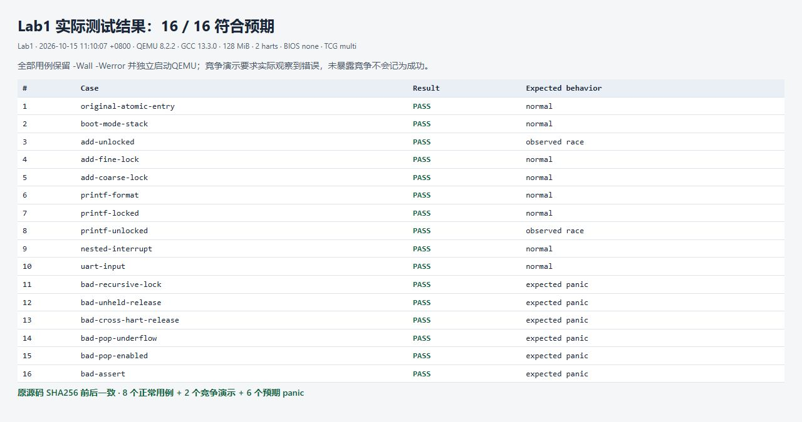
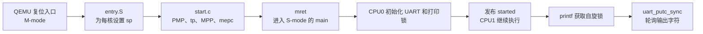
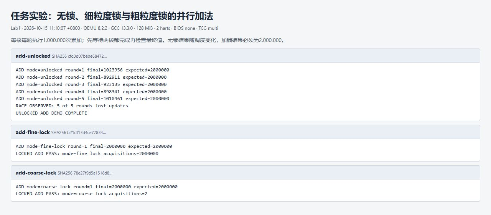
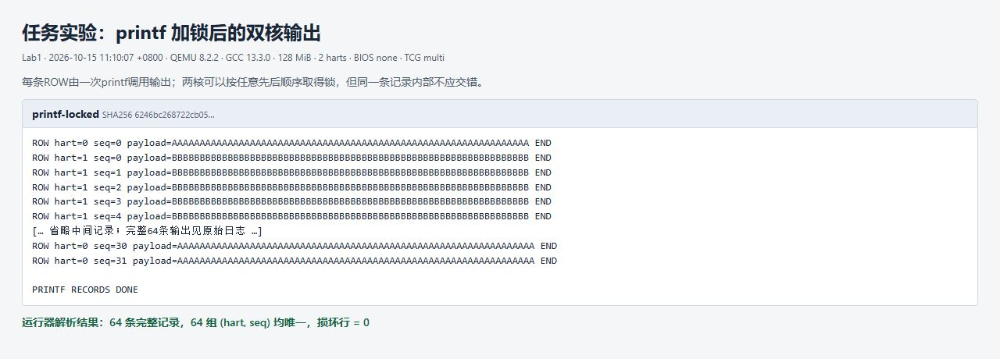
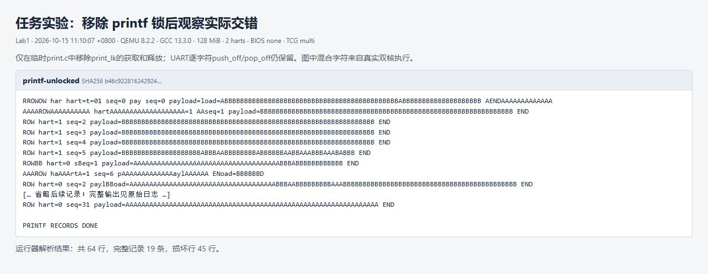
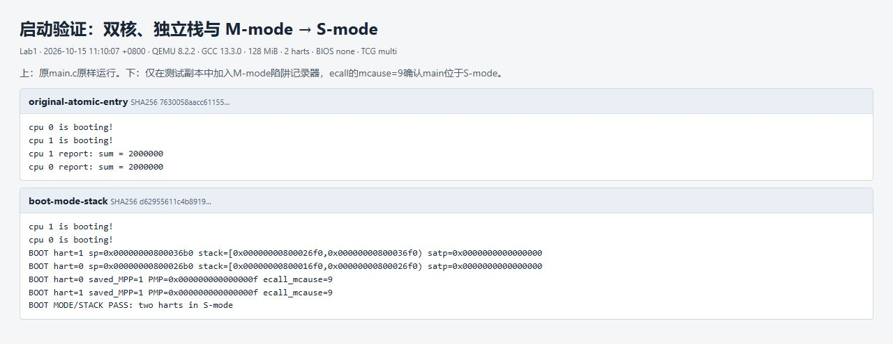
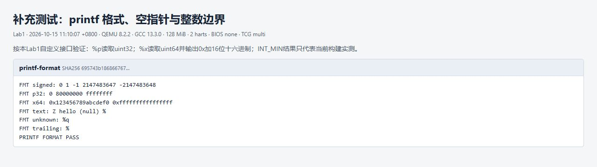
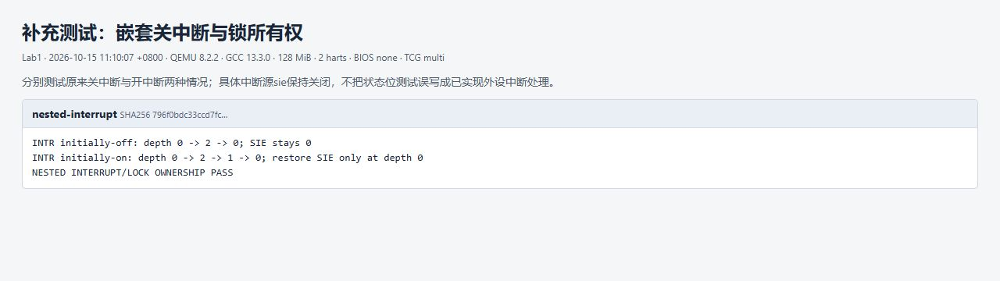
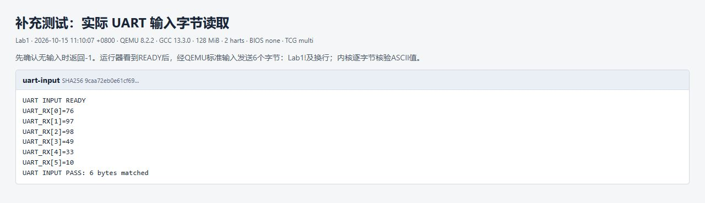
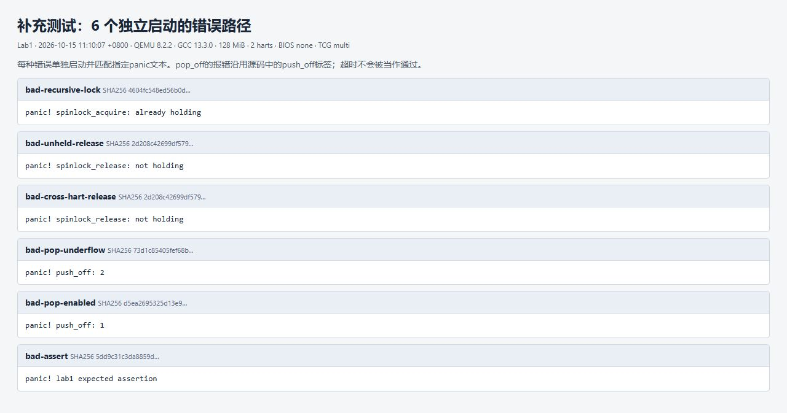

# 绝望操作系统 Lab1：机器启动、串口输出与自旋锁

Lab1 要把内核从机器启动入口带到 C 语言的 `main()`，让两个 CPU 都能输出启动信息，并解决它们同时访问共享资源时的竞争。这个阶段使用 QEMU `virt`、RISC-V RV64、双 hart，**不加载 OpenSBI，暂不开启分页**。

本报告对应 `lab1` 分支已有实现，核心文件保持原样。当前 `main.c` 除了输出启动信息，还用原子加法完成两核各一百万次累加。任务要求的无锁加法、不同锁粒度、移除打印锁等对照测试，另放在 `tests/lab1`，由脚本复制到临时工程执行，不覆盖正式入口。

实测结果：**16 个用例全部符合预期，包括 8 个正常用例、2 个实际暴露竞争的演示、6 个指定 `panic` 用例；共附 9 张实际测试截图。** 完整编译通过，测试前后内核源码与构建配置的 SHA256 一致。



## 一、代码如何连起来

本次实验的主线是：先给每个 hart 建立独立执行环境，再完成特权级切换，最后通过 UART 输出；输出要可靠，就必须继续实现原子互斥和可嵌套的关中断。



| 文件 | 本次作用 |
| --- | --- |
| [kernel.ld](./kernel.ld) | 指定 RISC-V 架构、入口 `_entry` 和 `0x80000000` 起始布局 |
| [entry.S](./src/kernel/boot/entry.S) | 读取 hart ID，为每核设置独立栈，再调用 `start()` |
| [start.c](./src/kernel/boot/start.c) | 配置 PMP、保存 hart ID、设置返回状态并从 M-mode 切到 S-mode |
| [main.c](./src/kernel/main.c) | 主核初始化、双核启动输出、原子累加与完成等待 |
| [arch/method.h](./src/kernel/arch/method.h) | CSR 读写、`tp/sp` 访问与中断状态操作 |
| [uart.c](./src/kernel/lib/uart.c) | UART 初始化、轮询发送和接收 |
| [print.c](./src/kernel/lib/print.c) | 自定义 `printf()`、`panic()` 和 `assert()` |
| [spinlock.c](./src/kernel/lock/spinlock.c) | 锁的初始化、原子获取、释放和嵌套关中断 |
| [cpu.c](./src/kernel/lib/cpu.c) | 根据 `tp` 找到当前 CPU 的状态 |
| [tests/lab1](./tests/lab1/) | 对照测试入口、运行器、原始日志与截图页面 |

## 二、从汇编入口进入 C 语言

### 1. 链接地址与启动方式

链接脚本中的关键配置是：

```ld
OUTPUT_ARCH("riscv")
ENTRY(_entry)
. = 0x80000000;
```

`ENTRY(_entry)` 指定 ELF 入口符号，地址设置决定内核的链接布局。当前构建把 `entry.o` 放在链接对象列表最前面，入口代码位于内核起始处。QEMU 从自己的复位跳板进入内核时仍处于 M-mode。

启动参数使用 `-bios none`。这与 Lab2 加载 OpenSBI、把内核入口放到 `0x80200000` 的方式不同：Lab1 的 M-mode 配置由自己的 `start.c` 完成。

### 2. `entry.S`：每个 hart 都需要自己的栈

```asm
la sp, CPU_stack
li a0, 4096
csrr a1, mhartid
addi a1, a1, 1
mul a0, a0, a1
add sp, sp, a0
call start
```

`CPU_stack` 是 `start.c` 中按 16 字节对齐的 `4096*NCPU` 字节数组。进入 C 函数前必须先有合法的 `sp`，因为保存返回地址、局部变量和调用其他函数都会使用栈。

每核的初始栈顶为：

```c
sp = CPU_stack + (hartid + 1) * 4096;
```

| hart | 分配的栈区间 | 初始 `sp` |
| --- | --- | --- |
| 0 | `[CPU_stack, CPU_stack+4096)` | `CPU_stack+4096` |
| 1 | `[CPU_stack+4096, CPU_stack+8192)` | `CPU_stack+8192` |

栈向低地址增长，因此 `sp` 一开始指向区间上界。两个 hart 的寄存器本来就是各自独立的；再分开栈内存，才能避免函数调用互相覆盖。这里的地址是数组的实际地址，并不是从物理地址 0 开始分栈。

### 3. `start.c`：为进入 S-mode 做准备

当前实现的主要步骤是：

```c
w_satp(0);
w_pmpaddr0(PMPADDR_ALL);
w_pmpcfg0(PMP_RWX_TOR);

int id = r_mhartid();
w_tp(id);

uint64 status = r_mstatus();
status &= ~MSTATUS_MPP_MASK;
status |= MSTATUS_MPP_S;
w_mstatus(status);

w_mepc((uint64)main);
asm volatile("mret");
```

这几项配置分别解决不同问题：

| 配置 | 作用 | 不能省略的原因 |
| --- | --- | --- |
| `satp=0` | 使用 Bare 地址模式，暂不启用页表 | 此时尚未建立可用页表 |
| PMP 地址与 `R/W/X + TOR` | 允许 S-mode 访问 QEMU 中所需内存和 MMIO | M-mode 能访问内存，不代表降权后也自动获得访问权限 |
| `tp=mhartid` | 把 hart ID 保存到低特权级仍能读取的通用寄存器 | 进入 S-mode 后不能再直接读 M-mode 的 `mhartid` CSR |
| `mstatus.MPP=S` | 指定 `mret` 要恢复到 S-mode | 普通 C 函数跳转不会改变当前特权级 |
| `mepc=main` | 指定 `mret` 后的执行地址 | 进入 S-mode 后应从 `main()` 开始执行 |

PMP 的第一项采用 TOR，即按地址上界描述区间；本实验配置覆盖 QEMU 所需的 RAM 和设备地址，并允许读、写、执行。它解决的是启动阶段的访问许可，还没有实现进程间内存隔离。

`mret` 是特权返回指令，不是普通函数 `return`。代码通过设置 MPP 和 `mepc`，主动构造一次返回到 S-mode 的执行环境。具体语义可对照 [RISC-V Machine-Level ISA](https://docs.riscv.org/reference/isa/v20260120/priv/machine.html)。

启动测试除了检查 `satp`、MPP、PMP 和栈地址，还在**临时副本**中装入一个最小 M-mode 陷阱记录器：`main()` 执行 `ecall` 后记录 `mcause=9`，确认调用来自 S-mode；若仍在 M-mode，环境调用的异常号将不同。这个记录器只服务于启动验证，并没有把正式内核变成完整的异常处理系统。

## 三、双核进入 `main()` 后如何协作

### 1. 用 `tp` 找到当前 CPU

```c
static cpu_t cpus[NCPU];

cpu_t *mycpu(void)
{
    int hartid = r_tp();
    return &cpus[hartid];
}
```

`cpus` 中每项保存该核的关中断层数 `noff` 和原始中断状态 `origin`。这些状态必须按核保存：CPU0 关了两层中断，不能让 CPU1 的一次 `pop_off()` 抵消它。

本实现配置固定的 `NCPU=2`，测试也使用 `-smp 2`。修改 QEMU 核数时还要同时考虑状态数组和启动同步逻辑，不能只改变模拟器参数。

### 2. 主核初始化后再发布 `started`

当前主核分支先完成：

```c
print_init();
printf("cpu %d is booting!\n", cpuid);
__sync_synchronize();
started = 1;
```

另一核则先等待：

```c
while (started == 0);
__sync_synchronize();
printf("cpu %d is booting!\n", cpuid);
```

这样 CPU1 不会在 UART 和打印锁尚未初始化时就调用 `printf()`。`__sync_synchronize()` 是本实现使用的完整内存屏障，用来约束共享数据的访问顺序。`volatile` 让轮询读取不会简单被优化成一次读取，但它本身并不提供原子性，也不能代替同步。

正式入口保留已有的 GCC 屏障与 `volatile` 写法；新测试的发布变量和屏障计数使用 `__atomic` 的 release/acquire 操作，把测试自身的同步与被测数据竞争分开。

### 3. 当前入口用原子加法完成回归

两个 hart 都执行下面的核心操作：

```c
for (int i = 0; i < 1000000; i++)
    __sync_fetch_and_add(&sum, 1);

__sync_fetch_and_add(&finish, 1);
while (finish < 2);
__sync_synchronize();
printf("cpu %d report: sum = %d\n", cpuid, sum);
```

`__sync_fetch_and_add()` 把“读旧值、加一、写回”做成原子操作。本例不使用它返回的旧值，只关心计数确实增加。`finish` 则用来等待两个核都完成，避免把某一核提前打印的中间结果误认为最终结果。

实测原入口的两条报告均为 `sum=2000000`。主核和从核谁先输出报告不固定，这不影响正确性。

## 四、UART 如何把字符送到终端

### 1. MMIO：读写地址就是访问设备寄存器

UART 基地址是 `0x10000000`。代码用 `volatile` 指针访问设备寄存器：

```c
#define Reg(reg) ((volatile unsigned char *)(UART_BASE + reg))
#define ReadReg(reg) (*(Reg(reg)))
#define WriteReg(reg, v) (*(Reg(reg)) = (v))
```

这里的 `volatile` 适用于 MMIO：同一地址两次读取可能返回不同设备状态，编译器不能把它当作普通、不变化的内存。但这些读写仍然不自动构成跨核互斥。

`uart_init()` 依次关闭 UART 内部中断、设置波特率分频寄存器、选择 8 位字符格式、清空并开启 FIFO，再设置 UART 内部 IER。Lab1 尚未接入 CPU 的中断处理入口，实际输出采用轮询；设置 UART 内部 IER 不等于已经完成 UART 中断处理。

### 2. 轮询发送一个字符

```c
void uart_putc_sync(int c)
{
    push_off();
    while (panicked)
        ;
    while ((ReadReg(LSR) & LSR_TX_IDLE) == 0)
        ;
    WriteReg(THR, c);
    pop_off();
}
```

`LSR_TX_IDLE` 表示设备可以接收后续输出，代码等待该位后把字符写入 THR。`push_off()/pop_off()` 保护当前核输出字符时的中断状态；它们不会让其他核停止执行，所以多核输出整段文本还需要上层打印锁。

### 3. 轮询输入一个字符

```c
int uart_getc_sync(void)
{
    if (ReadReg(LSR) & 0x01)
        return ReadReg(RHR);
    return -1;
}
```

有数据时读 RHR，没有数据时返回 `-1`。补充测试实际通过 QEMU 标准输入发送 `Lab1!\n`，检查内核收到的六个 ASCII 值，而不是只调用函数后打印一个“成功”。

## 五、`printf()` 如何解析格式并保持一条输出完整

### 1. 变参处理与数字输出

`va_start(ap, fmt)` 建立变参读取状态；遇到格式符时用正确类型的 `va_arg()` 取参数；最后调用 `va_end(ap)`。这些类型是调用约定的一部分，不能因为输出看起来像地址，就随意改变传参类型。

本 Lab1 的接口约定如下，**与标准 C 库 `printf()` 并不完全相同**：

| 格式 | 当前读取类型 | 当前输出方式 |
| --- | --- | --- |
| `%d` | `int` | 32 位有符号十进制 |
| `%p` | `uint32` | 32 位无符号十六进制，不带 `0x` |
| `%x` | `uint64` | `0x` 加固定 16 位十六进制 |
| `%c` | `int` | 单个字符；变参中字符会进行整数提升 |
| `%s` | `char *` | 逐字符输出，空指针显示 `(null)` |
| `%%` | 不读取参数 | 输出一个 `%` |
| 未知格式 `%q` | 不读取参数 | 原样输出 `%q` |
| 格式串末尾孤立 `%` | 不读取参数 | 输出 `%` 后结束 |

因此，在本分支中不能把任意 RV64 指针按标准库习惯传给 `%p`。测试显式传入 `uint32` 检查该约定；需要输出完整 64 位地址时，诊断代码使用 `%x` 并显式转换为 `uint64`。Lab2 的 `%p` 实现已经演进为读取完整指针，两次实验的版本应分别看待。

`printint()` 通过不断取余和除以进制把数字逆序存进小数组，再倒序输出；使用 `do...while` 保证数字 0 也至少输出一位。`printptr()` 则依次取 64 位数的最高十六进制位，输出后左移 4 位，固定完成 16 次。

当前负数分支写作 `x=-xx`。本次测试中 `INT_MIN` 实际打印正确，但按 C 语言规则，对最小有符号数取负存在溢出问题，不能据此声称已经获得可移植保证。后续可用 `x=0u-(uint32)xx` 在无符号域求其幅值；本次文档与测试没有改写现有实现。

### 2. 打印锁保护的是一次完整调用

`printf()` 的关键结构如下，格式分支略去：

```c
va_start(ap, fmt);
spinlock_acquire(&print_lk);
for (int i = 0; fmt[i] != '\0'; i++) {
    /* 普通字符直接输出；遇到%则解析格式并输出对应参数。 */
}
spinlock_release(&print_lk);
va_end(ap);
```

一条字符串包含多个字符。若每个字符都独立争用 UART，两核就可能轮流插入字符；打印锁从处理第一个字符一直持有到最后一个字符，才让一次调用的输出保持完整。

这并不保证“CPU0 永远先输出”，也不保证多个独立 `printf()` 自动合并成一条不可分割的消息。如果一条日志需要保持整体性，应尽量放在同一次调用中。

### 3. `panic()` 与 `assert()`

```c
void assert(bool condition, const char *warning)
{
    if (!condition)
        panic(warning);
}
```

`panic()` 先输出 `panic!` 和具体原因，再设置全局 `panicked=1` 并停止当前执行流；UART 输出路径也会检查这个标志。这样错误用例可以留下明确诊断，再停止输出。

它不是错误恢复机制，也没有实现格式串递归打印的可重入保护。持有打印锁时再次调用 `printf()` 或依赖它的 `panic()`，仍可能遇到递归锁问题，因此测试中的预期错误均避开这种无效诊断方式。

## 六、自旋锁：本核关中断与跨核原子互斥

### 1. 锁记录了什么

```c
typedef struct spinlock {
    int locked;
    char *name;
    int cpuid;
} spinlock_t;
```

`locked` 是参与原子交换的锁状态；`name` 用来标识锁；`cpuid` 记录持有者，支持检测同核递归获取和错误释放。初始化将 `locked` 置 0、`cpuid` 置 -1。

### 2. 为什么不能直接“关一次，开一次”

当前核可能先获取打印锁，再在 UART 每个字符中再次关中断。如果内层函数返回时无条件开中断，就会破坏外层临界区。所以每核保存 `noff` 和 `origin`：

```c
void push_off(void)
{
    int old = intr_get();
    intr_off();
    cpu_t *cpu = mycpu();
    if (cpu->noff == 0)
        cpu->origin = old;
    cpu->noff++;
}
```

只有第一次进入时保存原状态，后续只增加层数。`pop_off()` 先确认中断仍关闭且层数至少为 1，再减少计数；只有 `noff==0 && origin==1` 才重新打开中断。

例如原来开中断，外层和内层各关一次：层数从 `0→1→2→1→0`，最后一步才恢复开启。若原来就关闭，匹配完成后也必须保持关闭。

这里操作的是当前 hart 的 `sstatus.SIE`。它不能关闭另一个 hart 的中断，也不能阻止另一个 hart 访问同一内存。

### 3. 原子交换决定谁取得锁

```c
void spinlock_acquire(spinlock_t *lk)
{
    push_off();
    assert(!spinlock_holding(lk), "spinlock_acquire: already holding\n");
    while (__sync_lock_test_and_set(&lk->locked, 1) != 0)
        ;
    __sync_synchronize();
    lk->cpuid = mycpuid();
}
```

`__sync_lock_test_and_set()` 原子地写入 1，并返回原来的值。只有读到旧值为 0 的核获得锁；其他核会发现旧值为 1，继续循环等待。这就是“自旋”。若使用普通的先判断、再赋值，两核可能同时看到 0 并都进入临界区。

关本核中断，解决的是同核中断执行流重入等问题；原子交换解决的是多个核同时抢锁的问题。二者不能互相替代。当前实现没有提供公平排队保证。

### 4. 释放顺序也有要求

```c
assert(spinlock_holding(lk), "spinlock_release: not holding\n");
lk->cpuid = -1;
__sync_synchronize();
__sync_lock_release(&lk->locked);
pop_off();
```

先确认本核持有锁，再结束临界区并发布解锁，最后匹配一次 `pop_off()`。不能在锁仍被本核持有时就先恢复中断。

GCC 对 `__sync_lock_test_and_set()` 和 `__sync_lock_release()` 分别规定了获取与释放屏障语义；本实现还显式使用完整屏障。语义可对照 [GCC `__sync` 内建函数文档](https://gcc.gnu.org/onlinedocs/gcc/_005f_005fsync-Builtins.html)。

## 七、任务实验：并行加法与锁粒度

任务页的 4.1 要求解释为什么两个核各加一百万次，结果可能不到两百万，并比较上锁位置的影响。

### 1. `volatile sum++` 仍然可能丢失更新

一次普通 `sum++` 包含读取、加一、写回。若两个核都读到 100，再都写回 101，逻辑上发生了两次累加，内存却只增加一次。`volatile` 不会把这三个步骤变成原子操作。

测试使用同一份双核入口，每轮先等待双方到齐、清零共享计数，完成后再用屏障等待双方都结束，最后才打印最终值。无锁版本运行 5 轮，实测值为：

| 轮次 | 实际最终值 | 无竞争时应为 |
| --- | --- | --- |
| 1 | 1,023,956 | 2,000,000 |
| 2 | 892,911 | 2,000,000 |
| 3 | 923,135 | 2,000,000 |
| 4 | 898,341 | 2,000,000 |
| 5 | 1,010,461 | 2,000,000 |

具体结果会随调度变化，不能把某个数字写成固定期望。该段程序有意包含数据竞争，仅用来演示当前 GCC/QEMU 下观察到的错误，不是可复用的 C 语言同步方案。运行器要求实际观察到丢失更新，若某次调度没有暴露竞争，会提示重新运行，不会伪造失败结果。

### 2. 细粒度锁：每次累加单独保护

```c
for (int i = 0; i < 1000000; i++) {
    spinlock_acquire(&sum_lock);
    sum++;
    spinlock_release(&sum_lock);
}
```

两核合计获取锁 2,000,000 次，每次持有时间短。计数正确，但频繁竞争和修改锁状态有开销。

### 3. 粗粒度锁：整轮循环一次保护

```c
spinlock_acquire(&sum_lock);
for (int i = 0; i < 1000000; i++)
    sum++;
spinlock_release(&sum_lock);
```

两核合计只获取锁 2 次，最终值同样正确，但一个核会在另一个核完成整段循环之前持续等待，持锁核也会长时间保持本核中断关闭。因此“获取锁次数更少”不等于所有场景都更合适。

| 方案 | 是否保证本例计数正确 | 两核合计获取锁次数 | 主要取舍 |
| --- | --- | --- | --- |
| 无锁 `sum++` | 否 | 0 | 存在丢失更新 |
| 每次累加加锁 | 是 | 2,000,000 | 短临界区，竞争频繁 |
| 整轮循环加锁 | 是 | 2 | 长临界区，另一核等待时间长 |
| 当前正式入口的原子加法 | 是 | 不使用此自旋锁 | 适合单个计数器，不能代替任意多步临界区 |

本次细粒度锁、粗粒度锁和原入口的原子加法均得到 2,000,000。测试记录的是正确性与获取锁次数，没有把一次 QEMU 运行时间当作严格的性能基准。



原始日志：[无锁 5 轮](./tests/lab1/results/add-unlocked.log)、[细粒度锁](./tests/lab1/results/add-fine-lock.log)、[粗粒度锁](./tests/lab1/results/add-coarse-lock.log)。

## 八、任务实验：让双核输出实际发生交错

任务页的 4.2 要求去掉 `printf()` 的锁并观察交错。测试让两核同时开始，各用 32 次 `printf()` 输出带 hart ID、序号及 64 个 `A` 或 `B` 的完整记录。

### 1. 保留打印锁

运行器解析全部输出，检查 `(hart, seq)` 正好覆盖两核各 0～31、没有重复、每条 payload 与该核匹配。结果是 **64 条记录完整，损坏行数为 0**。截图仅展示首尾记录，完整日志见 [printf-locked.log](./tests/lab1/results/printf-locked.log)。



### 2. 只在临时副本中移除打印锁

对照版本只省略 `spinlock_acquire(&print_lk)` 和 `spinlock_release(&print_lk)`，保留 UART 逐字符的 `push_off()/pop_off()`，其余测试相同。

实测得到 64 行输出，其中只有 **19 条完整记录，45 行发生交错或损坏**；截图中的混合 `A/B`、被拆开的字段和行来自实际串口输出。它说明仅在当前核关中断，仍不能保护多个核共同使用的 UART。



完整日志见 [printf-unlocked.log](./tests/lab1/results/printf-unlocked.log)。无锁输出同样依赖调度；运行器会检查是否真的出现记录损坏，而不会仅凭换行顺序改变就判定发生了字符交错。

## 九、测试方法、截图与复现

### 1. 环境与运行方式

本次实测时间为 **2026-10-15，Asia/Shanghai**。环境为 WSL Ubuntu、RISC-V GCC 13.3.0、QEMU 8.2.2，使用：

```bash
make -B build
qemu-system-riscv64 -machine virt -bios none \
  -kernel target/kernel/kernel-qemu.elf \
  -m 128M -smp 2 -accel tcg,thread=multi -nographic
```

`make run` 可以运行正式入口；QEMU 文本界面可用 `Ctrl+A` 后按 `X` 退出。编译保留仓库的 `-Wall -Werror`。首次用例直接构建并运行当前 `main.c`，其完整日志为 [original-atomic-entry.build.log](./tests/lab1/results/original-atomic-entry.build.log)。

一键复现全部测试：

```bash
python3 tests/lab1/run.py

# 只重跑一类测试时，另选输出目录，保留仓库里的首次实测记录：
python3 tests/lab1/run.py --only printf --output /tmp/lab1-printf-recheck
python3 tests/lab1/run.py --only add- --output /tmp/lab1-add-recheck
```

运行器把 `src`、Makefile、公共配置和链接脚本复制到 `/tmp/os2026-lab1-test-*`，再在副本中替换测试入口；竞争对照只在副本中移除打印锁；启动诊断也只在副本中加入测试陷阱。正式源码文件没有为这些对照测试做修改，测试 C 文件不参与正常 Makefile 的源码扫描。

每个用例独立编译并重新启动 QEMU。脚本匹配完成标志或指定错误，最长等待 60 秒；超时、非预期 `panic`、错误计数或没有实际观察到竞争，均不能记为通过。测试完成后主动结束无限循环的 QEMU，因此日志末尾的进程终止提示属于运行器收尾。

[results.json](./tests/lab1/results/results.json) 记录 16 个用例的结果和竞争解析数据；[environment.json](./tests/lab1/results/environment.json) 记录工具版本、测试源代码的 SHA256 和运行前后是否一致。本次基于已有源码提交 `a3dad28`，测试只增加文档及独立复现材料。

所有图片都是**浏览器展示本次真实 QEMU 串口日志后截取的截图**，不是任务页的预期效果图。截图页由 [make_report.py](./tests/lab1/make_report.py) 读取 `.log` 和结果 JSON 生成，保留日志 SHA256 前缀；省略的长输出已有标注，原始日志全部保留。

### 2. 启动、栈与实际特权级

先原样运行正式入口，确认两个核都输出启动信息、两个最终报告均为 2,000,000；再通过临时诊断入口核验每核的 `sp` 位于自己的 4 KiB 区间且 16 字节对齐，`satp=0`，切换前 MPP 为 S，PMP 权限为 `0xf`，S-mode `ecall` 的异常号为 9。



日志：[正式入口](./tests/lab1/results/original-atomic-entry.log)、[特权级与栈](./tests/lab1/results/boot-mode-stack.log)。测试陷阱入口源码为 [mtrap.S](./tests/lab1/mtrap.S)。

### 3. 格式输出与整数边界

验证 0、正负数、32 位有符号上下界、32 位无符号十六进制、完整 64 位十六进制、字符、字符串、空指针、`%%`、未知格式和末尾孤立 `%`。运行器逐项匹配实际文本。`INT_MIN` 的可移植性限制及 `%p` 的自定义参数类型已在前面的实现说明中列出。



日志：[printf-format.log](./tests/lab1/results/printf-format.log)。

### 4. 嵌套关中断和锁状态

分别从 SIE 为 0 和 1 的状态开始，执行两次 `push_off()` 与两次 `pop_off()`，检查层数、原状态保存以及最后一层退出时的恢复。同时核验获取锁后 `spinlock_holding()` 为真、释放后为假、`noff` 恢复为 0，`assert(true)` 正常返回。

测试开启 SIE 时保持具体中断源 `sie=0`，只验证状态保存与恢复，不把它当作已经实现定时器或外设中断处理。



日志：[nested-interrupt.log](./tests/lab1/results/nested-interrupt.log)。

### 5. 实际 UART 输入

先验证没有输入时 `uart_getc_sync()` 返回 -1。运行器收到 `UART INPUT READY` 后才发送 `Lab1!\n`，内核依次核验 `76、97、98、49、33、10`，最后输出完成标志。



日志：[uart-input.log](./tests/lab1/results/uart-input.log)。

### 6. 六个必须拒绝的错误操作

`panic()` 不会返回，因此每种错误都单独启动，不把后续没有机会执行的调用算作测试完成。

| 用例 | 操作 | 本实现的预期错误 |
| --- | --- | --- |
| `bad-recursive-lock` | 同核持有同一锁后再次获取 | `spinlock_acquire: already holding` |
| `bad-unheld-release` | 释放没有持有的锁 | `spinlock_release: not holding` |
| `bad-cross-hart-release` | CPU0 持锁，让 CPU1 释放 | `spinlock_release: not holding` |
| `bad-pop-underflow` | 层数为 0 时执行 `pop_off()` | `push_off: 2` |
| `bad-pop-enabled` | 中断开启时执行 `pop_off()` | `push_off: 1` |
| `bad-assert` | 调用 `assert(false, ...)` | `lab1 expected assertion` |

`pop_off()` 的错误字符串在原源码中写成了 `push_off`，测试截图保留真实文本，表格说明实际触发条件。六项全部触发指定 `panic`，完整输出位于 [results](./tests/lab1/results/) 目录。



## 十、实现范围与后续衔接

Lab1 建立了三个后续实验需要的基础：每核独立执行环境、可用的诊断输出、共享资源的互斥访问。Lab2 在此基础上引入 OpenSBI 和内存管理，启动路径与 `%p` 等接口也会继续演进。

当前没有安装完整的中断与异常处理框架，没有实现公平锁，也没有实现任务页可选的 UEFI 启动、DTB 动态发现或 BootInfo；这些项目不计入本次完成项。测试用陷阱记录器仅确认现有启动路径的特权级，不能替代后续实验的正式 trap 实现。

排查这类双核问题时，先确认两核的栈和核号正确，再检查初始化发布顺序，最后在双方都完成后核验共享结果。看到输出混乱，应区分“多次调用顺序不同”和“同一次调用内部字符交错”；看到计数偏小，也要先区分中间值与最终值，再判断是否缺少原子性或互斥。

实验要求来自 [ECNU OSLab 2026 Lab1 任务页](https://gitee.com/christinaaa/ecnu-oslab-2026-task/tree/lab1/)，本次核对的任务分支提交为 `e1f2efd5bcccf6a7f991192edc2ee8057844ed93`。核心代码说明依据本仓库 `lab1` 的实际实现，测试结果依据上述可复现日志。
