# 绝望操作系统lab2：虚拟内存初步

（因为还没写lab1的readme，这篇readme会包含所有文件的解析……）


## Opensbi

本实验采用opensbi来提供操作硬件的接口，例如，在sbi.c中：

```c
#include "mod.h"
// 通过opensbi与底层硬件交互
sbi_ret_t sbi_ecall(uint64 eid, uint64 fid,
                    uint64 arg0, uint64 arg1, uint64 arg2,
                    uint64 arg3, uint64 arg4, uint64 arg5)
{
  register uint64 a0 asm("a0") = arg0;
  register uint64 a1 asm("a1") = arg1;
  register uint64 a2 asm("a2") = arg2;
  register uint64 a3 asm("a3") = arg3;
  register uint64 a4 asm("a4") = arg4;
  register uint64 a5 asm("a5") = arg5;
  register uint64 a6 asm("a6") = fid;
  register uint64 a7 asm("a7") = eid;

  asm volatile("ecall"
               : "+r"(a0), "+r"(a1)
               : "r"(a2), "r"(a3), "r"(a4), "r"(a5),
                 "r"(a6), "r"(a7)
               : "memory");

  return (sbi_ret_t){(int64)a0, (int64)a1};
}

sbi_ret_t sbi_hart_start(uint64 hartid, uint64 start_addr, uint64 opaque)
{
  return sbi_ecall(SBI_EXT_HSM, SBI_HSM_HART_START,
                   hartid, start_addr, opaque, 0, 0, 0);
}

```

根据opensbi的约定，在返回时（注意是返回时，传入函数时a0和a1可以有不同的含义）a0代表error，a1代表value，所以sbi_ret_t的结构就是：

```c
typedef struct sbi_ret
{
    int64 error;
    int64 value;
} sbi_ret_t;

```

而在sbi_hart_start中，根据传入的SBI_EXT_HSM和SBI_HSM_HART_START分别作为eid和fid选择了HSM中的“启动核”服务，此时传入a0的hartid和传入a1的start_addr就能被正确识别，通过ecall来给opensbi处理。


## _entry


```c
# OpenSBI在S-mode进入该入口：a0=hartid，a1=DTB地址。
# 本实验不使用DTB，因此忽略a1。

.section .text.entry
.global _entry
_entry:
        # CPU_stack 定义于start.c中
        # sp = CPU_stack + ((hartid + 1) * 4096)
        # 将sp置于当前CPU的内核栈的栈顶
        la t0, CPU_stack
        li t1, 4096
        addi t2, a0, 1
        mul t1, t1, t2
        add sp, t0, t1
        # 跳转到start
        call start
spin:
        wfi
        j spin

```


_entry主要完成一件事：将cpu0的sp设置在cpu_stack+4096，cpu1的sp设置在cpu_stack+8192，两段栈分别是 [CPU_stack, CPU_stack+4096) 和 [CPU_stack+4096, CPU_stack+8192)，栈向低地址增长；sp 初始指向各自区间的末端

## start.c


```c
#include "../arch/mod.h"

// 每个CPU在运行操作系统时需要一个初始的函数栈
__attribute__((aligned(16))) uint8 CPU_stack[4096 * NCPU];

extern void main(void);

void start(uint64 hartid)
{
    // OpenSBI已在S-mode进入内核。HSM启动hart时satp也为0。
    w_satp(0);
    sfence_vma();

    // OpenSBI通过a0传入hartid,也就是当前函数的输入参数hartid，我们可以直接使用他,内核继续用tp保存它。
    w_tp(hartid);

    // 进入main函数
    main();
}

```

satp是一个64位的寄存器，由以下三个字段组成：

| 字段   | 位范围         | 作用                 |
| ------ | -------------- | -------------------- |
| `MODE` | 63～60，共4位  | 选择地址翻译模式     |
| `ASID` | 59～44，共16位 | 标识当前地址空间     |
| `PPN`  | 43～0，共44位  | 保存根页表的物理页号 |

现在一开始把mode设置为0，代表不启动页表。之后再kvm_init中会将mode设置为8，代表使用sv39

考虑每个进程都有不同的虚拟地址空间，需要不同的页表，要使用asid来标识地址空间。不同ASID可以让TLB区分不同地址空间，减少切换时的刷新；但页表映射变化、ASID复用等情况仍需按规则刷新TLB。本次实验暂时把asid设置为0.

之后每次切换进程时，只需切换satp的内容就可以切换到对应这个进程的页表。

接下来，sfence_vma()把tlb原来的记录清除，并把hartid写入tp寄存器，然后开始调用main函数。


## main


```c
void main(void)
{
    uint64 hartid = r_tp();

    if (hartid == 0)
    {
        print_init(); //初始化uart和spinlock
        pmem_init(); //初始化kern_region和user_region

        buddy_test_single();

        kvm_init(); //为各个区域建立页表
        kvm_inithart(); //设置satp,切换为sv39模式
        kheap_init(); //初始化堆元数据与空闲链表，不提前分配对象页

        printf("cpu %d: paging enabled, satp=%x\n",
               (int)hartid, r_satp());

        // 页表占用的页属于永久分配，基准应在其初始化后记录。
        concurrent_baseline = pmem_freepages(true);

        __atomic_store_n(&initialized, 1, __ATOMIC_RELEASE); //当初始化完成时，将initialized设置为1

        for (uint64 id = 1; id < NCPU; id++)
        {
            sbi_ret_t ret = sbi_hart_start(id, (uint64)_entry, 0);
            assert(ret.error == SBI_SUCCESS,
                   "sbi_hart_start failed");
        }
    }
    else
    {
        while (!__atomic_load_n(&initialized, __ATOMIC_ACQUIRE))
            ;

        kvm_inithart();

        printf("cpu %d: paging enabled, satp=%x\n",
               (int)hartid, r_satp());
    }

    buddy_test_parallel(hartid);

    while (1)
        asm volatile("wfi");
}

```


## spinlock

```c
#include "mod.h"

/*
    开关中断的基本逻辑:
    1. 多个地方可能开关中断, 因此它不是“开/关”的二元状态，而是“关 关 关 开 开 开”的stack
    2. 在第一次执行关中断时, 记录中断的初始状态为X
    3. 每次关中断, stack中的元素加1
    4. 每次开中断, stack中的元素减1
    5. 如果stack中元素清空, 将中断状态设为初始的X
*/

// 带层数叠加的关中断
void push_off(void)
{
    int old = intr_get();
    intr_off();
    cpu_t *cpu = mycpu();
    if (cpu->noff == 0)
        cpu->origin = old;
    cpu->noff++;
}

// 带层数叠加的开中断
void pop_off(void)
{
    cpu_t *cpu = mycpu();
    assert(intr_get() == 0, "push_off: 1\n"); // 确保此时中断是关闭的
    assert(cpu->noff >= 1, "push_off: 2\n");  // 确保push和pop的对应
    cpu->noff--;
    if (cpu->noff == 0 && cpu->origin == 1) // 只有所有push操作都被抵消且原来状态是开着时
        intr_on();
}


// 自旋锁初始化
void spinlock_init(spinlock_t *lk, char *name)
{
    lk->locked = 0;
    lk->name = name;
    lk->cpuid = -1;
}

// 是否持有自旋锁
bool spinlock_holding(spinlock_t *lk)
{
    return lk->locked && lk->cpuid == mycpuid();
}

// 获取自旋锁
void spinlock_acquire(spinlock_t *lk)
{
    push_off();
    assert(!spinlock_holding(lk), "spinlock_acquire: already holding\n");
    while(__sync_lock_test_and_set(&lk->locked, 1) != 0);
    __sync_synchronize();
    lk->cpuid = mycpuid();
}

// 释放自旋锁
void spinlock_release(spinlock_t *lk)
{
    assert(spinlock_holding(lk), "spinlock_release: not holding\n");
    lk->cpuid = -1;
    __sync_synchronize();
    __sync_lock_release(&lk->locked);
    pop_off();
}

```


## Buddy 分配器


先来看数据结构，

```c
typedef struct buddy_region {
    uint64 begin, end;
    uint32 npages, allocable;
    spinlock_t lk;
    page_node_t *free[BUDDY_MAX_ORDER + 1];
    int16 *state;
} buddy_region_t;
```

`free`为每个阶的空闲块首链表，`state`为每个页的状态，状态编码是：

```c
#define STATE_UNUSED (-1)
#define STATE_ALLOC(order) (-(int)(order) - 2)
```

结合链表操作，状态含义为：

| 状态值          | 含义                        |
| --------------- | --------------------------- |
| 大于等于 0 的 k | 这是一个空闲的 k 阶块的块首 |
| -1              | 不是当前独立块的块首        |
| -2              | 已分配的 0 阶块首           |
| -3              | 已分配的 1 阶块首           |
| -4              | 已分配的 2 阶块首           |

**`-1` 不能直接理解成“这一页空闲”。** 它也可能是一个已分配大块的内部页。

每次分配一个新的空闲块时，块首节点加入free链表：

```c
static void list_push(buddy_region_t *r, uint32 index, unsigned order) {
    page_node_t *node = (page_node_t *)page_address(r, index);
    node->next = r->free[order];
    r->free[order] = node;
    r->state[index] = (int16)order;
}

```

初始化过程中，分配器会按照从大到小的顺序，为区域选择最大的合法块。

```c
    while (index < r->npages) {
        unsigned order = BUDDY_MAX_ORDER;
        while ((index & ((1u << order) - 1)) != 0 || (1u << order) > r->npages - index)
            order--;
        list_push(r, index, order);
        index += 1u << order;
    }

```

而当向分配器申请一个order阶的块时，分配器会找到大于等于order阶的最小块，然后不断对这一块对半拆分，每次把右半边重新加入free链表，直到左半边符合order阶

```c
unsigned found = order;
while (found <= BUDDY_MAX_ORDER && r->free[found] == NULL)
    found++;

if (found > BUDDY_MAX_ORDER) {
    spinlock_release(&r->lk);
    return NULL;
}

uint32 index = list_pop(r, found);
while (found > order) {
    found--;
    list_push(r, index + (1u << found), found);
}

r->state[index] = (int16)STATE_ALLOC(order);
r->allocable -= 1u << order;
```

### 释放：找到伙伴并逐级合并

申请解决了“把大块拆成需要的大小”，释放则要解决“怎样把小块重新拼回去”。这里的伙伴必须同时满足三个条件：**阶数相同、属于同一个区域、恰好是同一个父块拆出的左右两半**。物理地址相邻并不足以合并。

块的页号按区域起点计算：

```c
index = (pa - r->begin) / PGSIZE;
buddy = index ^ (1u << order);
```

一个 `order` 阶块包含 `2^order` 个连续页，异或会翻转决定左右半块的那一位。例如页号 0 和 1 是 0 阶伙伴；页号 0 和 2 是 1 阶伙伴。页号 1 与 2 虽然相邻，却不能合并成 1 阶块。

释放前先检查页对齐、区域边界和块对齐，再检查 `state[index] == STATE_ALLOC(order)`。这一步能拦截重复释放、把大块内部页当作独立页释放、用错误阶数释放等操作。通过检查后增加 `allocable`，然后执行：

```c
r->state[index] = STATE_UNUSED;
r->allocable += 1u << order;
while (order < BUDDY_MAX_ORDER) {
    uint32 buddy = index ^ (1u << order);
    if (buddy >= r->npages || r->state[buddy] != (int16)order)
        break;
    list_remove(r, buddy, order);
    if (buddy < index)
        index = buddy;
    order++;
}
list_push(r, index, order);
```

每次只把另一个伙伴从对应空闲链表移走，合并后的块首取较小页号，再向上一阶尝试。`allocable` 只在本次释放开始时增加一次；合并只改变组织方式，不会产生额外物理页。整个元数据修改过程持有区域锁，避免另一核在合并到一半时取走伙伴。

初始化时，内核区是前 `KERN_PAGES=1024` 页，因此可以组织成一个 10 阶块。用户区剩余页数通常不是 2 的幂，`region_init()` 从当前页号开始选取满足相对对齐且不越界的最大块，再继续处理尾部，不能为了凑整而丢掉尾页。

### 接口、清零与碎片

| 接口 | 作用 | 没有合适空闲块时 |
| --- | --- | --- |
| `pmem_alloc_order(order, in_kernel)` | 分配 `4096 << order` 字节连续内存 | `panic` |
| `pmem_try_alloc(in_kernel)` | 尝试申请一个 4 KiB 页 | 返回 `NULL` |
| `pmem_alloc(in_kernel)` | 与 0 阶分配兼容，供原 Lab2 和页表使用 | `panic` |
| `pmem_free_order(pa, order, in_kernel)` | 按原区域、原块首、原阶数归还 | 非法参数触发 `panic` |
| `pmem_free(pa, in_kernel)` | 归还一个独立申请的 0 阶页 | 非法参数触发 `panic` |
| `pmem_freepages(in_kernel)` | 在锁保护下读取空闲的 4 KiB 页总数 | 不分配内存 |

`pmem_try_alloc_order()` 是 `pmem.c` 中实现分配的基础函数，当前公共头文件尚未声明它。它先在锁内摘除、拆分并标记整个块，再解锁并清零该块，最后交给调用者。此时其他核已不能分配这段内存，因此清零不用一直占着区域锁。**清零发生在分配时**；空闲块首还要保存 `next`，释放后的页并不保证所有字节都是零。

`allocable` 统计的是空闲页数，并不代表一定能分配同样大小的连续块。例如先申请全部 1024 页，再只归还偶数页：虽然还有 512 个空闲页，每个页的伙伴仍被占用，申请 1 阶块仍然失败。只有把剩余奇数页也归还，才能逐级合并回完整的 10 阶块。

Buddy 通过分阶链表便于寻找连续块，但按 2 的幂分配会带来块内部的浪费；本实现也没有宣称所有操作都是 `O(log N)`：分配最多检查 16 个阶，释放合并时的 `list_remove()` 需要在线性单链表里寻找伙伴，实际耗时还与该阶空闲块数量有关。

还有一个容易混淆的地方：**Buddy 的块对齐相对于 `r->begin`，大页要求的物理地址对齐则是绝对地址对齐。** 因此 9 阶块虽然有 2 MiB 大，却不保证起点能整除 2 MiB；大页测试对此单独做了处理。

## 内核堆：让多个小对象共用物理页

Buddy 的最小单位仍然是 4 KiB。假设一个内核对象只要 64 字节，直接调用 `pmem_alloc(true)` 就会独占一整页。内核堆向 Buddy 申请物理页，再把每页切成同样大小的小块，使多个对象共用一页。

本实现位于 `src/kernel/mem/heap.c`，采用八个固定档位：

| 块大小 / 字节 | 32 | 64 | 128 | 256 | 512 | 1024 | 2048 | 4096 |
| --- | --- | --- | --- | --- | --- | --- | --- | --- |
| 一页容纳的块数 | 128 | 64 | 32 | 16 | 8 | 4 | 2 | 1 |

### 档位选择与对齐

`kmalloc(size)` 默认要求 16 字节对齐；`kmalloc_aligned(size, align)` 允许指定 1～4096 范围内的 2 的幂对齐。先计算 `need = max(size, align)`，再选择第一个不少于 `need` 的档位。

例如 `kmalloc(33)` 进入 64 字节档，`kmalloc_aligned(33, 256)` 进入 256 字节档。每个页首都按 4096 对齐，块大小与合法 `align` 又都是 2 的幂，所以 `页首 + 块编号 × 块大小` 能满足指定对齐。

大小为 0、超过 4096、对齐为 0、非 2 的幂对齐或超过 4096 的对齐，都返回 `NULL`。当前实现不支持跨多页的大对象；这类请求可由调用方使用 Buddy 连续页接口处理。

### 元数据与位图

```c
typedef struct heap_page {
    uint64 pa;
    uint32 class_index;
    uint32 free_count;
    uint64 used[2];
    struct heap_page *prev;
    struct heap_page *next;
    bool active;
} heap_page_t;
```

`heap_pages[KERN_PAGES]` 为内核页池中的每个页预留一份静态元数据。对象页内没有额外的堆头部，所以一页真的可以放满 128 个 32 字节对象；不过静态元数据本身也占用内核的 `.bss`，不能把这部分成本当作零。

`used[2]` 共 128 位，位为 1 表示该块已分配，位为 0 表示可用；较大档位只使用前面的有效位。块号 `i` 对应 `word=i/64` 和 `bit=1ULL<<(i%64)`。这样 32 字节档的第 64 个块之后会使用第二个位图字，测试必须覆盖 63、64、127 这些边界。

`partial[c]` 是该档位**至少还有一个可用块**的页的双向链表。页变满就移出链表，满页释放出一个块后重新加入。双向链表允许直接根据页元数据把节点移走。

### 申请与释放的完整过程

申请时先选择档位，再持有 `heap_lock` 找到 `partial[c]`。如果没有可用页，就调用 `pmem_try_alloc(true)` 扩展一页；物理页耗尽时释放堆锁并返回 `NULL`，不会把正常的堆分配失败变成系统 `panic`。随后扫描位图取出一个空闲位，置 1，减少 `free_count`，必要时把满页移出链表，最后返回对象地址。

`kheap_init()` 只初始化锁、页元数据数组和链表头，并不提前向 Buddy 申请对象页，也不清空整个内核页池。初始化只应由主核执行一次，且必须在各核使用堆之前完成。Buddy 新分配的页会清零，但同页内释放后再次申请的小块不保证清零；调用方应自行初始化对象。

`kfree(ptr)` 先向下对齐得到页首，再检查它是否在内核页池、是否属于堆、指针是否恰好位于块首、对应位是否仍为 1。检查通过后清除位图位并增加 `free_count`：

1. 原来是满页、现在仍有活对象：把页重新加入 `partial`。
2. 原来已有空闲块、现在仍有活对象：保留在原链表中。
3. 整页已空：从链表移除，撤销 `active` 元数据，把物理页归还 Buddy。

`kfree(NULL)` 不做任何事。重复释放、释放块内部地址、释放不属于堆的地址，都会触发说明原因的 `panic`。这些检查没有引入引用计数；调用方仍须保证对象所有权和释放次数正确。

所有堆元数据变更都由 `heap_lock` 串行保护。本实现向 Buddy 申请或归还页时仍持有堆锁，形成“堆锁 → Buddy 区域锁”的顺序；Buddy 不反向调用堆，避免形成相反锁序。跨核释放是允许的，对象生命周期则由调用者自行同步。

### 物理页利用情况

64 个 64 字节对象恰好占一页；第 65 个对象才需要第二页。相比每个对象独占一页，65 个对象的对象页消耗从 65 页降为 2 页。释放第一张页上的最后一个对象后，堆立即把该页归还 Buddy；全部释放后，`kheap_pages()` 应为 0，Buddy 空闲页数应回到测试前的基准。

这种方法仍存在档位向上取整和未满页的浪费，例如申请 33 字节会占一个 64 字节块。`kheap_print()` 输出每档的物理页数与活对象数，用于观察这种取舍。运行时申请的对象页数和内核静态元数据占用应分别计算。

## 大页：在更高一级页表中结束地址翻译

普通 Sv39 映射需要经过 L2、L1、L0 三级页表，在 L0 找到 4 KiB 叶子。大页允许在 L1 或 L2 直接存放叶子，减少管理连续地址范围需要的页表页。

| 叶子所在层级 | 覆盖大小 | VA 与 PA 的对齐要求 | 地址中的页内偏移 |
| --- | --- | --- | --- |
| L0 | 4 KiB | 4 KiB | 低 12 位 |
| L1 | 2 MiB | 2 MiB | 低 21 位 |
| L2 | 1 GiB | 1 GiB | 低 30 位 |

三种情况可以统一写成 `VM_LEVEL_SIZE(level) = 1UL << (12 + 9 * level)`。查到叶子后的翻译公式是：

```c
pa = PTE_TO_PA(*pte) + (va & (VM_LEVEL_SIZE(level) - 1));
```

有效 PTE 的 `R/W/X` 有任一位为 1，说明它是叶子；全部为 0 才表示指向下一级页表。**不能把 L1/L2 大页的数据地址当作页表继续遍历。** 对所有叶子还要检查 PA 与叶子大小对齐，以及 `W => R`：Sv39 中 `R=0,W=1` 是保留的非法组合。

本工程的 `VA_MAX=1UL<<38` 限制接口只接受 Sv39 规范地址的低半区，即 `[0, 256 GiB)`；它没有开放完整的高半区规范地址。

### 映射时选择合适的大小

原接口 `vm_mappages()` 保持只生成 4 KiB 叶子；新增 `vm_mappages_huge()` 在每次循环中依次尝试 1 GiB、2 MiB、4 KiB，同时检查剩余长度与 VA、PA 对齐。条件不足就降一级，不能为了使用大页把请求范围之外的地址也映射进去。

例如映射“2 MiB + 1 字节”，会先把长度向上取整到 4 KiB 边界，得到“2 MiB + 4 KiB”。若起点对齐，就生成一个 L1 叶子加一个 L0 叶子。若 VA 和 PA 永远相差 4 KiB，则即使区间很长，也无法同时达到 2 MiB 对齐，只能使用 4 KiB 叶子。

覆盖已有 L0 子表时，本实现继续使用较小页映射，不会自动销毁子表并提升成大页；重映射也不会替调用者释放原来的数据页。

### 查找、拆分和局部解映射

`vm_lookup(root, va, &level)` 返回地址所在的实际叶子，并报告层级。原来的 `vm_getpte()` 明确查找 L0 页表项：遇到大页且 `alloc=false` 时返回 `NULL`；`alloc=true` 时允许拆分大页以获得 L0 项。因此，检查一个大页是否存在应使用 `vm_lookup()`，不能把 `vm_getpte(..., false)==NULL` 一律视为地址未映射。

`vm_split()` 会申请一张 4 KiB 子页表，用原叶子的连续 PA 和权限填入 512 项，然后将原 PTE 改成指向子表的非叶子：

- 1 GiB 叶子拆成 512 个 2 MiB 叶子。
- 2 MiB 叶子拆成 512 个 4 KiB 叶子。

如果只取消 1 GiB 映射中的一个 4 KiB 页，就先拆 L2 叶子，再只拆包含目标的那一个 L1 叶子。原来只需要根表 1 页，拆分后总共需要 3 张页表页；其他地址仍保留正确映射。子表继承原叶子的权限，父项只保留非叶子需要的 `V` 和原有 `G`。

`vm_unmappages()` 若能一次覆盖完整叶子就直接清除；若范围只覆盖叶子的一部分，则先拆分后继续处理。它不会立刻回收已经变空的子页表，测试最后通过 `vm_freewalk()` 统一回收。

### 数据页与页表页的所有权

大页映射只建立地址关系，不代表分配器真的分配过一个同样大小的块。Buddy 的大块又必须以原阶数整体归还，不能把其内部的 4 KiB 页逐个当成独立分配块释放。

因此本实现明确规定：

- 大页解映射使用 `freeit=false`，实际数据块由持有者调用原阶数的 `pmem_free_order()` 释放。即使只取消大页中的一小段，只要当前查到的仍是大页叶子，`freeit=true` 也会在拆分前被拒绝。
- 普通页 `freeit=true` 只适用于由用户页池独立分配、且由这处映射负责释放的 0 阶页；不能把共享别名、内核页或大块内部页传入这个路径。
- `vm_freewalk()` 只释放页表页。调用前必须先取消全部叶子映射、切离该页表并刷新 TLB，且它的子表不能与其他根表共享。叶子仍然存在时调用会触发 `panic`。

真实 2 MiB 大页测试先申请一个用户 10 阶块，即 4 MiB 连续内存，再从块内向上取一个绝对 2 MiB 对齐的区间。无论块首的对齐余量如何，该区间都能落在 4 MiB 块内；结束后按原块首和 10 阶整体释放。

### 启用页表与刷新 TLB

`kvm_init()` 对 UART 和 PLIC 仍使用普通 4 KiB 映射；对内核代码、数据和剩余 RAM 尝试使用大页，分别保留代码的 `R|X` 与数据的 `R|W` 权限。每个 hart 都要调用 `kvm_inithart()`，将根表写入自己的 `satp`。

修改 PTE 前后的屏障负责约束编译器与内存访问顺序，`sfence.vma` 使当前 hart 不再使用旧 TLB 翻译。测试会先通过大页别名读写，让翻译有机会进入 TLB，再拆出 4 KiB 页、重映射到另一个 PA，并检查读写实际落在新 PA，旧 PA 没有被误写。

**当前接口只刷新本地 hart 的 TLB，也没有页表修改锁或跨核 TLB shootdown。** 本次双核测试共享已建好的内核页表，各核独立访问分配器；修改正在使用的测试页表则只由一个核执行。并发修改同一活动页表还需要后续加入同步与远程刷新，不能由本次通过的用例推断已经支持。

## 实验测试与截图

测试要求来自 [ECNU OSLab 2026 Lab2 任务页](https://gitee.com/christinaaa/ecnu-oslab-2026-task/tree/lab2/)，本次核对的任务分支提交为 `79b9ad32fca56697e8d904f349a151444e3fdcd8`。任务页第二阶段的物理页测试、第三阶段的页表测试，以及三个进阶目标均已覆盖。

### 环境、构建范围与复现

本次实测时间为 **2026-10-15（Asia/Shanghai）**，使用 WSL Ubuntu、RISC-V GCC 13.3.0、QEMU 8.2.2、QEMU 自带 OpenSBI，内存 130 MiB，双 hart，`-accel tcg,thread=multi`。每个用例重新启动 QEMU，编译保留 `-Wall -Werror`。

首次截图时，本地工作目录已经加入后续实验的进程和中断代码，其中 `src/kernel/proc/proc.c` 的 `proc_pgtbl_init()` 等函数尚未完成，该混合工作区完整 `make -B build` 返回 2。**首次截图中的 30 项通过结果针对单独构建的 Lab2 模块，不能据此声称该混合工作区完整构建成功。** 完整失败日志保留在 [full-project.build.log](./tests/lab2/results/full-project.build.log)。

测试脚本将当前 `src` 和链接配置复制到 `/tmp/os2026-lab2-readme-*`，只在副本中替换 `main.c`，并通过 Makefile 的 `KernelOBJ` 参数选择 Lab2 模块，排除未完成的后续实验 C 文件。该混合工作区的链接脚本需要 `trampoline.S`，因此保留该汇编；纯 Lab2 检出没有此文件时，脚本自动跳过。原入口的冒烟测试也仅在副本中省略 `trap_kernel_init()`、`trap_kernel_inithart()`、`timer_init()` 三处后续实验调用。`pmem.c`、`heap.c`、`kvm.c` 均直接编译当前实现，没有打补丁。

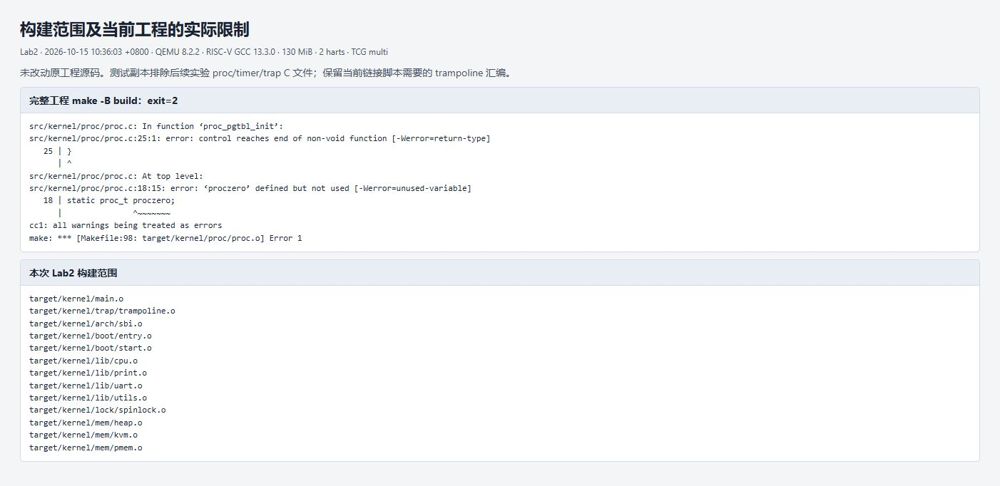

**上传 GitHub 前的纯 Lab2 复查：** 另从已提交的 `lab2` 建立干净副本，补齐 `src/kernel/mem/mod.h` 对 `../trap/type.h` 的显式包含，确保页表模块直接获得 PLIC 常量。此时完整 `make -B build` 返回 **0**，全部 **30 项测试再次符合预期**。这项头文件依赖修正已包含在本次上传中，尚未完成的后续实验代码保留在本地。复查的 [环境与源码校验值](./tests/lab2/github-check/environment.json)、[测试结果](./tests/lab2/github-check/results.json) 和 [完整构建日志](./tests/lab2/github-check/full-project.build.log) 一并保存。因此，下面的原始截图记录首次本地测试，`github-check` 记录实际上传的纯 Lab2 源码复查；两者的构建范围有明确区分。

在仓库根目录运行：

```bash
python3 tests/lab2/run.py
# 仅复现某组用例时，可按名字筛选：
python3 tests/lab2/run.py --only extra-huge --output /tmp/lab2-huge-recheck
```

完整运行会产生每例的 `.build.log`、QEMU 原始 `.log`、[results.json](./tests/lab2/results/results.json) 与 [environment.json](./tests/lab2/results/environment.json)。后者记录源文件 SHA256、工具版本、实际构建对象、Git HEAD 和源码前后是否一致；这次使用的是当前未提交工作区，HEAD 不能单独代表测试的全部源码。不同测试入口的全局变量大小不同，`ALLOC_BEGIN` 和用户页总数可能变化，因此用例均以本次 ELF 的实际基准进行断言。

TCG multi 下 OpenSBI 偶尔会选择 hart 1 为启动核，而当前工程约定 hart 0 负责初始化。脚本发现横幅中的 `Boot HART ID: 1` 后保存该次启动日志并重启，最多尝试 12 次；这些启动不计为测试通过，次数记录在 `boot_hart_retries`。因此测试结论的启动前提是 **boot hart 为 0**，也没有宣称修复了工程对启动核的假定。

所有图片都是**浏览器展示本次实际串口日志后的截图**，截图页由 [make_report.py](./tests/lab2/make_report.py) 从原始日志读取内容生成；它不会生成测试通过信息。为便于阅读，图片省略 OpenSBI 横幅与脚本主动结束 QEMU 的终止提示；长日志的节选另有标注。完整输出可通过各节链接核对，截图中同时显示日志 SHA256 前缀。

本次共运行 **30 个用例，30 个符合预期：8 个正常完成，22 个按预期触发指定 `panic`**。预期报错用例由脚本检查具体错误信息，超时、非预期 `panic` 或缺少完成标志均判失败。源码及构建配置的运行前后 SHA256 一致。

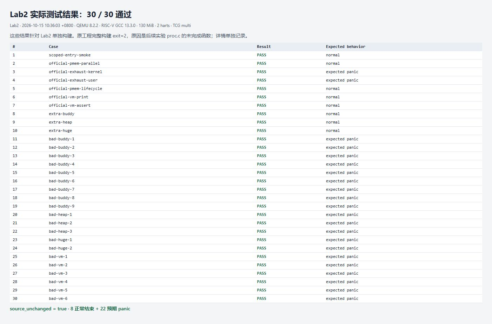

### 任务要求一：双核物理页申请与释放

对应任务页“第二阶段 test-1”，源码见 [official.c](./tests/lab2/official.c) 的 `LAB2_CASE=1`。在启用分页前，两核各申请 512 页，覆盖全部 1024 个内核物理页；逐页 `memset(..., 1, PGSIZE)` 并打印地址与首个整数。由于是按字节填 1，32 位整数打印为 `0x01010101`，即十进制 `16843009`。

两核都申请完成后才允许释放，并额外断言地址互不重复、全部字节保持正确、此时空闲页数为 0。并发释放后断言恢复 1024 页。脚本还独立解析全部 1024 条地址记录，核验每核确实各有 512 条。截图保留日志首尾片段，完整记录见 [official-pmem-parallel.log](./tests/lab2/results/official-pmem-parallel.log)。

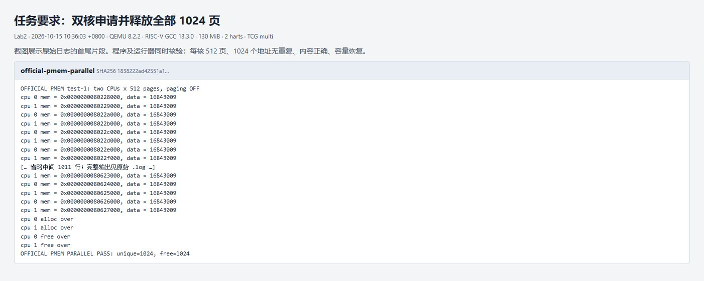

### 任务要求二：耗尽内核区与用户区

对应“第二阶段 test-2 / test_case_1”。分别以 `LAB2_CASE=2/3` 独立启动，分配实际可用的全部页，断言空闲页为 0，然后再申请一页，预期触发 `panic! buddy alloc: no suitable block`。两个区域分别验证，不能用某一区域的结果代替另一区域。

两次启动均在耗尽后触发指定错误，原始日志为 [内核区](./tests/lab2/results/official-exhaust-kernel.log) 与 [用户区](./tests/lab2/results/official-exhaust-user.log)。这里的 `panic` 是测试成功条件，不代表正常路径失败。

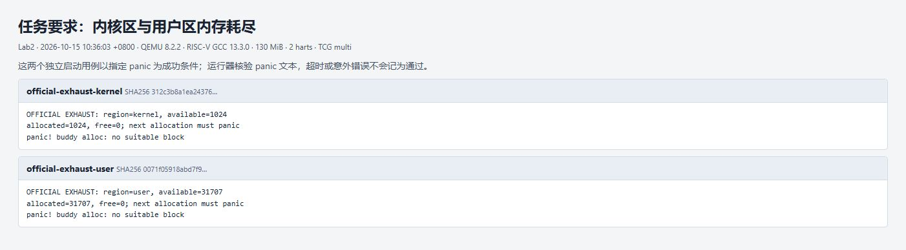

### 任务要求三：用户页回收计数与重新分配清零

对应“第二阶段 test-2 / test_case_2”，`LAB2_CASE=4`。依次完成 5 个阶段：申请 10 页并写入 `0xAA`、检查空闲数减少 10、释放、检查数量恢复、再次申请并逐字节验证清零。最后额外归还再次申请的页，确认测试自身没有泄漏。

原示例读取 `static user_region` 的 `allocable/list_head`，但当前实现已改为 Buddy，原来的单链表布局不再适用。测试改用带锁的 `pmem_freepages(false)` 检查空闲数，并用实际区域边界检查地址；没有为了测试把分配器内部对象改成全局变量。结果见 [official-pmem-lifecycle.log](./tests/lab2/results/official-pmem-lifecycle.log)。

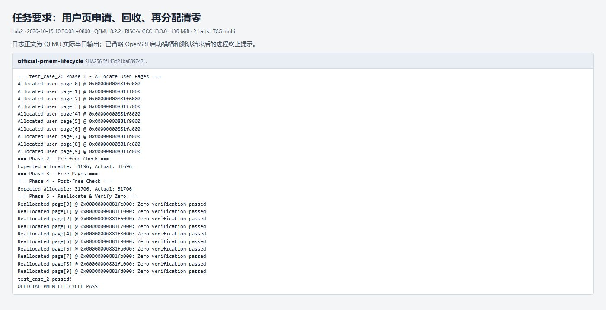

### 任务要求四：启用分页后的映射修改与页表打印

对应“第三阶段 test-1”，`LAB2_CASE=5`。在启用内核页表后映射 VA `0`、`10*PGSIZE`、`512*PGSIZE`、`512*512*PGSIZE`、`VA_MAX-PGSIZE`，覆盖短于一页的长度、跨 L1/L2 索引和最大允许 VA 边界。随后修改 VA 0 权限并解除两个页，分别调用 `vm_print()`，再用断言检查结果。

原任务示例有两处做了明确适配：

1. 原来的 `PTE_W` 改为 `PTE_R|PTE_W`，满足 Sv39 的 `W => R` 约束；另用错误路径测试验证单独 `PTE_W` 确实会被拒绝。
2. 第四处映射使用已申请的 `mem[3]`，避免继续引用随后会被 `freeit=true` 释放的 `mem[2]`。保留同一 PA 的别名时必须另行管理所有权，不能让测试留下悬空映射。

实测有效叶子从 5 个减少到 3 个，VA 0 的标志从 `0x43`（`V|R|A`）变为 `0xc7`（`V|R|W|A|D`），两个 hart 的 `satp` MODE 均为 8。测试最后取消剩余叶子并释放子页表，内核与用户空闲数都恢复。完整输出见 [official-vm-print.log](./tests/lab2/results/official-vm-print.log)。

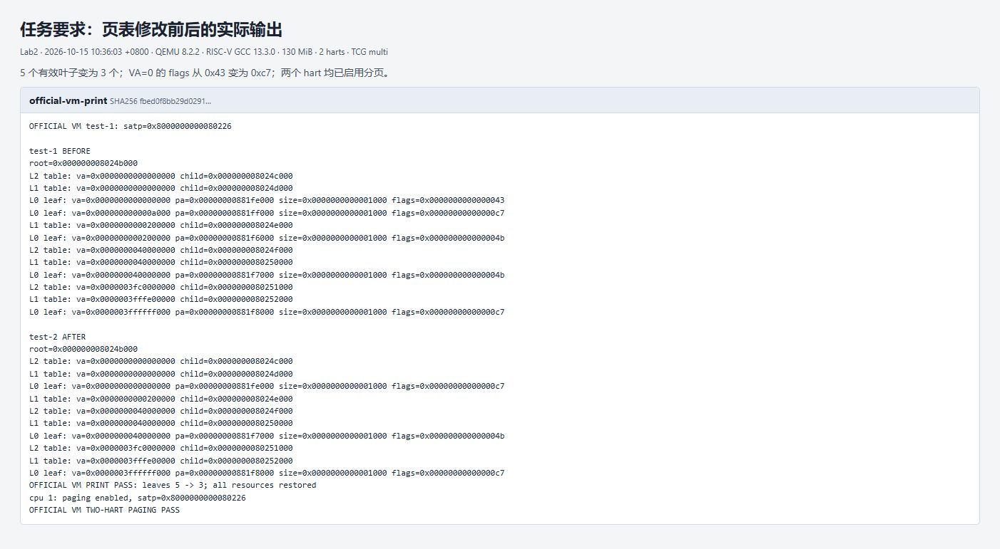

### 任务要求五：映射与解映射断言

对应“第三阶段 test-2 / test_mapping_and_unmapping”，`LAB2_CASE=6`。为 `0x100000` 和 `0x8000` 建立映射，逐项检查 PA 和权限；解映射后检查对应 L0 PTE 仍可查询且 `PTE_V=0`。最后释放空页表，并检查内核、用户页数都恢复。

输出包含 `test_mapping_and_unmapping passed!` 和双核分页完成标志；截图下半部分同时记录原入口省略后续实验初始化后的 Buddy 冒烟回归。日志分别为 [official-vm-assert.log](./tests/lab2/results/official-vm-assert.log) 与 [scoped-entry-smoke.log](./tests/lab2/results/scoped-entry-smoke.log)。

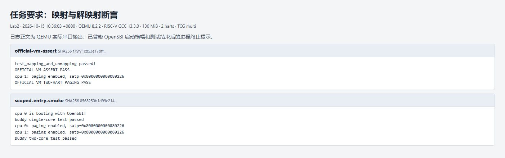

### 补充测试一：Buddy 的拆分、合并与并发

测试代码见 [buddy.c](./tests/lab2/buddy.c)，完整输出见 [extra-buddy.log](./tests/lab2/results/extra-buddy.log)。覆盖内容包括：

- 两个相邻 0 阶伙伴释放后能重新申请为原地址的 1 阶块；全部归还后还能申请完整 10 阶块，验证恢复的不只是空闲计数。
- 16 轮混合 0～5 阶分配，每轮 48 个同时存活块，核验清零、写入内容、乱序释放后的容量和大块恢复。
- 用完实际用户区域的所有页，检查地址合法且不重复，释放后保留非 2 的幂尾部容量，并可再申请 14 阶块。
- 偶数页先释放形成碎片，之后全部释放，验证重新合并回 10 阶块；碎片期间不能分配 1 阶块的情况由下方独立错误用例验证。
- 12 轮双核并发，每核持有 48 个混合阶块；检查两核所有活块两两不重叠、内容未被覆盖，并在每轮释放后恢复基准容量。

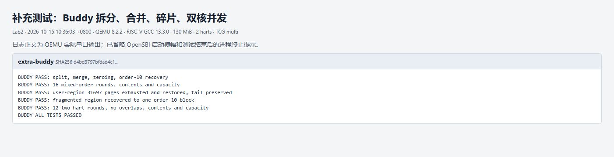

### 补充测试二：内核堆的边界、容量与跨核释放

测试代码见 [heap.c](./tests/lab2/heap.c)，完整输出见 [extra-heap.log](./tests/lab2/results/extra-heap.log)。

| 测试 | 检查内容 |
| --- | --- |
| 大小边界与内容 | 1、31、32、33、64、65、2048、2049、4096 字节；对齐、对象不重叠与内容保持 |
| 扩页与回收 | 64 个 64 字节对象为 1 页，第 65 个为 2 页；最后一个活对象释放后才归还对应页 |
| 128 位位图 | 128 个 32 字节对象为 1 页，第 129 个为 2 页；复用 63、64、127 号位置 |
| 显式对齐 | `align=1,2,...,4096` 的全部 13 种 2 的幂对齐，写入并验证内容 |
| 非法请求 | 零大小、超大大小、零对齐、非 2 的幂、超大对齐返回 `NULL`，`kfree(NULL)` 无副作用 |
| 耗尽与恢复 | 4096 字节对象耗尽可用内核页，再申请返回 `NULL`；所有已有对象仍完整，乱序释放后页数恢复 |
| 双核与跨核释放 | 64 轮、每核每轮 12 个不同大小和对齐的对象；另一核检查并释放，最终堆页数为 0 |

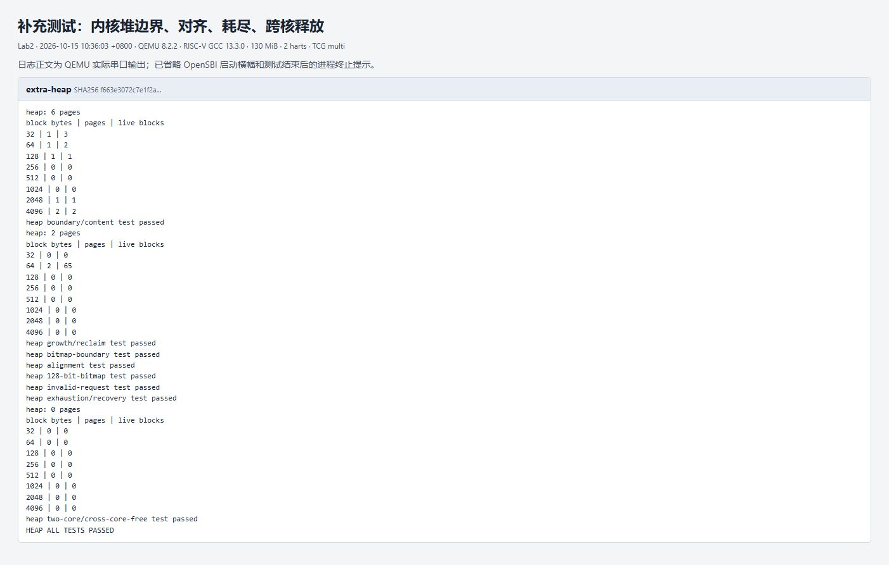

### 补充测试三：大页节省、局部拆分及真实地址翻译

测试代码见 [huge.c](./tests/lab2/huge.c)，完整输出见 [extra-huge.log](./tests/lab2/results/extra-huge.log)。

| 测试 | 实测结果与判据 |
| --- | --- |
| 同一 2 MiB 范围的页表开销 | 4 KiB 映射需 3 张页表，大页需 2 张；统计包含根表，比较前均使用空根 |
| 1 GiB 结构与两级拆分 | 初始仅根表 1 页；挖一个 4 KiB 洞后为 3 页，洞左右映射与远处 2 MiB 叶子均正确 |
| 长度尾部与对齐退化 | `2MiB+1` 只向上补齐一张 4 KiB 页；VA/PA 对齐不匹配时退回小页 |
| 大页内重映射 | 只改变指定 4 KiB 页的 PA，其余 511 页翻译不变；普通页 `freeit` 回收仍正常 |
| 当前活动页表拆分与 TLB | 真实访问 2 MiB 别名后局部解除、重新映射到新 PA；读写命中新 PA，旧 PA 保持原内容 |
| 真实 MMU 读写 | 保存 `satp`，切换到含真实 2 MiB 对齐 RAM 映射的测试根表，验证页首、跨页位置及末尾读写，再恢复原 `satp` |
| 资源恢复与兼容 | 测试根表、实际用户 Buddy 块全部回收；堆分配及双核 Buddy 仍通过 |

本机只有 130 MiB RAM，**1 GiB 测试只建立离线页表并检查结构和翻译计算，没有申请或读写 1 GiB 真实内存**。真实硬件路径由 2 MiB 用例验证。每次销毁测试页表前都先切回原 `satp` 并刷新 TLB。

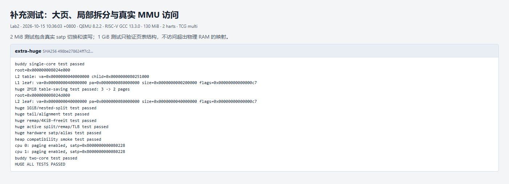

### 补充测试四：非法操作的独立启动测试

`panic()` 不会返回，所以每一种错误都必须单独编译、单独启动，不能把多个错误调用顺次写在同一次启动里。本次额外测试了 20 种错误路径，全部由运行器核验指定错误文本；再加上任务要求中的两次耗尽，共计 22 个预期 `panic` 用例。

| Buddy 用例 | 输入 | 预期拒绝原因 |
| --- | --- | --- |
| `bad-buddy-1` | 申请 16 阶块 | 超过最大阶 15 |
| `bad-buddy-2` | 释放 `pa+1` | 没有页对齐 |
| `bad-buddy-3` | 把内核页归还用户区 | 区域不匹配 |
| `bad-buddy-4` | 单独释放 2 阶块的内部页 | 不是独立分配块首 |
| `bad-buddy-5` | 把 2 阶块按 1 阶释放 | 已分配状态与阶数不符 |
| `bad-buddy-6` | 同一块释放两次 | 已不是该阶已分配块 |
| `bad-buddy-7` | 申请整个内核区后再申请一页 | 没有合适块 |
| `bad-buddy-8` | 只归还偶数页后申请 1 阶 | 总计空闲 512 页，但没有连续伙伴对 |
| `bad-buddy-9` | 用户区耗尽后再申请 | 没有合适块 |

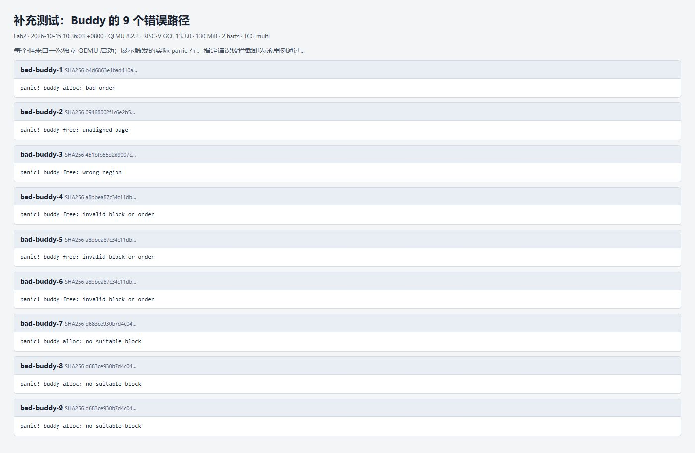

| 堆与大页用例 | 输入 | 预期拒绝原因 |
| --- | --- | --- |
| `bad-heap-1` | 保留同页活对象后重复释放另一对象 | 位图显示对象已空闲 |
| `bad-heap-2` | `kfree(ptr+1)` | 地址不是块首 |
| `bad-heap-3` | `kfree(&local)` | 地址不在内核可分配页池 |
| `bad-huge-1` | 大页用 `freeit=true` 解映射 | 大块数据页需由所有者按原阶数回收 |
| `bad-huge-2` | 页表仍有叶子时 `vm_freewalk()` | 不能直接销毁含有效叶子的页表 |

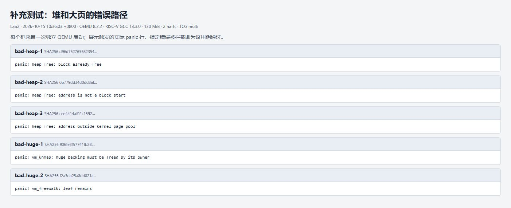

| 页表用例 | 输入 | 预期拒绝原因 |
| --- | --- | --- |
| `bad-vm-1` | 只设置 `PTE_W` | W 必须同时具有 R |
| `bad-vm-2` | VA 未按 4 KiB 对齐 | 不合法的起始地址 |
| `bad-vm-3` | 起点为 `VA_MAX` | 超过接口支持范围 |
| `bad-vm-4` | 解除根本没有建立的映射 | 地址尚未映射 |
| `bad-vm-5` | 根页表为 `NULL` | 无效根指针 |
| `bad-vm-6` | 映射长度为 0 | 无效范围 |

页表错误测试源文件为 [vm_bad.c](./tests/lab2/vm_bad.c)。所有 `bad-*` 原始输出及每次构建日志都保存在 [results 目录](./tests/lab2/results/)。

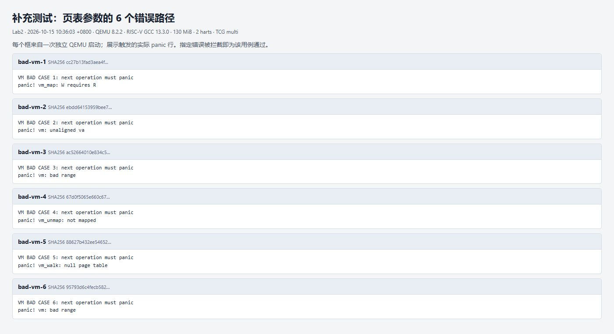

## 本次实现的联系与边界

这三个进阶功能分别回答三个问题：Buddy 管理“哪些连续物理页可用”，内核堆管理“一页里面哪些小对象可用”，大页管理“用多大粒度建立 VA 到 PA 的关系”。堆以 Buddy 为后端；大页映射需要连续且满足绝对对齐的物理范围，但不会代替 Buddy 分配它。

复现或排查时，应先记录资源基准，再检查申请后的地址、大小、对齐、内容和页表项，最后释放并比较容量；需要验证合并时还要重新申请大块，仅比较计数不够。内存耗尽与非法释放要独立启动，页表验证则应区分离线结构检查与实际 MMU 访问。本地后续实验的整体构建、任意启动 hart 的适配以及活动页表的跨核修改与远程 TLB 同步仍待完成；本次上传的纯 Lab2 分支已通过完整构建和上述复查。
