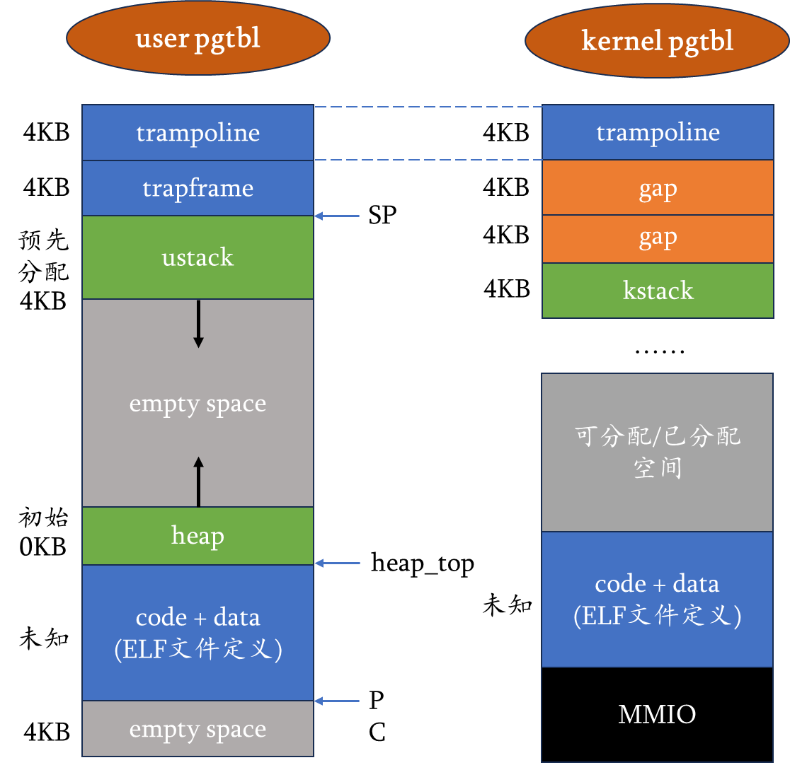

# OS2026 · Lab4：首个用户进程和用户态陷阱

本分支从 `lab3` 继承前序内容，再加入已有的用户进程和用户态切换框架。Lab1、Lab2 已完成的基础代码、报告、截图和测试全部保留；Lab3 和 Lab4 的待补函数仍须实现。

## 前序实验

- [Lab1 报告](README.lab1.md)、[测试与记录](tests/lab1/)、[截图](pictures/lab1/)。
- [Lab2 报告](README.lab2.md)、[测试与记录](tests/lab2/)、[截图](pictures/lab2/)。
- [Lab3 分支说明](README.lab3.md)、[Lab3 验收规格](spec/patches/lab3.yaml)。
- 历史测试记录说明对应阶段的验证结果；后续分支仍需完成自己的构建与验收。

## Lab4 内容

| 文件 | 用途与当前状态 |
| --- | --- |
| `spec/patches/lab4.yaml` | 首进程、ecall 往返和异常处理的验收目标 |
| `src/kernel/proc/` | 进程结构、上下文和切换；页表初始化与首进程创建仍为空 |
| `src/kernel/lib/cpu.c`、`type.h` | 当前 CPU 的进程指针和内核上下文 |
| `src/kernel/trap/trampoline.S` | 用户态与内核态之间的汇编切换框架 |
| `src/kernel/trap/trap_user.c` | 用户 trap 和返回用户态的待补函数 |
| `src/user/`、`user.ld` | 用户程序、系统调用封装和用户链接脚本 |
| `Makefile`、`kernel.ld` | 用户程序嵌入内核以及 trampoline 段的构建支持 |

用户与内核地址空间参考图保存在本实验自己的目录中：



## 构建与验收

```bash
git switch lab4
make clean
make build
# 完成 Lab3、Lab4 的待补实现并成功构建后：
make run
```

在 Lab3 所需工具之外，用户代码嵌入还需要 `xxd`。`src/user/initcode.h` 由构建生成，不提交到仓库。

2026-10-19 整理时已执行 `make build`：用户程序及内嵌头文件生成成功，内核编译停在原有 `proc_pgtbl_init()` 缺少返回值、`proczero` 未使用的错误。本分支仍是待完成的教学框架，核心空函数会触发严格编译检查。继续实现时还需接通首进程启动、用户页表与 trampoline 映射，完成 ecall 和用户中断往返。验收应覆盖两次系统调用、用户执行期间的时钟/UART 中断，以及未知调用与用户异常，详见 [Lab4 验收规格](spec/patches/lab4.yaml)。
