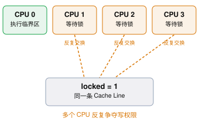
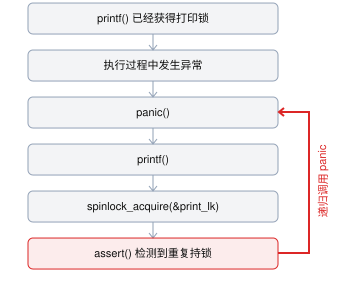

# Lab1

本次实验新增的功能有：操作系统最基本的启动cpu的能力，简单的printf函数和spinlock的实现。下面来逐一看看这些功能。


## spinlock

考虑到系统中有可能会多个函数的连续调用，每个函数都需要关中断，而只要有一个函数需要关中断那么cpu就要关中断（一般来讲每次获取锁就是一次关中断），因此用一个后进先出的栈来管理关中断状态是一个自然的想法。具体来说，每个函数要关中断就调用push_off，本质是把cpu->noff+1，而要开中断就调用pop_off，只有当cpu->noff = 0时才恢复到cpu->origin的状态。

在操作系统中，大多数的关中断与开中断操作都是由锁来调用的。具体来说，spinlock_acquire和spinlock_release分别需要调用关中断和开中断：

```c
void spinlock_acquire(spinlock_t *lk)
{
    push_off();
    assert(!spinlock_holding(lk), "spinlock_acquire: already holding\n");
    while(__sync_lock_test_and_set(&lk->locked, 1) != 0);
     __sync_synchronize();
    lk->cpuid = mycpuid();
}
```

```c
void spinlock_release(spinlock_t *lk)
{
    assert(spinlock_holding(lk), "spinlock_release: not holding\n");
    lk->cpuid = -1;
     __sync_synchronize();
    __sync_lock_release(&lk->locked);
    pop_off();
}
```

原因是，**如果在持有锁的时候发生中断，中断处理程序需要同一把锁，就会发生死锁**。所以在获得一把锁时，锁本身的机制防止了其他cpu的干扰，关中断防止了当前cpu中断的干扰，两者共同保证当前程序不会被干扰。

**而自旋锁的本质就在于原子操作。**原子操作是硬件保证的、不会被打断的操作，要么一起完成，要么一个都完不成，因此保证了承诺的不变量是正确的。

## spinlock的优化

TAS自旋锁的实现虽然简单，但是性能却一般，下面看看怎么优化。

- **目前的性能瓶颈**： `__sync_lock_test_and_set`这个函数要执行以下三个操作：读取`locked`的旧值，将`locked`设为1，返回旧值。问题在于，**即使锁已经被其他 CPU 持有，等待的 CPU 也会不断尝试写入 1。**假设现在 CPU 0 持有锁，其他三个 CPU 都在等待。



多个 CPU 不断执行原子交换，可能使缓存行的所有权在不同 CPU 之间频繁转移，也就是常说的 **Cache Line Bouncing**。

一个自然想法是用TTAS自旋锁，**先读取锁的状态，只有发现锁可能空闲时，才尝试执行原子交换。**多个 CPU 可以同时缓存同一条处于共享状态的 Cache Line。因此，在锁被持有期间，等待核只需要不断读取本地缓存，不必反复争夺写权限。具体实现如下：

```c
while (1) {
    // 第一阶段：只读，等待锁变为空闲
    while (__atomic_load_n(&lk->locked,
                           __ATOMIC_RELAXED) != 0) {
    }

    // 第二阶段：尝试原子获取锁
    if (__sync_lock_test_and_set(&lk->locked, 1) == 0)
        break;
}
```

TTAS 的优点在于将大量原子读改写操作转化为普通的原子读取操作。但是，TTAS 仍然存在一个问题：锁释放时，多个 CPU 可能同时尝试获取锁，形成新一轮竞争。这个问题有更优的锁可以实现，但是对这个简单的内核来说，TTAS已经足够优了。

**删去无用的内存屏障**：实际上，acquire和release中的__atomic系列函数已经足以保证临界区中的数据按照约定顺序存取，不用加入内存屏障。

**缩小临界区**：朴素printf的实现是这样的：

```c
void printf(const char *fmt, ...)
{
    va_list ap;
    va_start(ap, fmt);
    spinlock_acquire(&print_lk);
    for (; *fmt; fmt++) {
        if (*fmt != '%') {
            uart_putc_sync(*fmt);
            continue;
        }
        fmt++;
        if (*fmt == '\0') {
            uart_putc_sync('%');
            break;
        }
        switch (*fmt) {
        case 'd': {
            int n = va_arg(ap, int);
            uint32 magnitude = (uint32)n;
            if (n < 0) {
                uart_putc_sync('-');
                magnitude = 0u - magnitude;
            }
            printint(magnitude, 10);
            break;
        }
        case 'p':
            printint(va_arg(ap, uint32), 16);
            break;
        case 'x':
            printptr(va_arg(ap, uint64));
            break;
        case 'c':
            uart_putc_sync(va_arg(ap, int));
            break;
        case 's': {
            char *s = va_arg(ap, char *);
            if (s == NULL)
                s = "(null)";
            while (*s)
                uart_putc_sync(*s++);
            break;
        }
        case '%':
            uart_putc_sync('%');
            break;
        default:
            uart_putc_sync('%');
            uart_putc_sync(*fmt);
            break;
        }
    }
    spinlock_release(&print_lk);
    va_end(ap);
}
```

可以看到，整个过程都在临界区中。但是，完全可以先在当前 CPU 的局部缓冲区中完成格式化，再获取锁进行输出：

```c
void printf(const char *fmt, ...)
{
    char buf[512];

    va_list ap;
    va_start(ap, fmt);

    // 新实现的格式化函数，将结果写入局部缓冲区
    kvsnprintf(buf, sizeof(buf), fmt, ap);

    va_end(ap);

    spinlock_acquire(&print_lk);

    for (int i = 0; buf[i]; i++)
        uart_putc_sync(buf[i]);

    spinlock_release(&print_lk);
}
```

同时，现在的实现开关中断太过浪费：

```c
printf()
    spinlock_acquire()
        push_off()

    uart_putc_sync()  // 每输出一个字符都执行
        push_off()
        UART 输出
        pop_off()

    spinlock_release()
        pop_off()
```

可以将 UART 输出拆成两层，在外层一次性关中断：

```c
// 底层：不负责关中断和加锁
static void uart_putc_raw(int c)
{
    while ((ReadReg(LSR) & LSR_TX_IDLE) == 0)
        ;

    WriteReg(THR, c);
}

// 上层：提供中断状态保护
void uart_putc_sync(int c)
{
    push_off();
    uart_putc_raw(c);
    pop_off();
}
```


## 修复printf潜在的死锁问题

上面的printf实现看似正确，但却隐藏着死锁的风向。原因在于panic的实现：

```c
void panic(const char *s)
{
    printf("panic! %s\n", s);
    panicked = 1;
    while (1)
        ;
}
```

假如程序在执行printf的时候报错，此时调用panic，panic又调用printf，但是此前的printf已经持有了打印锁，就会造成死锁。



在这种情况下，甚至别的cpu发现了这个cpu报错也无法解决，最终无法输出报错信息。

一个可行的解决思路是采用一个紧急输出函数：

```c
void uart_putc_emergency(int c)
{
    // 设置有限的轮询次数，避免 UART 故障时永远等待
    for (int i = 0; i < 1000000; i++) {
        if (ReadReg(LSR) & LSR_TX_IDLE) {
            WriteReg(THR, c);
            return;
        }
    }
}
```

这个函数不用获得锁，因而也不会发生上面的问题。具体实现见代码。


## 课后实验

**1、 sum**

一个很自然的解决办法是给每次sum操作上锁：

```c
for (int i = 0; i < 1000000; i++) {
    spinlock_acquire(&sum_lk);
    sum++;
    spinlock_release(&sum_lk);
}
```

但是这种方法有一个明显的缺点：两个 CPU 总共需要执行 **200 万次加锁和解锁**，产生大量同步开销。

于是我们想到，能不能用粒度粗一些的锁呢？当前是可以的，我们可以在循环外面上锁来做到这一点：

```c
spinlock_acquire(&sum_lk);

for (int i = 0; i < 1000000; i++) {
    sum++;
}

spinlock_release(&sum_lk);
```

输出为：

```c
cpu 0 is booting!
cpu 1 is booting!
cpu 0 report: sum = 1000000
cpu 1 report: sum = 2000000
```

这样的话，虽然加法还是完全串行的，但两个 CPU 总共只需要执行 **2 次加锁和解锁**，大大减少了同步开销。

完整测试代码如下：

```c
#include "arch/mod.h"
#include "lib/mod.h"
#include "lock/mod.h"

// 1 为细粒度锁，0 为粗粒度锁
#define FINE_GRAINED 1

static int started = 0;
static volatile int sum = 0;
static spinlock_t sum_lk;

int main(void)
{
    int cpuid = r_tp();

    if (cpuid == 0) {
        print_init();
        spinlock_init(&sum_lk, "sum");

        printf("cpu %d is booting!\n", cpuid);

        __atomic_store_n(&started, 1,
                         __ATOMIC_RELEASE);
    } else {
        while (!__atomic_load_n(&started,
                                __ATOMIC_ACQUIRE));

        printf("cpu %d is booting!\n", cpuid);
    }

#if FINE_GRAINED

    // 细粒度锁
    for (int i = 0; i < 1000000; i++) {
        spinlock_acquire(&sum_lk);
        sum++;
        spinlock_release(&sum_lk);
    }

#else

    // 粗粒度锁
    spinlock_acquire(&sum_lk);

    for (int i = 0; i < 1000000; i++)
        sum++;

    spinlock_release(&sum_lk);

#endif

    // 保证读取 sum 及报告顺序的一致性
    spinlock_acquire(&sum_lk);
    printf("cpu %d report: sum = %d\n",
           cpuid, sum);
    spinlock_release(&sum_lk);

    while (1);
}
```

结果是细粒度锁耗时1.415s，粗粒度锁耗时0.343s。

当然了，如果不是实验限制，在本地先累加1000000次然后再共享肯定是最快的方式：

```c
int local_sum = 0;

for (int i = 0; i < 1000000; i++)
    local_sum++;

spinlock_acquire(&sum_lk);
sum += local_sum;
spinlock_release(&sum_lk);
```

相比减少锁，减少共享数据往往更加有效。


**2、 printf**

测试代码为：

```c
#include "arch/mod.h"
#include "lib/mod.h"

static int started = 0;

int main(void)
{
    int cpuid = r_tp();

    if (cpuid == 0) {
        print_init();

        __atomic_store_n(&started, 1,
                         __ATOMIC_RELEASE);
    } else {
        while (!__atomic_load_n(&started,
                                __ATOMIC_ACQUIRE));
    }

    for (int i = 0; i < 32; i++) {
        if (cpuid == 0) {
            printf("CPU 0: AAAAAAAAAAAAAAAA\n");
        } else {
            printf("CPU 1: BBBBBBBBBBBBBBBB\n");
        }
    }

    while (1);
}
```

加锁的情况下，结果为：

```c
CPU 0: AAAAAAAAAAAAAAAA
CPU 1: BBBBBBBBBBBBBBBB
CPU 1: BBBBBBBBBBBBBBBB
CPU 0: AAAAAAAAAAAAAAAA
CPU 0: AAAAAAAAAAAAAAAA
CPU 1: BBBBBBBBBBBBBBBB
...
```

而移除打印锁后，结果为：

```c
CPU 0: AAACPU 1: BBBAAAABBBB
AABBBBAAAAA
CPUC 0P:U A A1A: ABBABABA
...
```

一个有趣的问题是，假设不在 `printf()` 外层加锁，而是在 `uart_putc_sync()` 中使用一把共享锁，能否防止这个问题？答案是不行，因为这样虽然防止了多个cpu同时操作uart，但是仍然不能保证字符串输出的完整性。
