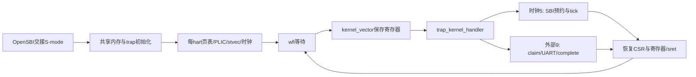

# Lab3 完整教程：从一次中断到恢复原执行流

这份教程对应本分支实际代码。建议具备C指针、结构体、函数调用栈和Lab2三级页表基础；遇到不熟悉的寄存器，先看“最小前置知识”，再沿调用链阅读。每个源文件都有说明，每个C函数（包括static辅助函数与头文件内联函数）都有用途、执行步骤、边界和完整代码。汇编入口另按阶段解释。

## 1. 先理解要解决的问题

Lab2结束时内核只能主动执行代码；串口输入和计时事件却可以在任意指令之间到达。实验要让CPU暂时处理它们，然后精确恢复被打断的寄存器、栈和PC。光写一个C函数不够，因为C函数本身会覆盖寄存器。主线是：**先构造可安全进入的环境，再保存现场，再分派事件，最后恢复现场**。



## 2. 最小前置知识

`hart`是一个能独立执行指令的硬件线程，本实验有0、1两个。`stvec`决定监督者trap从哪里执行；`scause`最高位为1表示中断，其余位是完整原因号；`sepc`记录返回PC；`stval`记录故障地址等附加信息。`sstatus.SPP`记录trap之前的特权级，`SIE`是S-mode全局开关，`SPIE`保存陷入前的开关状态。`sie`另外控制STIE和SEIE这两个来源开关。硬件只自动记录有限CSR，不会替你压栈保存通用寄存器。

**检查点：** 如果只写stvec和SIE，但没开SEIE，UART是否必然触发？不会，设备IER、PLIC优先级/阈值/enable、SEIE等路径也要贯通。

## 3. 初始化为什么按这个顺序

hart0先print_init，才可诊断错误；pmem_init之后kvm_init才能申请页表；安装页表之后MMIO映射才可用；trap_kernel_init创建共享tick锁和PLIC优先级；发布initialized后HSM启动尚未运行的hart1；若固件先交接hart1，start先唤醒hart0，hart1等待，避免冷启动竞态。两核各自安装内核页表、PLIC context和stvec，然后开SEIE与全局SIE，timer_init预约本hart时钟并开STIE。hart0最后打开UART接收IER。原Lab2双核buddy测试保留，且在中断正式运行之前完成。

**检查点：** 为什么timer_create不能在两个hart上各调用一次？第二次调用会重置正在使用的锁和ticks；每hart定时器和全局计数器是不同的资源。

## 4. 一次UART输入的完整路线

以输入`A`为例：UART的接收FIFO有字节，IRQ10请求PLIC；PLIC选择某个已启用的S context；CPU产生原因9的监督者外部中断并进入kernel_vector。汇编保存寄存器后进入C。C保存CSR，external handler领取IRQ10，uart_intr持续读取至-1，以printf回显。处理完向相同context写回IRQ10完成。C恢复返回CSR，汇编恢复通用寄存器并sret。

退格字节0x08和删除字节0x7f都会输出`08 20 08`：移动左一格、写空格覆盖、再移回左格。CR和LF各输出`0d 0a`。连续输入必须循环排空当前FIFO，不能只处理一个字节就停止读取。

## 5. 一次时钟中断的完整路线

QEMU本次日志报告timebase为10,000,000Hz，默认INTERVAL=1,000,000，因此理想间隔约0.1秒。代码使用`r_time()+INTERVAL`预约，实际处理中有延迟，ticks代表hart0处理次数而非精确墙钟。两核都收到自己的时钟中断，都必须重设事件，但只有hart0让全局ticks递增。timer_get_ticks用同一把锁读取。修改INTERVAL后重新编译，依赖文件确保相关目标重建。

**检查点：** 若把“仅hart0更新tick”的if扩大包住整个SBI重设调用，会怎样？hart1到期后不能正确预约下一次。正确条件只包住timer_update。

## 6. 汇编kernel_vector逐阶段阅读

1. `addi sp,sp,-256`：RV64每槽8字节，留32槽，保持16字节栈对齐。
2. `sd`：ra偏移0，帧基址sp偏移8，gp16，tp24，a0在72，t6在240。保存sp这一槽是减256后的帧基址，不是原sp。
3. `call trap_kernel_handler`：C可以自由使用调用者保存寄存器，因为完整现场已在内核栈。
4. `ld`：恢复现场，tp不从保存区恢复以继续保留内核hart ID。sp槽装回帧基址后仍可继续以它读取后续槽。
5. `addi sp,sp,256`恢复原栈顶；`sret`根据sepc、SPP、SPIE恢复执行位置与特权状态。

这32个槽并不意味着保存了32个独立可写寄存器：x0恒为0且无需保存，末尾还留有对齐空间。不要在汇编和C结构之间凭直觉调整偏移。

## 7. 逐文件、逐函数阅读

### `Makefile`

构建依赖图、自动工具链探测、QEMU双核启动和清理。各编译规则先mkdir -p $(@D)，保证make -j可用。Lab4把用户ELF转bin再xxd生成initcode.h，proc.o显式依赖该头。

[打开源码](../../Makefile)

```makefile
# 引入通用配置文件
include common.mk

.DEFAULT_GOAL := build

# 自动探测本机可用的RISC-V工具链前缀
# common.mk中默认是riscv64-linux-gnu-, 但有些环境(例如macOS上的brew)装的是riscv64-unknown-elf-
# 探测不到任何工具链时保留common.mk中的默认值, 命令行传入的TOOLPREFIX优先级最高:
#   make TOOLPREFIX=riscv64-linux-gnu-
DETECTED_TOOLPREFIX := $(shell \
    for p in riscv64-linux-gnu- riscv64-unknown-elf- riscv64-elf- riscv64-none-elf-; do \
        if command -v $${p}gcc >/dev/null 2>&1; then echo $$p; break; fi; \
    done)
ifneq ($(DETECTED_TOOLPREFIX),)
TOOLPREFIX = $(DETECTED_TOOLPREFIX)
endif


# 配置CPU核心数量
CPUNUM = 2
# 定义目标文件输出目录
TARGET = target
# 定义各模块路径
KernelPath = src/kernel
# 内核链接脚本
KERNEL_LD  = kernel.ld
# 定义内核目标文件路径
ELFKernel = $(TARGET)/kernel/kernel-qemu.elf
NakedKernel = $(TARGET)/kernel/kernel-qemu.bin

# 收集内核源代码文件（.c和.S汇编文件）
KernelSourceFile = $(wildcard $(KernelPath)/*.c) $(wildcard $(KernelPath)/*.S)
KernelSourceFile += $(wildcard $(KernelPath)/*/*.c) $(wildcard $(KernelPath)/*/*.S)

# 生成目标文件（.o）路径列表
KernelOBJ = $(patsubst $(KernelPath)/%.S, $(TARGET)/kernel/%.o, $(filter %.S, $(KernelSourceFile)))
KernelOBJ += $(patsubst $(KernelPath)/%.c, $(TARGET)/kernel/%.o, $(filter %.c, $(KernelSourceFile)))

# QEMU模拟器配置
QEMU     = qemu-system-riscv64  # 指定QEMU程序
QEMUOPTS = -machine virt -bios default -kernel $(ELFKernel)  # 使用OpenSBI启动S-mode内核
QEMUOPTS += -m 130M -smp $(CPUNUM) -nographic  # 物理内存从0x80000000到0x88200000

# 调试相关配置
GDBPORT = $(shell expr `id -u` % 5000 + 25000)  # 动态计算GDB端口号
# 根据QEMU版本选择合适的GDB调试参数
QEMUGDB = $(shell if $(QEMU) -help | grep -q '^-gdb'; \
    then echo "-gdb tcp::$(GDBPORT)"; \
    else echo "-s -p $(GDBPORT)"; fi)

# 头文件变化触发内核目标重编译
-include $(KernelOBJ:.o=.d)

# 生成GDB初始化文件
.gdbinit: .gdbinit.tmpl-riscv
    sed "s/:1234/:$(GDBPORT)/" < $^ > $@

# 运行目标：先构建再启动QEMU
run: build
    $(QEMU) $(QEMUOPTS)

# 调试目标：启动带GDB调试的QEMU
debug: $(ELFKernel) .gdbinit
    $(QEMU) $(QEMUOPTS) -S $(QEMUGDB)

# 构建目标：创建输出目录并编译内核
build: $(TARGET) $(ELFKernel)

# 创建输出目录结构（如果不存在）
.PHONY: $(TARGET)
$(TARGET):
    @mkdir -p $(TARGET)/kernel
    @mkdir -p $(TARGET)/kernel/arch
    @mkdir -p $(TARGET)/kernel/boot
    @mkdir -p $(TARGET)/kernel/lock
    @mkdir -p $(TARGET)/kernel/lib
    @mkdir -p $(TARGET)/kernel/mem
    @mkdir -p $(TARGET)/kernel/trap

# 编译规则：将汇编文件(.S)编译为目标文件(.o)
$(TARGET)/kernel/%.o: $(KernelPath)/%.S
    @mkdir -p $(@D)
    $(CC) $(CFLAGS) -c -o $@ $<

# 编译规则：将C文件(.c)编译为目标文件(.o)
$(TARGET)/kernel/%.o: $(KernelPath)/%.c
    @mkdir -p $(@D)
    $(CC) $(CFLAGS) -c -o $@ $<

# 链接生成内核ELF文件
$(ELFKernel): $(KernelOBJ) $(KERNEL_LD)
    $(LD) $(LDFLAGS) -T $(KERNEL_LD) $(KernelOBJ) -o $@

# 清理目标：删除输出目录
.PHONY: clean
clean:
    rm -rf target
```

### `common.mk`

共享工具链命令与严格编译参数，保留-Wall -Werror、freestanding、medany、无PIE与调试信息。

[打开源码](../../common.mk)

```makefile
# 这个文件负责公共的配置

TOOLPREFIX = riscv64-linux-gnu-
CC = ${TOOLPREFIX}gcc
LD = ${TOOLPREFIX}ld
OBJCOPY = ${TOOLPREFIX}objcopy
OBJDUMP = ${TOOLPREFIX}objdump

# 编译相关配置
CFLAGS = -Wall -Werror -O -fno-omit-frame-pointer -ggdb -gdwarf-2
CFLAGS += -std=gnu17
CFLAGS += -MD
CFLAGS += -mcmodel=medany
CFLAGS += -ffreestanding -fno-common -nostdlib -mno-relax
CFLAGS += -I.
CFLAGS += $(shell $(CC) -fno-stack-protector -E -x c /dev/null >/dev/null 2>&1 && echo -fno-stack-protector)

# Disable PIE when possible (for Ubuntu 16.10 toolchain)
ifneq ($(shell $(CC) -dumpspecs 2>/dev/null | grep -e '[^f]no-pie'),)
CFLAGS += -fno-pie -no-pie
endif
ifneq ($(shell $(CC) -dumpspecs 2>/dev/null | grep -e '[^f]nopie'),)
CFLAGS += -fno-pie -nopie
endif

# 链接相关配置
LDFLAGS = -z max-page-size=4096
```

### `kernel.ld`

内核从0x80200000链接，定义代码/数据/可分配区域。Lab4将trampsec按页对齐并用ASSERT限制为一页。

[打开源码](../../kernel.ld)

```ld
OUTPUT_ARCH( "riscv" )
ENTRY( _entry )

PHDRS
{
  text PT_LOAD FLAGS(5); /* read + execute */
  data PT_LOAD FLAGS(6); /* read + write */
}

SECTIONS
{
  /* OpenSBI occupies the machine-mode firmware area from 0x80000000. */
  . = 0x80200000;

  .text : {
    KEEP(*(.text.entry))
    *(.text .text.*)
    . = ALIGN(0x1000);
    /*
    _trampoline = .;
    *(trampsec)
    . = ALIGN(0x1000);
    ASSERT(. - _trampoline == 0x1000, "error: trampoline larger than one page");
    */
    PROVIDE(KERNEL_DATA = .);
  } :text

  .rodata : {
    . = ALIGN(16);
    *(.srodata .srodata.*) /* do not need to distinguish this from .rodata */
    . = ALIGN(16);
    *(.rodata .rodata.*)
  } :text

  .data : {
    . = ALIGN(16);
    *(.sdata .sdata.*) /* do not need to distinguish this from .data */
    . = ALIGN(16);
    *(.data .data.*)
  } :data

  .bss : {
    . = ALIGN(16);
    *(.sbss .sbss.*) /* do not need to distinguish this from .bss */
    . = ALIGN(16);
    *(.bss .bss.*)
  } :data

  . = ALIGN(4096);
  PROVIDE(ALLOC_BEGIN = .);
  /* QEMU RAM is 130 MiB from 0x80000000; leave the first 2 MiB for OpenSBI. */
  PROVIDE(ALLOC_END = 0x80200000 + 128M);
}
```

### `src/kernel/arch/method.h`

SBI函数声明和逐CSR的内联访问器；每个实现见下文。

[打开源码](../../src/kernel/arch/method.h)

#### `r_sstatus`（源码第14行）

**解决什么问题与输入输出：** 读取当前hart的sstatus寄存器并返回64位快照。

**按执行顺序理解：** 声明局部uint64，通过volatile内联汇编csrr把CSR内容送到输出操作数，然后返回。

**必须留意的边界：** 只读快照不替调用者加锁；time是硬件时间，sepc是返回PC，satp是地址翻译配置，不能混用。

```c
static inline uint64 r_sstatus()
{
    uint64 x;
    asm volatile("csrr %0, sstatus" : "=r"(x));
    return x;
}
```

#### `w_sstatus`（源码第22行）

**解决什么问题与输入输出：** 设置当前hart的sstatus寄存器。

**按执行顺序理解：** 用csrw把输入操作数写到指定CSR；调用者提供满足架构要求的编码。

**必须留意的边界：** 写satp不会自动刷新TLB；写stvec前必须确保入口可执行，写sepc前要确定返回的是原PC还是ecall之后的PC。

```c
static inline void w_sstatus(uint64 x)
{
    asm volatile("csrw sstatus, %0" : : "r"(x));
}
```

#### `r_sip`（源码第28行）

**解决什么问题与输入输出：** 读取当前hart的sip寄存器并返回64位快照。

**按执行顺序理解：** 声明局部uint64，通过volatile内联汇编csrr把CSR内容送到输出操作数，然后返回。

**必须留意的边界：** 只读快照不替调用者加锁；time是硬件时间，sepc是返回PC，satp是地址翻译配置，不能混用。

```c
static inline uint64 r_sip()
{
    uint64 x;
    asm volatile("csrr %0, sip" : "=r"(x));
    return x;
}
```

#### `w_sip`（源码第36行）

**解决什么问题与输入输出：** 设置当前hart的sip寄存器。

**按执行顺序理解：** 用csrw把输入操作数写到指定CSR；调用者提供满足架构要求的编码。

**必须留意的边界：** 写satp不会自动刷新TLB；写stvec前必须确保入口可执行，写sepc前要确定返回的是原PC还是ecall之后的PC。

```c
static inline void w_sip(uint64 x)
{
    asm volatile("csrw sip, %0" : : "r"(x));
}
```

#### `r_sie`（源码第42行）

**解决什么问题与输入输出：** 读取当前hart的sie寄存器并返回64位快照。

**按执行顺序理解：** 声明局部uint64，通过volatile内联汇编csrr把CSR内容送到输出操作数，然后返回。

**必须留意的边界：** 只读快照不替调用者加锁；time是硬件时间，sepc是返回PC，satp是地址翻译配置，不能混用。

```c
static inline uint64 r_sie()
{
    uint64 x;
    asm volatile("csrr %0, sie" : "=r"(x));
    return x;
}
```

#### `w_sie`（源码第50行）

**解决什么问题与输入输出：** 设置当前hart的sie寄存器。

**按执行顺序理解：** 用csrw把输入操作数写到指定CSR；调用者提供满足架构要求的编码。

**必须留意的边界：** 写satp不会自动刷新TLB；写stvec前必须确保入口可执行，写sepc前要确定返回的是原PC还是ecall之后的PC。

```c
static inline void w_sie(uint64 x)
{
    asm volatile("csrw sie, %0" : : "r"(x));
}
```

#### `w_sepc`（源码第57行）

**解决什么问题与输入输出：** 设置当前hart的sepc寄存器。

**按执行顺序理解：** 用csrw把输入操作数写到指定CSR；调用者提供满足架构要求的编码。

**必须留意的边界：** 写satp不会自动刷新TLB；写stvec前必须确保入口可执行，写sepc前要确定返回的是原PC还是ecall之后的PC。

```c
static inline void w_sepc(uint64 x)
{
    asm volatile("csrw sepc, %0" : : "r"(x));
}
```

#### `r_sepc`（源码第63行）

**解决什么问题与输入输出：** 读取当前hart的sepc寄存器并返回64位快照。

**按执行顺序理解：** 声明局部uint64，通过volatile内联汇编csrr把CSR内容送到输出操作数，然后返回。

**必须留意的边界：** 只读快照不替调用者加锁；time是硬件时间，sepc是返回PC，satp是地址翻译配置，不能混用。

```c
static inline uint64 r_sepc()
{
    uint64 x;
    asm volatile("csrr %0, sepc" : "=r"(x));
    return x;
}
```

#### `w_stvec`（源码第71行）

**解决什么问题与输入输出：** 设置当前hart的stvec寄存器。

**按执行顺序理解：** 用csrw把输入操作数写到指定CSR；调用者提供满足架构要求的编码。

**必须留意的边界：** 写satp不会自动刷新TLB；写stvec前必须确保入口可执行，写sepc前要确定返回的是原PC还是ecall之后的PC。

```c
static inline void w_stvec(uint64 x)
{
    asm volatile("csrw stvec, %0" : : "r"(x));
}
```

#### `r_stvec`（源码第77行）

**解决什么问题与输入输出：** 读取当前hart的stvec寄存器并返回64位快照。

**按执行顺序理解：** 声明局部uint64，通过volatile内联汇编csrr把CSR内容送到输出操作数，然后返回。

**必须留意的边界：** 只读快照不替调用者加锁；time是硬件时间，sepc是返回PC，satp是地址翻译配置，不能混用。

```c
static inline uint64 r_stvec()
{
    uint64 x;
    asm volatile("csrr %0, stvec" : "=r"(x));
    return x;
}
```

#### `w_satp`（源码第85行）

**解决什么问题与输入输出：** 设置当前hart的satp寄存器。

**按执行顺序理解：** 用csrw把输入操作数写到指定CSR；调用者提供满足架构要求的编码。

**必须留意的边界：** 写satp不会自动刷新TLB；写stvec前必须确保入口可执行，写sepc前要确定返回的是原PC还是ecall之后的PC。

```c
static inline void w_satp(uint64 x)
{
    asm volatile("csrw satp, %0" : : "r"(x));
}
```

#### `r_satp`（源码第91行）

**解决什么问题与输入输出：** 读取当前hart的satp寄存器并返回64位快照。

**按执行顺序理解：** 声明局部uint64，通过volatile内联汇编csrr把CSR内容送到输出操作数，然后返回。

**必须留意的边界：** 只读快照不替调用者加锁；time是硬件时间，sepc是返回PC，satp是地址翻译配置，不能混用。

```c
static inline uint64 r_satp()
{
    uint64 x;
    asm volatile("csrr %0, satp" : "=r"(x));
    return x;
}
```

#### `w_sscratch`（源码第99行）

**解决什么问题与输入输出：** 设置当前hart的sscratch寄存器。

**按执行顺序理解：** 用csrw把输入操作数写到指定CSR；调用者提供满足架构要求的编码。

**必须留意的边界：** 写satp不会自动刷新TLB；写stvec前必须确保入口可执行，写sepc前要确定返回的是原PC还是ecall之后的PC。

```c
static inline void w_sscratch(uint64 x)
{
    asm volatile("csrw sscratch, %0" : : "r"(x));
}
```

#### `r_scause`（源码第105行）

**解决什么问题与输入输出：** 读取当前hart的scause寄存器并返回64位快照。

**按执行顺序理解：** 声明局部uint64，通过volatile内联汇编csrr把CSR内容送到输出操作数，然后返回。

**必须留意的边界：** 只读快照不替调用者加锁；time是硬件时间，sepc是返回PC，satp是地址翻译配置，不能混用。

```c
static inline uint64 r_scause()
{
    uint64 x;
    asm volatile("csrr %0, scause" : "=r"(x));
    return x;
}
```

#### `r_stval`（源码第113行）

**解决什么问题与输入输出：** 读取当前hart的stval寄存器并返回64位快照。

**按执行顺序理解：** 声明局部uint64，通过volatile内联汇编csrr把CSR内容送到输出操作数，然后返回。

**必须留意的边界：** 只读快照不替调用者加锁；time是硬件时间，sepc是返回PC，satp是地址翻译配置，不能混用。

```c
static inline uint64 r_stval()
{
    uint64 x;
    asm volatile("csrr %0, stval" : "=r"(x));
    return x;
}
```

#### `r_time`（源码第121行）

**解决什么问题与输入输出：** 读取当前hart的time寄存器并返回64位快照。

**按执行顺序理解：** 声明局部uint64，通过volatile内联汇编csrr把CSR内容送到输出操作数，然后返回。

**必须留意的边界：** 只读快照不替调用者加锁；time是硬件时间，sepc是返回PC，satp是地址翻译配置，不能混用。

```c
static inline uint64 r_time()
{
    uint64 x;
    asm volatile("csrr %0, time" : "=r"(x));
    return x;
}
```

#### `intr_on`（源码第129行）

**解决什么问题与输入输出：** 打开或关闭当前hart的监督者全局中断。

**按执行顺序理解：** 读取sstatus，再只置位或清除SIE，保留其他状态；这不改变sie中各中断源的独立开关。

**必须留意的边界：** 持有push_off嵌套层数时不能手动intr_on；U-mode接收监督者中断的规则也不能简单等同于S-mode的SIE。

```c
static inline void intr_on()
{
    w_sstatus(r_sstatus() | SSTATUS_SIE);
}
```

#### `intr_off`（源码第135行）

**解决什么问题与输入输出：** 打开或关闭当前hart的监督者全局中断。

**按执行顺序理解：** 读取sstatus，再只置位或清除SIE，保留其他状态；这不改变sie中各中断源的独立开关。

**必须留意的边界：** 持有push_off嵌套层数时不能手动intr_on；U-mode接收监督者中断的规则也不能简单等同于S-mode的SIE。

```c
static inline void intr_off()
{
    w_sstatus(r_sstatus() & ~SSTATUS_SIE);
}
```

#### `intr_get`（源码第141行）

**解决什么问题与输入输出：** 判断当前hart的SSTATUS.SIE是否置位，返回0或1。

**按执行顺序理解：** 读sstatus并测试SIE掩码；push_off用它保存最外层临界区之前的状态。

**必须留意的边界：** 它只反映全局位，不能证明某个设备中断源也已经打开。

```c
static inline int intr_get()
{
    uint64 x = r_sstatus();
    return (x & SSTATUS_SIE) != 0;
}
```

#### `r_sp`（源码第148行）

**解决什么问题与输入输出：** 取得当前sp通用寄存器的值。

**按执行顺序理解：** 用mv指令把寄存器复制到编译器分配的输出寄存器，再返回64位值。

**必须留意的边界：** sp是当前栈指针，ra是返回地址；内核tp保存hart ID，用户tp不受这个约定约束。

```c
static inline uint64 r_sp()
{
    uint64 x;
    asm volatile("mv %0, sp" : "=r"(x));
    return x;
}
```

#### `r_tp`（源码第156行）

**解决什么问题与输入输出：** 取得当前tp通用寄存器的值。

**按执行顺序理解：** 用mv指令把寄存器复制到编译器分配的输出寄存器，再返回64位值。

**必须留意的边界：** sp是当前栈指针，ra是返回地址；内核tp保存hart ID，用户tp不受这个约定约束。

```c
static inline uint64 r_tp()
{
    uint64 x;
    asm volatile("mv %0, tp" : "=r"(x));
    return x;
}
```

#### `w_tp`（源码第164行）

**解决什么问题与输入输出：** 把当前hart ID写入内核使用的tp。

**按执行顺序理解：** 通过mv tp设置寄存器；start用OpenSBI传入的hartid调用它。

**必须留意的边界：** 用户trap必须从trapframe恢复内核hart ID后才能调用mycpu；不能信任用户tp。

```c
static inline void w_tp(uint64 x)
{
    asm volatile("mv tp, %0" : : "r"(x));
}
```

#### `r_ra`（源码第170行）

**解决什么问题与输入输出：** 取得当前ra通用寄存器的值。

**按执行顺序理解：** 用mv指令把寄存器复制到编译器分配的输出寄存器，再返回64位值。

**必须留意的边界：** sp是当前栈指针，ra是返回地址；内核tp保存hart ID，用户tp不受这个约定约束。

```c
static inline uint64 r_ra()
{
    uint64 x;
    asm volatile("mv %0, ra" : "=r"(x));
    return x;
}
```

#### `sfence_vma`（源码第178行）

**解决什么问题与输入输出：** 使当前hart的地址翻译缓存与页表修改一致。

**按执行顺序理解：** sfence_vma执行全地址空间本地刷新；vm_sync额外执行内存同步，再以带memory约束的sfence.vma阻止编译器重排相关访问。

**必须留意的边界：** 仅影响本hart；本实验页表在发布前构造，不实现跨hart运行时TLB shootdown。

```c
static inline void sfence_vma()
{
    asm volatile("sfence.vma zero, zero");
}
```

### `src/kernel/arch/mod.h`

模块聚合头，按type.h、method.h及依赖模块组织包含关系；使用#pragma once避免重复展开。没有独立运行逻辑。

[打开源码](../../src/kernel/arch/mod.h)

```c
#pragma once
#include "type.h"
#include "method.h"
```

### `src/kernel/arch/sbi.c`

本模块的实际实现文件；下列函数共同完成本实验流程。

[打开源码](../../src/kernel/arch/sbi.c)

#### `sbi_ecall`（源码第3行）

**解决什么问题与输入输出：** 把内核请求按SBI ABI交给M-mode固件，返回error/value二元组。

**按执行顺序理解：** 将6个参数固定到a0..a5，将功能号放a6、扩展号放a7；执行ecall后把a0/a1解读为有符号结果。memory约束告诉编译器调用可能影响内存，不能把相关访问随意移到调用另一侧。

**必须留意的边界：** 这是S-mode向M-mode的请求，和Lab4用户向内核的ecall属于不同边界；调用者负责检查error。

```c
sbi_ret_t sbi_ecall(uint64 eid, uint64 fid,
                    uint64 arg0, uint64 arg1, uint64 arg2,
                    uint64 arg3, uint64 arg4, uint64 arg5)
{
  register uint64 a0 asm("a0") = arg0;
  register uint64 a1 asm("a1") = arg1;
  register uint64 a2 asm("a2") = arg2;
  register uint64 a3 asm("a3") = arg3;
  register uint64 a4 asm("a4") = arg4;
  register uint64 a5 asm("a5") = arg5;
  register uint64 a6 asm("a6") = fid;
  register uint64 a7 asm("a7") = eid;

  asm volatile("ecall"
               : "+r"(a0), "+r"(a1)
               : "r"(a2), "r"(a3), "r"(a4), "r"(a5),
                 "r"(a6), "r"(a7)
               : "memory");

  return (sbi_ret_t){(int64)a0, (int64)a1};
}
```

#### `sbi_hart_start`（源码第25行）

**解决什么问题与输入输出：** 请求OpenSBI从指定物理入口启动一个hart。

**按执行顺序理解：** 选择HSM扩展与HART_START功能，传入hartid、入口和opaque；固件让新hart以S-mode进入，a0是hartid、a1是opaque。

**必须留意的边界：** 返回成功表示启动请求被接受；不能用它代替共享初始化的发布屏障。main先完成共享初始化再启动次核。

```c
sbi_ret_t sbi_hart_start(uint64 hartid, uint64 start_addr, uint64 opaque)
{
  return sbi_ecall(SBI_EXT_HSM, SBI_HSM_HART_START,
                   hartid, start_addr, opaque, 0, 0, 0);
}
```

#### `sbi_set_timer`（源码第33行）

**解决什么问题与输入输出：** 为当前hart预约下一次绝对时间事件。

**按执行顺序理解：** 选择TIME扩展SET_TIMER功能，把64位截止时间放在第一个参数；固件处理机器态硬件差异。

**必须留意的边界：** 参数是绝对时间，例如当前time=300、INTERVAL=100，应传400；直接传100会立即过期。

```c
sbi_ret_t sbi_set_timer(uint64 stime_value)
{
  return sbi_ecall(SBI_EXT_TIME, SBI_TIME_SET_TIMER,
                   stime_value, 0, 0, 0, 0, 0);
}
```

### `src/kernel/arch/type.h`

基础整数类型、bool、NCPU、SBI扩展号与SSTATUS/SIE位掩码。uint64固定64位用于CSR与PTE。

[打开源码](../../src/kernel/arch/type.h)

```c
#pragma once

/* 基本类型定义 */

typedef char int8;
typedef short int16;
typedef int int32;
typedef long long int64;
typedef unsigned char uint8;
typedef unsigned short uint16;
typedef unsigned int uint32;
typedef unsigned long long uint64;
typedef unsigned long long reg;

typedef struct sbi_ret
{
    int64 error;
    int64 value;
} sbi_ret_t;

typedef enum
{
    false = 0,
    true = 1
} bool;

#ifndef NULL
#define NULL ((void *)0)
#endif


/* OS 全局变量 */

#define NCPU 2 // 最大CPU数量

/* SBI Hart State Management extension */
#define SBI_SUCCESS 0
#define SBI_EXT_HSM 0x48534D
#define SBI_HSM_HART_START 0

/* SBI Timer extension */
#define SBI_EXT_TIME 0x54494D45
#define SBI_TIME_SET_TIMER 0


/* RISC-V 架构常量与宏定义 */

/* Supervisor Status Register (sstatus) */
#define SSTATUS_SPP (1L << 8)
#define SSTATUS_SPIE (1L << 5)
#define SSTATUS_UPIE (1L << 4)
#define SSTATUS_SIE (1L << 1)
#define SSTATUS_UIE (1L << 0)

/* Supervisor Interrupt Enable (sie) */
#define SIE_SEIE (1L << 9) /* S-mode 外设中断 */
#define SIE_STIE (1L << 5) /* S-mode 时钟中断 */
#define SIE_SSIE (1L << 1) /* S-mode 软件中断 */
```

### `src/kernel/boot/entry.S`

固件入口；按a0的hartid计算CPU_stack+(hartid+1)*4096，将sp设为16字节对齐的栈顶，再call start。

[打开源码](../../src/kernel/boot/entry.S)

```asm
# OpenSBI在S-mode进入该入口：a0=hartid，a1=DTB地址。
# 本实验不使用DTB，因此忽略a1。

.section .text.entry
.global _entry
_entry:
        # CPU_stack 定义于start.c中
        # sp = CPU_stack + ((hartid + 1) * 4096)
        # 将sp置于当前CPU的内核栈的栈顶
        la t0, CPU_stack
        li t1, 4096
        addi t2, a0, 1
        mul t1, t1, t2
        add sp, t0, t1
        # 跳转到start
        call start
spin:
        wfi
        j spin
```

### `src/kernel/boot/start.c`

静态CPU_stack早期栈以及从OpenSBI进入main的桥梁。

[打开源码](../../src/kernel/boot/start.c)

#### `start`（源码第14行）

**解决什么问题与输入输出：** 让固件交接的hart进入内核main。

**按执行顺序理解：** 清satp回到bare模式并刷新TLB，把a0传来的hartid写入tp；a1非零表示固件入口，登记initial_hart，若先启动hart1则通过HSM启动hart0，之后调用main。CPU_stack给两个hart各提供4096字节早期栈。

**必须留意的边界：** 不能读取mhartid等机器态CSR；OpenSBI交接后一直在S-mode运行。

```c
void start(uint64 hartid, uint64 opaque)
{
    // OpenSBI已在S-mode进入内核。HSM启动hart时satp也为0。
    w_satp(0);
    sfence_vma();

    // OpenSBI通过a0传入hartid,也就是当前函数的输入参数hartid，我们可以直接使用他,内核继续用tp保存它。
    w_tp(hartid);

    if (opaque != 0)
    {
        __atomic_store_n(&initial_hart, hartid, __ATOMIC_RELEASE);
        if (hartid != 0)
        {
            sbi_ret_t ret = sbi_hart_start(0, (uint64)_entry, 0);
            if (ret.error != SBI_SUCCESS)
            {
                // 打印锁尚未创建，使用已由固件配置的UART直接诊断。
                const char *message = "boot: cannot start hart0\r\n";
                while (*message)
                    uart_putc_sync(*message++);
                while (1)
                    asm volatile("wfi");
            }
        }
    }

    // 进入main函数
    main();
}
```

### `src/kernel/lib/cpu.c`

本模块的实际实现文件；下列函数共同完成每hart状态访问。

[打开源码](../../src/kernel/lib/cpu.c)

#### `mycpu`（源码第5行）

**解决什么问题与输入输出：** 返回当前hart对应的cpu_t结构。

**按执行顺序理解：** 从tp取hart ID，作为cpus数组下标；Lab4加入范围断言，使内核hart状态错误能被直接发现。

**必须留意的边界：** 必须已经恢复内核tp；本实验不迁移进程，因此中断不会把它变成另一hart的对象。

```c
cpu_t *mycpu(void)
{
    int hartid = r_tp();
    return &cpus[hartid];
}
```

#### `mycpuid`（源码第11行）

**解决什么问题与输入输出：** 返回内核当前hart ID。

**按执行顺序理解：** 从tp读取整数；这个值用来选择PLIC context和决定谁更新全局ticks。

**必须留意的边界：** NCPU固定为2，必须与QEMU -smp 2一致。

```c
int mycpuid(void)
{
    int hartid = r_tp();
    return hartid;
}
```

### `src/kernel/lib/method.h`

本模块对外函数声明，规定调用方能看到的接口；函数实现位于同目录.c，逐函数解释见对应实现文件。

[打开源码](../../src/kernel/lib/method.h)

```c
#pragma once

/* print.c: 标准输出与错误处理函数 */

void print_init(void);
void printf(const char *fmt, ...);
void panic(const char *s);
void assert(bool condition, const char *warning);

/* uart.c: UART驱动函数 */

void uart_init(void);
void uart_enable_rx_interrupt(void);
void uart_putc_sync(int c);
int uart_getc_sync(void);
void uart_intr(void);

/* cpu.c: 获得CPU信息 */

int mycpuid(void);
cpu_t *mycpu(void);

/* utils.c: 一些常用的工具函数 */

void memset(void *begin, uint8 data, uint32 n);
void memmove(void *dst, const void *src, uint32 n);
int strncmp(const char *p, const char *q, uint32 n);
```

### `src/kernel/lib/mod.h`

模块聚合头，按type.h、method.h及依赖模块组织包含关系；使用#pragma once避免重复展开。没有独立运行逻辑。

[打开源码](../../src/kernel/lib/mod.h)

```c
#pragma once
#include "type.h"
#include "method.h"
#include "../arch/mod.h"
#include "../lock/mod.h"
```

### `src/kernel/lib/print.c`

本模块的实际实现文件；下列函数共同完成加锁输出与错误诊断。

[打开源码](../../src/kernel/lib/print.c)

#### `print_init`（源码第12行）

**解决什么问题与输入输出：** 初始化UART和printf锁。

**按执行顺序理解：** 先配置串口，再初始化名为printf的锁；main只在hart0调用一次。

**必须留意的边界：** 任何其他模块正常打印之前都必须执行；不能多核重复初始化锁。

```c
void print_init(void)
{
    uart_init();
    spinlock_init(&print_lk, "printf");
}
```

#### `printint`（源码第19行）

**解决什么问题与输入输出：** 以指定基数输出32位整数。

**按执行顺序理解：** 对符号进行处理，再不断取余得到最低位数字放入缓冲区，最后逆序发送；零至少输出一位。

**必须留意的边界：** 有符号负值先转无符号再取反，避免INT_MIN取正值溢出；base有效范围2..16。

```c
static void printint(int xx, int base, int sign)
{
    char buf[16];
    int i;
    uint32 x;

    if (sign && (sign = xx < 0))
        x = 0u - (uint32)xx;
    else
        x = xx;

    i = 0;
    do
    {
        buf[i++] = digits[x % base];
    } while ((x /= base) != 0);

    if (sign)
        buf[i++] = '-';

    while (--i >= 0)
        uart_putc_sync(buf[i]);
}
```

#### `printptr`（源码第44行）

**解决什么问题与输入输出：** 输出完整64位十六进制数，带0x和前导零。

**按执行顺序理解：** 先发0x，再从最高半字节开始输出恰好16个十六进制数字。

**必须留意的边界：** 本仓库printf通过%x调用它；不要按标准libc习惯猜测%p的类型。

```c
static void printptr(uint64 x)
{
    uart_putc_sync('0');
    uart_putc_sync('x');
    for (int i = 0; i < (sizeof(uint64) * 2); i++, x <<= 4)
        uart_putc_sync(digits[x >> (sizeof(uint64) * 8 - 4)]);
}
```

#### `printf`（源码第61行）

**解决什么问题与输入输出：** 在一把锁内完成整条格式化消息输出。

**按执行顺序理解：** acquire print_lock；用va_list按fmt逐字符扫描，识别转换后取对应类型实参，调用底层打印辅助函数；va_end后release。

**必须留意的边界：** 支持%d/%x/%p/%s/%c/%%，未知格式按字面输出。%x读取uint64、%p读取void *；类型不匹配会产生错误输出。

```c
void printf(const char *fmt, ...)
{
    va_list ap;
    va_start(ap, fmt);
    spinlock_acquire(&print_lk);
    for(int i = 0;fmt[i] != '\0';i++) {
        if(fmt[i] != '%') {
            uart_putc_sync(fmt[i]);
            continue;
        }
        i++;
        if(fmt[i] == '\0') {
            uart_putc_sync('%');
            break;
        }
        switch (fmt[i]) {
            case 'd': {
                int value = va_arg(ap, int);
                printint(value, 10, 1);
                break;
            }

            case 'p': {
                void * value = va_arg(ap, void *);
                printptr((uint64)value);
                break;
            }

            case 'x': {
                uint64 value = va_arg(ap, uint64);
                printptr(value);
                break;
            }

            case 'c': {
                int value = va_arg(ap, int);
                uart_putc_sync(value);
                break;
            }

            case 's': {
                char * str = va_arg(ap, char *);
                if (str == NULL) {
                    str = "(null)";
                }
                while (*str != '\0') {
                    uart_putc_sync(*str);
                    str++;
                }
                break;
            }
            case '%':
                uart_putc_sync('%');
                break;
            default:
                uart_putc_sync('%');
                uart_putc_sync(fmt[i]);
                break;
        }
    }
    spinlock_release(&print_lk);
    va_end(ap);
}
```

#### `panic`（源码第131行）

**解决什么问题与输入输出：** 在不可继续的内核错误时输出诊断并停住当前hart。

**按执行顺序理解：** 先关闭中断，不获取printf锁，直接轮询写串口输出panic!及消息，再进入wfi永久循环。

**必须留意的边界：** 不获取printf锁，允许在持锁错误时诊断；它只停当前hart，不会自动停止其他hart。用户错误不应使用panic。

```c
void panic(const char *s)
{
    intr_off();
    // 不获取printf锁：panic可能发生在持锁或trap上下文中。
    const char *prefix = "panic! ";
    while (*prefix)
        uart_putc_sync(*prefix++);
    if (s != NULL)
        while (*s)
            uart_putc_sync(*s++);
    uart_putc_sync('\n');
    while (1)
        asm volatile("wfi");
}
```

#### `assert`（源码第147行）

**解决什么问题与输入输出：** 在内核不变量失败时调用panic。

**按执行顺序理解：** 条件为真直接返回，条件为假把warning交给panic。

**必须留意的边界：** 应检查栈、页表、锁所有权等内部约束，不把正常内存不足或未知用户调用当成内核崩溃。

```c
void assert(bool condition, const char *warning)
{
    if (!condition) {
        panic(warning);
    }
}
```

### `src/kernel/lib/type.h`

UART字节MMIO寄存器和cpu_t定义。noff/origin记录关中断嵌套；Lab4增加proc指针和context_t ctx。

[打开源码](../../src/kernel/lib/type.h)

```c
#pragma once
#include "../arch/type.h"
#include <stdarg.h>

// the UART control registers.
// some have different meanings for
// read vs write.
// see http://byterunner.com/16550.html

#define RHR 0 // receive holding register (for input bytes)
#define THR 0 // transmit holding register (for output bytes)
#define IER 1 // interrupt enable register
#define IER_TX_ENABLE (1 << 1)
#define IER_RX_ENABLE (1 << 0)
#define FCR 2 // FIFO control register
#define FCR_FIFO_ENABLE (1 << 0)
#define FCR_FIFO_CLEAR (3 << 1) // clear the content of the two FIFOs
#define ISR 2                   // interrupt status register
#define LCR 3                   // line control register
#define LCR_EIGHT_BITS (3 << 0)
#define LCR_BAUD_LATCH (1 << 7) // special mode to set baud rate
#define LSR 5                   // line status register
#define LSR_RX_READY (1 << 0)   // input is waiting to be read from RHR
#define LSR_TX_IDLE (1 << 5)    // THR can accept another character to send

// 读写寄存器的宏定义
#define Reg(reg) ((volatile unsigned char *)(UART_BASE + reg))
#define ReadReg(reg) (*(Reg(reg)))
#define WriteReg(reg, v) (*(Reg(reg)) = (v))

// UART 相关
#define UART_BASE 0x10000000ul
#define UART_IRQ 10

typedef struct cpu
{
    int noff;   // 关中断的深度
    int origin; // 第一次关中断前的状态
} cpu_t;
```

### `src/kernel/lib/uart.c`

本模块的实际实现文件；下列函数共同完成串口配置、收发与回显。

[打开源码](../../src/kernel/lib/uart.c)

#### `uart_init`（源码第9行）

**解决什么问题与输入输出：** 把16550 UART配置成可轮询收发的8N1串口。

**按执行顺序理解：** 先关IER，置DLAB，再写除数低字节3、高字节0；恢复8位数据格式；启用并清空FIFO；保持IER关闭。

**必须留意的边界：** 初始化时不能就开接收中断：此时PLIC与stvec可能尚未就绪。轮询发送也不需要TX中断。

```c
void uart_init(void)
{
    // 关闭中断
    WriteReg(IER, 0x00);

    // 进入设置比特率的模式
    WriteReg(LCR, LCR_BAUD_LATCH);

    // 设置比特率的低位和高位，最终设置为38.4K
    WriteReg(0, 0x03);
    WriteReg(1, 0x00);

    // 设置传输字节长度为8bit,不校验
    WriteReg(LCR, LCR_EIGHT_BITS);

    // 清零和使能FIFO模式
    WriteReg(FCR, FCR_FIFO_ENABLE | FCR_FIFO_CLEAR);

    // 接收中断等PLIC和stvec准备好后单独启用；轮询发送不需要TX中断。
    WriteReg(IER, 0);
}
```

#### `uart_enable_rx_interrupt`（源码第32行）

**解决什么问题与输入输出：** 在trap路径就绪之后打开UART接收中断。

**按执行顺序理解：** 向IER写IER_RX_ENABLE，值为1；由hart0在本地trap和时钟初始化后调用一次。

**必须留意的边界：** 这是设备层开关，还要有PLIC enable、SEIE和S-mode全局使能共同配合。

```c
void uart_enable_rx_interrupt(void)
{
    WriteReg(IER, IER_RX_ENABLE);
}
```

#### `uart_putc_sync`（源码第38行）

**解决什么问题与输入输出：** 轮询发送一个低8位字符。

**按执行顺序理解：** push_off避免本hart被中断打断临界片段；处理panic标志，轮询LSR的发送可用位，写THR，最后pop_off。

**必须留意的边界：** 只发送一个字节，不自动加CR/LF；printf的锁负责多核整条消息的串行化。

```c
void uart_putc_sync(int c)
{
    // 关闭中断
    push_off();

    // 如果错误发生则卡住
    while (panicked)
        ;

    // 等待TX队列进入idle状态
    while ((ReadReg(LSR) & LSR_TX_IDLE) == 0)
        ;

    // 输出
    WriteReg(THR, c);

    // 开启中断
    pop_off();
}
```

#### `uart_getc_sync`（源码第60行）

**解决什么问题与输入输出：** 非阻塞读取一个当前可用字节。

**按执行顺序理解：** 测试LSR bit0，有字节就读RHR并返回0..255，否则立刻返回-1。

**必须留意的边界：** 必须用int接收结果，若先放入unsigned char，-1会变成255，导致读空判断失效。

```c
int uart_getc_sync(void)
{
    if (ReadReg(LSR) & 0x01)
        return ReadReg(RHR);
    else
        return -1;
}
```

#### `uart_intr`（源码第69行）

**解决什么问题与输入输出：** 排空已到达的UART输入并执行终端回显。

**按执行顺序理解：** 循环getc，-1退出；0x08和0x7f都打印退格、空格、退格；CR或LF分别输出CRLF；其他字节以%c打印。

**必须留意的边界：** 每个字节的擦除序列通过一次printf串行输出。CRLF输入会分别产生两次换行，这是本实验console契约明确规定的行为。

```c
void uart_intr(void)
{
    while (1)
    {
        int c = uart_getc_sync();
        if (c == -1)
        break;
        if (c == '\b' || c == 0x7f)
            printf("\b \b");
        else if (c == '\r' || c == '\n')
            printf("\r\n");
        else
            printf("%c", c);
    }
}
```

### `src/kernel/lib/utils.c`

本模块的实际实现文件；下列函数共同完成不依赖libc的基础内存/字符串操作。

[打开源码](../../src/kernel/lib/utils.c)

#### `memset`（源码第4行）

**解决什么问题与输入输出：** 把目标前n字节设置成同一个字节值。

**按执行顺序理解：** 把地址转uint8指针后逐字节赋值；用于清页、结构体和位图。

**必须留意的边界：** n为0不访问内存；调用者保证区域可写且长度不越界。

```c
void memset(void *begin, uint8 data, uint32 n)
{
    uint8 *list = (uint8 *)begin;
    for (uint32 i = 0; i < n; i++)
        list[i] = data;
}
```

#### `memmove`（源码第12行）

**解决什么问题与输入输出：** 复制允许源和目标重叠的一段内存。

**按执行顺序理解：** 根据相对地址决定从前向后或从后向前复制，保证还没读取的源字节不被覆盖。

**必须留意的边界：** 与memcpy不同，重叠是合法输入；n为0不访问源或目标。

```c
void memmove(void *dst, const void *src, uint32 n)
{
    char *d = dst;
    const char *s = src;
    while (n--)
    {
        *d = *s;
        d++;
        s++;
    }
}
```

#### `strncmp`（源码第27行）

**解决什么问题与输入输出：** 按无符号字节比较至多n个字符。

**按执行顺序理解：** 循环寻找首个不同字节或NUL；返回差值，相等返回0。

**必须留意的边界：** 不会要求字符串在n范围内必须出现NUL；n为0立即相等。

```c
int strncmp(const char *p, const char *q, uint32 n)
{
    while (n > 0 && *p && *p == *q)
        n--, p++, q++;
    if (n == 0)
        return 0;
    return (uint8)*p - (uint8)*q;
}
```

### `src/kernel/lock/method.h`

本模块对外函数声明，规定调用方能看到的接口；函数实现位于同目录.c，逐函数解释见对应实现文件。

[打开源码](../../src/kernel/lock/method.h)

```c
#pragma once

/* spinlock.c: 中断开关与自旋锁 */

void push_off();
void pop_off();

void spinlock_init(spinlock_t *lk, char *name);
bool spinlock_holding(spinlock_t *lk);
void spinlock_acquire(spinlock_t *lk);
void spinlock_release(spinlock_t *lk);
```

### `src/kernel/lock/mod.h`

模块聚合头，按type.h、method.h及依赖模块组织包含关系；使用#pragma once避免重复展开。没有独立运行逻辑。

[打开源码](../../src/kernel/lock/mod.h)

```c
#pragma once
#include "type.h"
#include "method.h"
#include "../arch/mod.h"
#include "../lib/mod.h"
```

### `src/kernel/lock/spinlock.c`

本模块的实际实现文件；下列函数共同完成共享状态互斥和中断嵌套。

[打开源码](../../src/kernel/lock/spinlock.c)

#### `push_off`（源码第13行）

**解决什么问题与输入输出：** 进入可嵌套的本hart关中断区。

**按执行顺序理解：** 先保存原SIE，再关闭中断；若noff原为0就记录origin，最后noff加1。

**必须留意的边界：** 必须先关中断再使用受当前hart身份约束的状态；多次push只能由相同次数pop抵消。

```c
void push_off(void)
{
    int old = intr_get();
    intr_off();
    cpu_t *cpu = mycpu();
    if (cpu->noff == 0)
        cpu->origin = old;
    cpu->noff++;
}
```

#### `pop_off`（源码第24行）

**解决什么问题与输入输出：** 退出一层关中断区，并在最外层恢复原状态。

**按执行顺序理解：** 断言当前中断关闭、noff至少为1；递减计数；只有计数归零且origin原为开启才intr_on。

**必须留意的边界：** 它不会无条件开中断，因此在trap里使用自旋锁不会提前打开中断。

```c
void pop_off(void)
{
    cpu_t *cpu = mycpu();
    assert(intr_get() == 0, "push_off: 1\n"); // 确保此时中断是关闭的
    assert(cpu->noff >= 1, "push_off: 2\n");  // 确保push和pop的对应
    cpu->noff--;
    if (cpu->noff == 0 && cpu->origin == 1) // 只有所有push操作都被抵消且原来状态是开着时
        intr_on();
}
```

#### `spinlock_init`（源码第36行）

**解决什么问题与输入输出：** 初始化一把未持有的自旋锁。

**按执行顺序理解：** 把locked清零，保存诊断名称，将cpuid设为-1表示没有持有者。

**必须留意的边界：** 只能在锁尚未并发使用时初始化，不能靠重置锁来解锁。

```c
void spinlock_init(spinlock_t *lk, char *name)
{
    lk->locked = 0;
    lk->name = name;
    lk->cpuid = -1;
}
```

#### `spinlock_holding`（源码第44行）

**解决什么问题与输入输出：** 检查本hart是否持有指定锁。

**按执行顺序理解：** 同时检查locked非零和cpuid等于mycpuid；用在重复获取和非法释放断言里。

**必须留意的边界：** 这是所有权诊断，不是替代原子获取锁的同步操作。

```c
bool spinlock_holding(spinlock_t *lk)
{
    return lk->locked && lk->cpuid == mycpuid();
}
```

#### `spinlock_acquire`（源码第50行）

**解决什么问题与输入输出：** 以互斥方式进入共享数据临界区。

**按执行顺序理解：** push_off防止同hart中断重入；检查重复持锁；原子test-and-set循环等待；屏障之后登记持有hart。

**必须留意的边界：** 等待另一个hart会忙等；锁内不能等待只有当前hart中断才能完成的事情。

```c
void spinlock_acquire(spinlock_t *lk)
{
    push_off();
    assert(!spinlock_holding(lk), "spinlock_acquire: already holding\n");
    while(__sync_lock_test_and_set(&lk->locked, 1) != 0);
    __sync_synchronize();
    lk->cpuid = mycpuid();
}
```

#### `spinlock_release`（源码第60行）

**解决什么问题与输入输出：** 结束共享临界区并恢复相应中断层数。

**按执行顺序理解：** 检查所有权，清持有者，执行发布屏障，原子清locked，最后pop_off。

**必须留意的边界：** 必须先发布共享数据再解锁；不能先pop_off，否则中断可能在锁仍被本hart持有时重入。

```c
void spinlock_release(spinlock_t *lk)
{
    assert(spinlock_holding(lk), "spinlock_release: not holding\n");
    lk->cpuid = -1;
    __sync_synchronize();
    __sync_lock_release(&lk->locked);
    pop_off();
}
```

### `src/kernel/lock/type.h`

spinlock_t的locked、name、cpuid分别表示原子锁字、诊断名称和持有hart。

[打开源码](../../src/kernel/lock/type.h)

```c
#pragma once
#include "../arch/type.h"

/* 自旋锁 */
typedef struct spinlock
{
    int locked; // 是否上锁
    char *name; // 锁的名字
    int cpuid;  // 持有该锁的CPU
} spinlock_t;
```

### `src/kernel/main.c`

本模块的实际实现文件；下列函数共同完成系统启动依赖组织。

[打开源码](../../src/kernel/main.c)

#### `buddy_test_single`（源码第15行）

**解决什么问题与输入输出：** 验证Lab2继承的buddy拆分与合并。

**按执行顺序理解：** 在页表分配前记录完整容量，申请相邻单页，释放后申请二页块验证合并，再申请1024页整体块并回收。

**必须留意的边界：** 必须在kvm_init之前执行，否则永久页表页会让初始容量检查失败。

```c
static void buddy_test_single(void)
{
    uint32 before = pmem_freepages(true);
    assert(before == KERN_PAGES, "buddy test: initial capacity");

    void *a = pmem_alloc_order(0, true);
    void *b = pmem_alloc_order(0, true);

    assert((uint64)b == (uint64)a + PGSIZE,
           "buddy test: split addresses");

    pmem_free_order((uint64)a, 0, true);
    pmem_free_order((uint64)b, 0, true);

    // 两个单页伙伴释放后，应合并成两页块。
    void *c = pmem_alloc_order(1, true);
    assert(c == a, "buddy test: merge failed");
    pmem_free_order((uint64)c, 1, true);

    // 全部释放后，应能重新分配整个 1024 页内核区。
    void *whole = pmem_alloc_order(10, true);
    assert((uint64)whole == (uint64)ALLOC_BEGIN,
           "buddy test: full-region merge failed");

    pmem_free_order((uint64)whole, 10, true);

    assert(pmem_freepages(true) == before,
           "buddy test: single-core capacity");

    printf("buddy single-core test passed\n");
}
```

#### `buddy_test_parallel`（源码第47行）

**解决什么问题与输入输出：** 验证两个hart并发分配时不会重复分配或丢页。

**按执行顺序理解：** ready原子屏障等待两核到齐；32轮分配不同阶数、验证清零、写入核专属标记、核对后释放；finished屏障后核对容量基线。

**必须留意的边界：** 基线在永久页表映射之后记录；Lab4首进程只能在这个双核测试完成后创建，否则会污染基线。

```c
static void buddy_test_parallel(uint64 hartid)
{
    __atomic_add_fetch(&ready, 1, __ATOMIC_RELEASE);

    // 两个 CPU 都到齐后，再开始测试。
    while (__atomic_load_n(&ready, __ATOMIC_ACQUIRE) < NCPU)
        ;

    for (unsigned round = 0; round < 32; round++)
    {
        unsigned order = (round + hartid) % 4;
        uint64 len = (uint64)PGSIZE << order;
        uint8 mark = (uint8)(hartid + 1);

        uint8 *block = pmem_alloc_order(order, true);

        for (uint64 i = 0; i < len; i++)
            assert(block[i] == 0, "buddy test: block not zero");

        memset(block, mark, len);

        for (uint64 i = 0; i < len; i++)
            assert(block[i] == mark,
                   "buddy test: block overwritten");

        pmem_free_order((uint64)block, order, true);
    }

    __atomic_add_fetch(&finished, 1, __ATOMIC_RELEASE);

    if (hartid == 0)
    {
        while (__atomic_load_n(&finished, __ATOMIC_ACQUIRE) < NCPU)
            ;

        assert(pmem_freepages(true) == concurrent_baseline,
               "buddy test: concurrent capacity");

        printf("buddy two-core test passed\n");
    }
}
```

#### `main`（源码第89行）

**解决什么问题与输入输出：** 组织单次共享初始化和每hart本地初始化。

**按执行顺序理解：** hart0初始化打印、物理页、内核页表、堆和trap共享状态，release发布initialized后HSM启动hart1；hart1 acquire等待再安装页表。两核执行buddy并发测试，安装本地trap和时钟。hart0启用UART；Lab3两核wfi，Lab4由hart0创建并进入proczero。

**必须留意的边界：** 顺序就是资源依赖关系：先有页表映射才能访问MMIO，先有stvec才能开中断，先完成进程构造才能发布cpu.proc。

```c
void main(void)
{
    uint64 hartid = r_tp();

    if (hartid == 0)
    {
        print_init();
        printf("cpu %d is booting with OpenSBI!\n", (int)hartid);
        pmem_init();

        buddy_test_single();

        kvm_init();
        kvm_inithart();
        kheap_init();

        // Shared trap state must be ready before secondary harts start.
        trap_kernel_init();

        printf("cpu %d: paging enabled, satp=%x\n",
               (int)hartid, r_satp());

        // 页表占用的页属于永久分配，基准应在其初始化后记录。
        concurrent_baseline = pmem_freepages(true);

        __atomic_store_n(&initialized, 1, __ATOMIC_RELEASE);

        for (uint64 id = 1; id < NCPU; id++)
        {
            // 冷启动hart若为1，它已经在等待共享初始化，无需再次启动。
            if (id == __atomic_load_n(&initial_hart, __ATOMIC_ACQUIRE))
                continue;
            sbi_ret_t ret = sbi_hart_start(id, (uint64)_entry, 0);
            assert(ret.error == SBI_SUCCESS,
                   "sbi_hart_start failed");
        }
    }
    else
    {
        while (!__atomic_load_n(&initialized, __ATOMIC_ACQUIRE))
            ;

        kvm_inithart();

        printf("cpu %d is booting with OpenSBI!\n", (int)hartid);
        printf("cpu %d: paging enabled, satp=%x\n",
               (int)hartid, r_satp());
    }

    buddy_test_parallel(hartid);

    // 以下初始化是每个CPU各自独有的

    // PLIC开关, 中断入口stvec, 中断使能位
    trap_kernel_inithart();

    // 设置本CPU的第一次时钟事件, 并打开S-mode时钟中断
    timer_init();

    if (hartid == 0)
        uart_enable_rx_interrupt();

    while (1)
        asm volatile("wfi");
}
```

### `src/kernel/mem/heap.c`

本模块的实际实现文件；下列函数共同完成内核小对象分配。

[打开源码](../../src/kernel/mem/heap.c)

#### `heap_class_index`（源码第24行）

**解决什么问题与输入输出：** 把大小和对齐需求转换成32至4096字节的档位。

**按执行顺序理解：** 先拒绝零、越界和非2幂对齐；取max(size,align)，选择首个不小于它的档位。

**必须留意的边界：** 返回-1表示请求不支持；档位对齐依赖页对齐与档位为2的幂。

```c
static int heap_class_index(uint64 size, uint64 align) {
    if (size == 0 || size > PGSIZE || align == 0 || align > PGSIZE || (align & (align - 1)) != 0)
        return -1;
    uint64 need = size > align ? size : align;
    for (int c = 0; c < HEAP_CLASS_COUNT; c++)
        if (heap_sizes[c] >= need)
            return c;
    return -1;
}
```

#### `heap_page_index`（源码第34行）

**解决什么问题与输入输出：** 把内核池中的页地址转换成堆元数据索引。

**按执行顺序理解：** 检查地址位于前KERN_PAGES页且页对齐，再减ALLOC_BEGIN除PGSIZE。

**必须留意的边界：** 返回-1使调用者可区分非法页和有效索引0。

```c
static int heap_page_index(uint64 pa) {
    uint64 begin = (uint64)ALLOC_BEGIN;
    uint64 end = begin + (uint64)KERN_PAGES * PGSIZE;
    if (pa < begin || pa >= end || pa % PGSIZE != 0)
        return -1;
    return (int)((pa - begin) / PGSIZE);
}
```

#### `partial_add`（源码第42行）

**解决什么问题与输入输出：** 维护同档位中仍有空闲槽的双向页链表。

**按执行顺序理解：** add头插并维护前后指针；remove分别处理首节点和中间节点，修复相邻链后清本节点链接。

**必须留意的边界：** 调用者持有heap_lock；全满页不在partial中，整页全空时需要从链上移除并归还buddy。

```c
static void partial_add(heap_page_t *p) {
    uint32 c = p->class_index;
    p->prev = NULL;
    p->next = partial[c];
    if (partial[c] != NULL)
        partial[c]->prev = p;
    partial[c] = p;
}
```

#### `partial_remove`（源码第51行）

**解决什么问题与输入输出：** 维护同档位中仍有空闲槽的双向页链表。

**按执行顺序理解：** add头插并维护前后指针；remove分别处理首节点和中间节点，修复相邻链后清本节点链接。

**必须留意的边界：** 调用者持有heap_lock；全满页不在partial中，整页全空时需要从链上移除并归还buddy。

```c
static void partial_remove(heap_page_t *p) {
    uint32 c = p->class_index;
    if (p->prev != NULL)
        p->prev->next = p->next;
    else
        partial[c] = p->next;
    if (p->next != NULL)
        p->next->prev = p->prev;
    p->prev = NULL;
    p->next = NULL;
}
```

#### `heap_grow_locked`（源码第63行）

**解决什么问题与输入输出：** 在某档位无空闲槽时向buddy申请一页。

**按执行顺序理解：** try_alloc内核页，失败返回NULL；核对物理页索引和active状态，初始化档位、free_count、位图，再加入partial。

**必须留意的边界：** 调用时已经持有heap_lock；内存不足不panic，buddy返回重复或非法页才属于内部错误。

```c
static heap_page_t *heap_grow_locked(uint32 c) {
    void *page = pmem_try_alloc(true);
    if (page == NULL)
        return NULL;
    int index = heap_page_index((uint64)page);
    if (index < 0) {
        spinlock_release(&heap_lock);
        panic("heap: buddy returned an invalid page");
        return NULL;
    }
    heap_page_t *p = &heap_pages[index];
    if (p->active) {
        spinlock_release(&heap_lock);
        panic("heap: buddy returned an active page");
        return NULL;
    }
    p->pa = (uint64)page;
    p->class_index = c;
    p->free_count = PGSIZE / heap_sizes[c];
    p->used[0] = 0;
    p->used[1] = 0;
    p->active = true;
    partial_add(p);
    return p;
}
```

#### `heap_take_locked`（源码第89行）

**解决什么问题与输入输出：** 从已有堆页中占用一个槽。

**按执行顺序理解：** 按档位算槽数，扫描used位图找0，置1、free_count减1；若变全满则移出partial；返回pa+i*size。

**必须留意的边界：** 位图与free_count不一致属于损坏；它不保证复用槽的旧内容自动清零。

```c
static void *heap_take_locked(heap_page_t *p) {
    uint32 size = heap_sizes[p->class_index];
    uint32 count = PGSIZE / size;
    for (uint32 i = 0; i < count; i++) {
        uint32 word = i / 64;
        uint64 bit = (uint64)1 << (i % 64);
        if ((p->used[word] & bit) == 0) {
            p->used[word] |= bit;
            p->free_count--;
            if (p->free_count == 0)
                partial_remove(p);
            return (void *)(p->pa + (uint64)i * size);
        }
    }
    spinlock_release(&heap_lock);
    panic("heap: free count disagrees with bitmap");
    return NULL;
}
```

#### `kheap_init`（源码第109行）

**解决什么问题与输入输出：** 初始化内核小对象堆。

**按执行顺序理解：** 创建heap_lock，把所有heap_pages元数据和partial头指针清零。

**必须留意的边界：** 不能在堆已分配对象后重新初始化，否则会失去所有权信息。

```c
void kheap_init(void) {
    spinlock_init(&heap_lock, "heap");
    memset(heap_pages, 0, sizeof(heap_pages));
    memset(partial, 0, sizeof(partial));
}
```

#### `kmalloc`（源码第115行）

**解决什么问题与输入输出：** 从分档堆申请一个满足大小和对齐的对象。

**按执行顺序理解：** 选择档位，持heap_lock找partial页，没有则扩展；失败释放锁返回NULL；否则take一个槽，释放锁返回。kmalloc默认16字节对齐，aligned使用指定对齐。

**必须留意的边界：** 不支持超过4096字节；获得的指针必须原样交给kfree，不能释放内部偏移。

```c
void *kmalloc(uint64 size) {
    int c = heap_class_index(size, HEAP_DEFAULT_ALIGN);
    if (c < 0)
        return NULL;
    spinlock_acquire(&heap_lock);
    heap_page_t *p = partial[c];
    if (p == NULL)
        p = heap_grow_locked((uint32)c);
    if (p == NULL) {
        spinlock_release(&heap_lock);
        return NULL;
    }
    void *result = heap_take_locked(p);
    spinlock_release(&heap_lock);
    return result;
}
```

#### `kmalloc_aligned`（源码第132行）

**解决什么问题与输入输出：** 从分档堆申请一个满足大小和对齐的对象。

**按执行顺序理解：** 选择档位，持heap_lock找partial页，没有则扩展；失败释放锁返回NULL；否则take一个槽，释放锁返回。kmalloc默认16字节对齐，aligned使用指定对齐。

**必须留意的边界：** 不支持超过4096字节；获得的指针必须原样交给kfree，不能释放内部偏移。

```c
void *kmalloc_aligned(uint64 size, uint64 align)
{
    int c = heap_class_index(size, align);
    if (c < 0)
        return NULL;

    spinlock_acquire(&heap_lock);
    heap_page_t *p = partial[c];
    if (p == NULL)
        p = heap_grow_locked((uint32)c);
    if (p == NULL) {
        spinlock_release(&heap_lock);
        return NULL;
    }

    void *result = heap_take_locked(p);
    spinlock_release(&heap_lock);
    return result;
}
```

#### `kfree`（源码第153行）

**解决什么问题与输入输出：** 释放一个堆对象，整页空闲后归还buddy。

**按执行顺序理解：** NULL直接返回；从地址找页元数据，检查active、槽起点和used位；清位、增加空闲数。原先全满则重新加入partial，全页空闲则摘链、清元数据并释放物理页。

**必须留意的边界：** 双重释放、非槽首地址、非堆页都需诊断；先更新堆元数据再让buddy重新使用页。

```c
void kfree(void *ptr) {
    if (ptr == NULL)
        return;
    uint64 address = (uint64)ptr;
    uint64 pa = address & ~((uint64)PGSIZE - 1);
    int index = heap_page_index(pa);
    if (index < 0) {
        panic("heap free: address outside kernel page pool");
        return;
    }
    spinlock_acquire(&heap_lock);
    heap_page_t *p = &heap_pages[index];
    if (!p->active) {
        spinlock_release(&heap_lock);
        panic("heap free: page does not belong to heap");
        return;
    }
    uint32 size = heap_sizes[p->class_index];
    uint64 offset = address - p->pa;
    if (offset >= PGSIZE || offset % size != 0) {
        spinlock_release(&heap_lock);
        panic("heap free: address is not a block start");
        return;
    }
    uint32 block = (uint32)(offset / size);
    uint32 word = block / 64;
    uint64 bit = (uint64)1 << (block % 64);
    if ((p->used[word] & bit) == 0) {
        spinlock_release(&heap_lock);
        panic("heap free: block already free");
        return;
    }
    bool was_full = p->free_count == 0;
    p->used[word] &= ~bit;
    p->free_count++;
    if (p->free_count == PGSIZE / size) {
        if (!was_full)
            partial_remove(p);
        p->active = false;
        p->pa = 0;
        p->class_index = 0;
        p->free_count = 0;
        p->used[0] = 0;
        p->used[1] = 0;
        p->prev = NULL;
        p->next = NULL;
        pmem_free(pa, true);
    }
    else if (was_full) {
        partial_add(p);
    }
    spinlock_release(&heap_lock);
}
```

#### `kheap_pages`（源码第207行）

**解决什么问题与输入输出：** 读取堆占用或输出各档位诊断。

**按执行顺序理解：** 持heap_lock扫描active页；pages只计数，print另外汇总各档页数和已用槽数并输出。

**必须留意的边界：** 扫描期间保持一致；printf只用于诊断，不能反过来尝试获取heap_lock。

```c
uint32 kheap_pages(void) {
    spinlock_acquire(&heap_lock);
    uint32 count = 0;
    for (uint32 i = 0; i < KERN_PAGES; i++)
        if (heap_pages[i].active)
            count++;
    spinlock_release(&heap_lock);
    return count;
}
```

#### `kheap_print`（源码第217行）

**解决什么问题与输入输出：** 读取堆占用或输出各档位诊断。

**按执行顺序理解：** 持heap_lock扫描active页；pages只计数，print另外汇总各档页数和已用槽数并输出。

**必须留意的边界：** 扫描期间保持一致；printf只用于诊断，不能反过来尝试获取heap_lock。

```c
void kheap_print(void)
{
    spinlock_acquire(&heap_lock);
    uint32 pages[HEAP_CLASS_COUNT] = {0};
    uint32 live[HEAP_CLASS_COUNT] = {0};
    uint32 total = 0;
    for (uint32 i = 0; i < KERN_PAGES; i++) {
        heap_page_t *p = &heap_pages[i];
        if (!p->active)
            continue;
        uint32 c = p->class_index;
        pages[c]++;
        live[c] += PGSIZE / heap_sizes[c] - p->free_count;
        total++;
    }

    printf("heap: %d pages\n", (int)total);
    printf("block bytes | pages | live blocks\n");
    for (int c = 0; c < HEAP_CLASS_COUNT; c++)
        printf("%d | %d | %d\n", (int)heap_sizes[c],
               (int)pages[c], (int)live[c]);
    spinlock_release(&heap_lock);
}
```

### `src/kernel/mem/kvm.c`

本模块的实际实现文件；下列函数共同完成Sv39页表管理。

[打开源码](../../src/kernel/mem/kvm.c)

#### `vm_sync`（源码第5行）

**解决什么问题与输入输出：** 使当前hart的地址翻译缓存与页表修改一致。

**按执行顺序理解：** sfence_vma执行全地址空间本地刷新；vm_sync额外执行内存同步，再以带memory约束的sfence.vma阻止编译器重排相关访问。

**必须留意的边界：** 仅影响本hart；本实验页表在发布前构造，不实现跨hart运行时TLB shootdown。

```c
static void vm_sync(void) {
    __sync_synchronize();
    asm volatile("sfence.vma zero, zero" ::: "memory");
}
```

#### `vm_round_len`（源码第10行）

**解决什么问题与输入输出：** 检查页映射范围并把长度向上取整到4KiB。

**按执行顺序理解：** 检查va对齐、非空长度和VA_MAX边界；加PGSIZE-1后清低12位得到实际覆盖长度。

**必须留意的边界：** len不是页数；va+len的溢出通过len<=VA_MAX-va避免。

```c
static uint64 vm_round_len(uint64 va, uint64 len) {
    assert((va & (PGSIZE - 1)) == 0, "vm: unaligned va");
    assert(va < VA_MAX && len > 0 && len <= VA_MAX - va, "vm: bad range");
    return (len + PGSIZE - 1) & ~((uint64)PGSIZE - 1);
}
```

#### `vm_check_leaf`（源码第16行）

**解决什么问题与输入输出：** 核对叶子PTE是否合法。

**按执行顺序理解：** 检查含R/W/X叶子位，W必须伴随R，并检查物理地址按当前级别页大小对齐。

**必须留意的边界：** L0为4KiB，L1为2MiB，L2为1GiB；大页物理地址不能只做4KiB对齐检查。

```c
static void vm_check_leaf(pte_t pte, int level)
{
    assert(PTE_LEAF(pte), "vm: not a leaf");
    assert(!(pte & PTE_W) || (pte & PTE_R), "vm: W requires R");
    assert((PTE_TO_PA(pte) & (VM_LEVEL_SIZE(level) - 1)) == 0,
           "vm: misaligned leaf pa");
}
```

#### `vm_split`（源码第24行）

**解决什么问题与输入输出：** 把一个大页映射细分成下一层512个小页映射。

**按执行顺序理解：** 分配子页表，按原pa与下一级步长填充512项并保留flags；发布后把原PTE改成指向子表的非叶项，刷新TLB。

**必须留意的边界：** 用于局部覆盖或局部取消大页映射；不改变原数据物理页所有权。

```c
static void vm_split(pte_t *pte, int level) {
    assert(level > 0 && level <= 2, "vm_split: bad level");
    pte_t old = *pte;
    assert(old & PTE_V, "vm_split: invalid pte");
    vm_check_leaf(old, level);
    pgtbl_t child = (pgtbl_t)pmem_alloc(true);
    uint64 pa = PTE_TO_PA(old);
    uint64 step = VM_LEVEL_SIZE(level - 1);
    for (int i = 0; i < 512; i++)
        child[i] = PA_TO_PTE(pa + (uint64)i * step) | PTE_FLAGS(old);
    __sync_synchronize();
    *pte = PA_TO_PTE(child) | PTE_V | (old & PTE_G);
    vm_sync();
}
```

#### `vm_walk_level`（源码第39行）

**解决什么问题与输入输出：** 沿Sv39三级树走到目标级别PTE，按需建表或拆大页。

**按执行顺序理解：** 从L2往target下降；有效叶遇到alloc时split，无效项遇到alloc时分配零页表；随后通过PPN找到下一层。

**必须留意的边界：** alloc=false不修改树，遇上层叶直接返回NULL；这个继承接口分配失败会panic，Lab4另加try映射用于可恢复构造。

```c
static pte_t *vm_walk_level(pgtbl_t pgtbl, uint64 va, int target, bool alloc) {
    assert(pgtbl != NULL, "vm_walk: null page table");
    assert(va < VA_MAX, "vm_walk: va out of range");
    assert(target >= 0 && target <= 2, "vm_walk: bad level");
    for (int level = 2; level > target; level--) {
        pte_t *pte = &pgtbl[VA_TO_VPN(va, level)];
        if (*pte & PTE_V) {
            if (PTE_LEAF(*pte)) {
                if (!alloc)
                    return NULL;
                vm_split(pte, level);
            }
        }
        else {
            if (!alloc)
                return NULL;
            pgtbl_t child = (pgtbl_t)pmem_alloc(true);
            __sync_synchronize();
            *pte = PA_TO_PTE(child) | PTE_V;
        }
        pgtbl = (pgtbl_t)PTE_TO_PA(*pte);
    }
    return &pgtbl[VA_TO_VPN(va, target)];
}
```

#### `vm_getpte`（源码第64行）

**解决什么问题与输入输出：** 取得4KiB对应的末级PTE指针。

**按执行顺序理解：** 包装vm_walk_level并固定target=0；alloc控制缺少中间表时是否创建。

**必须留意的边界：** 返回指针不等于映射有效，调用者还要检查PTE_V；可能因现有大页且alloc=false返回NULL。

```c
pte_t *vm_getpte(pgtbl_t pgtbl, uint64 va, bool alloc) {
    return vm_walk_level(pgtbl, va, 0, alloc);
}
```

#### `vm_lookup`（源码第68行）

**解决什么问题与输入输出：** 查询实际存在的映射，允许叶子位于任意一级。

**按执行顺序理解：** 从L2往L0查；无效项返回NULL；遇叶校验并写level_out后返回；非叶继续下降。

**必须留意的边界：** 可以用它区分4KiB、2MiB、1GiB，不要拿只返回末级PTE的接口代替大页查询。

```c
pte_t *vm_lookup(pgtbl_t pgtbl, uint64 va, int *level_out) {
    assert(pgtbl != NULL, "vm_lookup: null page table");
    assert(va < VA_MAX, "vm_lookup: va out of range");
    if (level_out != NULL)
        *level_out = -1;
    for (int level = 2; level >= 0; level--) {
        pte_t *pte = &pgtbl[VA_TO_VPN(va, level)];
        if (!(*pte & PTE_V))
            return NULL;
        if (PTE_LEAF(*pte)) {
            vm_check_leaf(*pte, level);
            if (level_out != NULL)
                *level_out = level;
            return pte;
        }
        assert(level > 0, "vm_lookup: bottom non-leaf");
        pgtbl = (pgtbl_t)PTE_TO_PA(*pte);
    }
    return NULL;
}
```

#### `vm_map_range`（源码第89行）

**解决什么问题与输入输出：** 按给定最大级别把一段虚拟地址映射到物理地址。

**按执行顺序理解：** 检查范围、对齐与权限，补V/A和可写页D；循环选择不越剩余长度、va/pa都对齐的最大级别，取得PTE后写入，再推进va/pa；最后刷新。

**必须留意的边界：** 这是Lab2允许覆盖的通用接口，覆盖不自动释放旧物理页；Lab4用户构造的try接口拒绝重复映射。

```c
static void vm_map_range(pgtbl_t pgtbl, uint64 va, uint64 pa, uint64 len, int perm, int max_level) {
    assert(pgtbl != NULL, "vm_map: null page table");
    uint64 remain = vm_round_len(va, len);
    assert((pa & (PGSIZE - 1)) == 0, "vm_map: unaligned pa");
    assert(pa < (1ul << 56) && remain <= (1ul << 56) - pa, "vm_map: pa out of range");
    assert((perm & ~0x3FF) == 0, "vm_map: bad flags");
    assert(!(perm & PTE_W) || (perm & PTE_R), "vm_map: W requires R");
    assert((perm & (PTE_R | PTE_X)) != 0, "vm_map: not a leaf");
    uint64 flags = (uint64)perm | PTE_V | PTE_A;
    if (perm & PTE_W)
        flags |= PTE_D;
    while (remain != 0) {
        int level = max_level;
        pte_t *pte = NULL;
        uint64 size;

        for (;;) {
            size = VM_LEVEL_SIZE(level);
            if (size <= remain && ((va | pa) & (size - 1)) == 0) {
                pte = vm_walk_level(pgtbl, va, level, true);
                if (!(*pte & PTE_V) || PTE_LEAF(*pte))
                    break;
                assert(level > 0, "vm_map: bottom non-leaf");
            }
            assert(level > 0, "vm_map: cannot select page size");
            level--;
        }
        *pte = PA_TO_PTE(pa) | flags;
        va += size;
        pa += size;
        remain -= size;
    }
    vm_sync();
}
```

#### `vm_mappages`（源码第124行）

**解决什么问题与输入输出：** 为普通页或混合大页提供映射入口。

**按执行顺序理解：** 都调用vm_map_range，普通版最大级别0，大页版最大级别2并按对齐和剩余范围向下退化。

**必须留意的边界：** 映射与分配数据页是两个动作；本接口只在需要时分配页表页，不分配数据页。

```c
void vm_mappages(pgtbl_t pgtbl, uint64 va, uint64 pa, uint64 len, int perm) {
    vm_map_range(pgtbl, va, pa, len, perm, 0);
}
```

#### `vm_mappages_huge`（源码第128行）

**解决什么问题与输入输出：** 为普通页或混合大页提供映射入口。

**按执行顺序理解：** 都调用vm_map_range，普通版最大级别0，大页版最大级别2并按对齐和剩余范围向下退化。

**必须留意的边界：** 映射与分配数据页是两个动作；本接口只在需要时分配页表页，不分配数据页。

```c
void vm_mappages_huge(pgtbl_t pgtbl, uint64 va, uint64 pa, uint64 len, int perm) {
    vm_map_range(pgtbl, va, pa, len, perm, 2);
}
```

#### `vm_unmappages`（源码第132行）

**解决什么问题与输入输出：** 移除一段已知映射，可选释放用户数据页。

**按执行顺序理解：** 查询叶级别；若范围只覆盖大页一部分就先split；完整覆盖则清PTE、刷新，freeit时把L0数据页归还用户池。

**必须留意的边界：** 大页释放需由所有者处理，freeit=true只允许L0；移除叶项之后才可freewalk释放中间页表。

```c
void vm_unmappages(pgtbl_t pgtbl, uint64 va, uint64 len, bool freeit) {
    uint64 end = va + vm_round_len(va, len);
    while (va < end) {
        int level;
        pte_t *pte = vm_lookup(pgtbl, va, &level);
        assert(pte != NULL, "vm_unmap: not mapped");
        uint64 size = VM_LEVEL_SIZE(level);
        assert(!freeit || level == 0, "vm_unmap: huge backing must be freed by its owner");
        if ((va & (size - 1)) != 0 || size > end - va) {
            vm_split(pte, level);
            continue;
        }
        uint64 pa = PTE_TO_PA(*pte);
        *pte = 0;
        vm_sync();
        if (freeit)
            pmem_free(pa, false);
        va += size;
    }
}
```

#### `kvm_init`（源码第153行）

**解决什么问题与输入输出：** 建立内核恒等映射和必要特殊映射。

**按执行顺序理解：** 分配根页表；UART和PLIC映射RW，内核代码RX、数据及可分配物理内存RW；Lab4再把trampoline同一物理页映射到TRAMPOLINE，并申请KSTACK(0)的内核栈页。

**必须留意的边界：** 内核映射不能带PTE_U；Lab4不在内核页表映射TRAPFRAME，C通过p->tf访问物理页的恒等映射。

```c
void kvm_init(void) {
    uint64 data = (uint64)KERNEL_DATA;
    uint64 begin = (uint64)ALLOC_BEGIN;
    uint64 end = (uint64)ALLOC_END;
    kernel_pgtbl = (pgtbl_t)pmem_alloc(true);
    vm_mappages(kernel_pgtbl, UART_BASE, UART_BASE, PGSIZE, PTE_R | PTE_W);
    vm_mappages(kernel_pgtbl, PLIC_BASE, PLIC_BASE, PLIC_SIZE, PTE_R | PTE_W);
    vm_mappages_huge(kernel_pgtbl, KERNEL_BASE, KERNEL_BASE, data - KERNEL_BASE, PTE_R | PTE_X);
    vm_mappages_huge(kernel_pgtbl, data, data, begin - data, PTE_R | PTE_W);
    vm_mappages_huge(kernel_pgtbl, begin, begin, end - begin, PTE_R | PTE_W);
}
```

#### `kvm_inithart`（源码第165行）

**解决什么问题与输入输出：** 在本hart激活已构造好的内核页表。

**按执行顺序理解：** 先同步页表写入，w_satp(MAKE_SATP(kernel_pgtbl))，再同步刷新本地TLB。

**必须留意的边界：** 共享根页表只创建一次，但每hart都有自己的satp，必须分别安装。

```c
void kvm_inithart(void) {
    vm_sync();
    w_satp(MAKE_SATP(kernel_pgtbl));
    vm_sync();
}
```

#### `vm_print_level`（源码第171行）

**解决什么问题与输入输出：** 递归打印页表树的有效项。

**按执行顺序理解：** 入口打印根地址；递归层遍历512项，叶打印va/pa/size/flags，非叶打印child后进入下一层。

**必须留意的边界：** 这是诊断函数，不修改页表；本仓库%p接收void *并输出完整64位指针。

```c
static void vm_print_level(pgtbl_t pgtbl, int level, uint64 base)
{
    for (int i = 0; i < 512; i++) {
        pte_t pte = pgtbl[i];

        if (!(pte & PTE_V))
            continue;

        uint64 va = base + (uint64)i * VM_LEVEL_SIZE(level);

        if (PTE_LEAF(pte)) {
            vm_check_leaf(pte, level);

            printf("L%d leaf: va=%p pa=%p size=%x flags=%x\n",
                   level, (void *)va, (void *)PTE_TO_PA(pte),
                   VM_LEVEL_SIZE(level), (uint64)PTE_FLAGS(pte));
        } else {
            assert(level > 0, "vm_print: bottom non-leaf");

            printf("L%d table: va=%p child=%p\n", level,
                   (void *)va, (void *)PTE_TO_PA(pte));

            vm_print_level((pgtbl_t)PTE_TO_PA(pte), level - 1, va);
        }
    }
}
```

#### `vm_print`（源码第198行）

**解决什么问题与输入输出：** 递归打印页表树的有效项。

**按执行顺序理解：** 入口打印根地址；递归层遍历512项，叶打印va/pa/size/flags，非叶打印child后进入下一层。

**必须留意的边界：** 这是诊断函数，不修改页表；本仓库%p接收void *并输出完整64位指针。

```c
void vm_print(pgtbl_t pgtbl)
{
    assert(pgtbl != NULL, "vm_print: null page table");
    printf("root=%p\n", (void *)pgtbl);
    vm_print_level(pgtbl, 2, 0);
}
```

#### `vm_count_level`（源码第205行）

**解决什么问题与输入输出：** 统计一棵页表树用了多少页表页。

**按执行顺序理解：** 每层先计当前页1，再只对有效非叶子递归累加；数据页不进入统计。

**必须留意的边界：** 大页映射可能省掉下层页表，因此结果与映射总数据页数无直接等号。

```c
static uint32 vm_count_level(pgtbl_t pgtbl, int level)
{
    uint32 count = 1; // 当前页表页本身。

    for (int i = 0; i < 512; i++) {
        pte_t pte = pgtbl[i];

        if (!(pte & PTE_V) || PTE_LEAF(pte))
            continue;

        assert(level > 0, "vm_count: bottom non-leaf");

        count += vm_count_level((pgtbl_t)PTE_TO_PA(pte), level - 1);
    }

    return count;
}
```

#### `vm_count_pgtbl`（源码第223行）

**解决什么问题与输入输出：** 统计一棵页表树用了多少页表页。

**按执行顺序理解：** 每层先计当前页1，再只对有效非叶子递归累加；数据页不进入统计。

**必须留意的边界：** 大页映射可能省掉下层页表，因此结果与映射总数据页数无直接等号。

```c
uint32 vm_count_pgtbl(pgtbl_t pgtbl)
{
    assert(pgtbl != NULL, "vm_count: null page table");
    return vm_count_level(pgtbl, 2);
}
```

#### `vm_free_level`（源码第229行）

**解决什么问题与输入输出：** 回收已经没有叶映射的停用页表树。

**按执行顺序理解：** 递归遍历非叶项，先释放子表、清父项，最后把当前页归还内核池。

**必须留意的边界：** 存在叶项就断言失败，防止丢掉数据页所有权；销毁前必须先移除叶映射且当前hart不能仍使用该页表。

```c
static void vm_free_level(pgtbl_t pgtbl, int level)
{
    for (int i = 0; i < 512; i++) {
        pte_t pte = pgtbl[i];

        if (!(pte & PTE_V))
            continue;

        assert(!PTE_LEAF(pte), "vm_freewalk: leaf remains");
        assert(level > 0, "vm_freewalk: bottom non-leaf");

        vm_free_level((pgtbl_t)PTE_TO_PA(pte), level - 1);
        pgtbl[i] = 0;
    }

    pmem_free((uint64)pgtbl, true);
}
```

#### `vm_freewalk`（源码第248行）

**解决什么问题与输入输出：** 回收已经没有叶映射的停用页表树。

**按执行顺序理解：** 递归遍历非叶项，先释放子表、清父项，最后把当前页归还内核池。

**必须留意的边界：** 存在叶项就断言失败，防止丢掉数据页所有权；销毁前必须先移除叶映射且当前hart不能仍使用该页表。

```c
void vm_freewalk(pgtbl_t pgtbl)
{
    assert(pgtbl != NULL, "vm_freewalk: null page table");
    vm_free_level(pgtbl, 2);
}
```

### `src/kernel/mem/method.h`

本模块对外函数声明，规定调用方能看到的接口；函数实现位于同目录.c，逐函数解释见对应实现文件。

[打开源码](../../src/kernel/mem/method.h)

```c
#pragma once

/* pmem.c: 物理内存管理逻辑 */

void pmem_init(void);
void *pmem_alloc(bool in_kernel);
void pmem_free(uint64 page, bool in_kernel);

/* kvm.c: 内核态虚拟内存管理 + 页表通用函数 */

pte_t *vm_getpte(pgtbl_t pgtbl, uint64 va, bool alloc);
void vm_mappages(pgtbl_t pgtbl, uint64 va, uint64 pa, uint64 len, int perm);
void vm_unmappages(pgtbl_t pgtbl, uint64 va, uint64 len, bool freeit);
void vm_print(pgtbl_t pgtbl);
void kvm_init();
void kvm_inithart();

/* buddy system */

void *pmem_alloc_order(unsigned order, bool in_kernel);
void pmem_free_order(uint64 pa, unsigned order, bool in_kernel);
uint32 pmem_freepages(bool in_kernel);

/* heap */

void kheap_init(void);
void *kmalloc(uint64 size);
void *kmalloc_aligned(uint64 size, uint64 align);
void kfree(void *ptr);
uint32 kheap_pages(void);
void kheap_print(void);
void *pmem_try_alloc(bool in_kernel);

/* huge page */
pte_t *vm_lookup(pgtbl_t pgtbl, uint64 va, int *level_out);

void vm_mappages_huge(pgtbl_t pgtbl, uint64 va, uint64 pa,
                      uint64 len, int perm);

uint32 vm_count_pgtbl(pgtbl_t pgtbl);

void vm_freewalk(pgtbl_t pgtbl);
```

### `src/kernel/mem/mod.h`

模块聚合头，按type.h、method.h及依赖模块组织包含关系；使用#pragma once避免重复展开。没有独立运行逻辑。

[打开源码](../../src/kernel/mem/mod.h)

```c
#pragma once
#include "type.h"
#include "method.h"
#include "../lock/mod.h"
#include "../lib/mod.h"
#include "../trap/type.h"
#include "../trap/mod.h"
```

### `src/kernel/mem/pmem.c`

本模块的实际实现文件；下列函数共同完成buddy物理页管理。

[打开源码](../../src/kernel/mem/pmem.c)

#### `region_of`（源码第24行）

**解决什么问题与输入输出：** 按in_kernel选择内核或用户buddy区域。

**按执行顺序理解：** true返回kern_region，false返回user_region，后续操作统一处理region指针。

**必须留意的边界：** 分配和释放必须选择同一区域，不能把页表页归还用户池。

```c
static buddy_region_t *region_of(bool in_kernel) {
    return in_kernel ? &kern_region : &user_region;
}
```

#### `page_index`（源码第28行）

**解决什么问题与输入输出：** 在区域物理页地址与页索引之间互换。

**按执行顺序理解：** 索引=(pa-begin)/PGSIZE；地址=begin+index*PGSIZE。buddy使用相对区域起点的索引进行异或运算。

**必须留意的边界：** 地址对齐与范围由上层检查；相对索引对齐不等于整个物理地址天然按大块字节数对齐。

```c
static uint32 page_index(buddy_region_t *r, uint64 pa) {
    return (pa - r->begin) / PGSIZE;
}
```

#### `page_address`（源码第32行）

**解决什么问题与输入输出：** 在区域物理页地址与页索引之间互换。

**按执行顺序理解：** 索引=(pa-begin)/PGSIZE；地址=begin+index*PGSIZE。buddy使用相对区域起点的索引进行异或运算。

**必须留意的边界：** 地址对齐与范围由上层检查；相对索引对齐不等于整个物理地址天然按大块字节数对齐。

```c
static uint64 page_address(buddy_region_t *r, uint32 index) {
    return r->begin + (uint64)index * PGSIZE;
}
```

#### `list_push`（源码第37行）

**解决什么问题与输入输出：** 将一个空闲块插入对应阶数的空闲链表。

**按执行顺序理解：** 用块起始页的前8字节存next，再更新free[order]，把state[index]记成order。

**必须留意的边界：** 调用者必须持有区域锁；只有空闲页才能借用页内字节做链表节点。

```c
static void list_push(buddy_region_t *r, uint32 index, unsigned order) {
    page_node_t *node = (page_node_t *)page_address(r, index);
    node->next = r->free[order];
    r->free[order] = node;
    r->state[index] = (int16)order;
}
```

#### `list_pop`（源码第44行）

**解决什么问题与输入输出：** 从非空空闲阶链表取出第一个块。

**按执行顺序理解：** 获得头节点与索引，推进链头，将原块首state标成STATE_UNUSED，返回索引。

**必须留意的边界：** 链表非空由调用者保证；实际已分配状态在拆分完成后设置。

```c
static uint32 list_pop(buddy_region_t *r, unsigned order) {
    page_node_t *node = r->free[order];
    uint32 index = page_index(r, (uint64)node);
    r->free[order] = node->next;
    r->state[index] = STATE_UNUSED;
    return index;
}
```

#### `list_remove`（源码第52行）

**解决什么问题与输入输出：** 从阶链表删除指定buddy块。

**按执行顺序理解：** 用指向指针的link沿链查找目标，找到后跨过该节点，并清除块首状态。

**必须留意的边界：** 元数据说空闲但链表找不到属于内核一致性错误，先释放区域锁再panic。

```c
static void list_remove(buddy_region_t *r, uint32 index, unsigned order){
    page_node_t *target = (page_node_t *)page_address(r, index);
    page_node_t **link = &r->free[order];
    while (*link != NULL && *link != target) {
        link = &(*link)->next;
    }
    if (*link == NULL) {
        spinlock_release(&r->lk);
        panic("buddy: state/list mismatch");
        return;
    }
    *link = target->next;
    r->state[index] = STATE_UNUSED;
}
```

#### `region_init`（源码第67行）

**解决什么问题与输入输出：** 把一个物理页区间构造成buddy空闲结构。

**按执行顺序理解：** 设置边界、容量、锁和元数据；清空各阶链表与state；从低索引开始选能对齐且不越界的最大阶，逐块插入。

**必须留意的边界：** 区间不必是2的幂页数，最后可由多个阶块拼成；元数据容量必须覆盖整个区域。

```c
static void region_init(buddy_region_t *r, uint64 begin, uint64 end, int16 *state, char *name) {
    r->begin = begin;
    r->end = end;
    r->npages = (end - begin) / PGSIZE;
    r->allocable = r->npages;
    r->state = state;

    spinlock_init(&r->lk, name);
    spinlock_acquire(&r->lk);
    for (unsigned order = 0; order <= BUDDY_MAX_ORDER; order++) {
        r->free[order] = NULL;
    }
    for (uint32 i = 0; i < r->npages; i++) {
        r->state[i] = STATE_UNUSED;
    }
    uint32 index = 0;
    while (index < r->npages) {
        unsigned order = BUDDY_MAX_ORDER;
        while ((index & ((1u << order) - 1)) != 0 || (1u << order) > r->npages - index)
            order--;
        list_push(r, index, order);
        index += 1u << order;
    }
    spinlock_release(&r->lk);
}
```

#### `pmem_init`（源码第93行）

**解决什么问题与输入输出：** 按链接符号确定可分配区域并划分内核池与用户池。

**按执行顺序理解：** 检查页对齐、容量和state数组上限；前1024页作为内核池，其余作为用户池，分别region_init。

**必须留意的边界：** ALLOC_BEGIN之前的固件、代码、数据和静态元数据不进入分配器。

```c
void pmem_init(void) {
    uint64 begin = (uint64)ALLOC_BEGIN;
    uint64 end = (uint64)ALLOC_END;
    assert(begin % PGSIZE == 0 && end % PGSIZE == 0, "pmem_init: unaligned region");
    assert(begin < end && (end - begin) / PGSIZE >= KERN_PAGES, "pmem_init: region too small");
    assert((end - begin) / PGSIZE <= BUDDY_PAGE_CAP, "pmem_init: metadata too small");
    uint64 split = begin + (uint64)KERN_PAGES *PGSIZE;
    region_init(&kern_region, begin, split, page_state, "kern_buddy");
    region_init(&user_region, split, end, page_state + KERN_PAGES, "user_buddy");
}
```

#### `pmem_try_alloc_order`（源码第104行）

**解决什么问题与输入输出：** 可失败地申请2^order个连续页并清零。

**按执行顺序理解：** 锁内从目标阶向上寻找非空块，没有则解锁返回NULL；取出大块逐级拆分，把右半插回；登记已分配阶数并减少可用页；解锁后清零整块。

**必须留意的边界：** 清零放在解锁之后减少争用，此时块已独占；返回NULL是资源不足，不能调用依赖它成功的memset。

```c
void *pmem_try_alloc_order(unsigned order, bool in_kernel) {
    assert(order <= BUDDY_MAX_ORDER, "buddy alloc: bad order");
    buddy_region_t *r = region_of(in_kernel);
    spinlock_acquire(&r->lk);
    unsigned found = order;
    while (found <= BUDDY_MAX_ORDER && r->free[found] == NULL)
        found++;
    if (found > BUDDY_MAX_ORDER) {
        spinlock_release(&r->lk);
        return NULL;
    }
    uint32 index = list_pop(r, found);
    while (found > order) {
        found--;
        list_push(r, index + (1u << found), found);
    }
    r->state[index] = (int16)STATE_ALLOC(order);
    r->allocable -= 1u <<order;
    spinlock_release(&r->lk);
    void *block = (void *)page_address(r, index);
    memset(block, 0, (uint64)PGSIZE << order);
    return block;
}
```

#### `pmem_alloc_order`（源码第128行）

**解决什么问题与输入输出：** 申请连续页，失败视为调用者无法继续。

**按执行顺序理解：** 包装try版本；若返回NULL则panic，否则返回块指针。

**必须留意的边界：** 适合启动时必要内核资源；Lab4构造可恢复用户进程必须使用pmem_try_alloc。

```c
void *pmem_alloc_order(unsigned order, bool in_kernel)
{
    void *block = pmem_try_alloc_order(order, in_kernel);

    if (block == NULL)
        panic("buddy alloc: no suitable block");

    return block;
}
```

#### `pmem_try_alloc`（源码第138行）

**解决什么问题与输入输出：** 可失败地申请一个物理页。

**按执行顺序理解：** 调用pmem_try_alloc_order(0,in_kernel)，继承清零和区域锁保证。

**必须留意的边界：** NULL必须沿构造失败路径处理，不能发布半初始化进程。

```c
void *pmem_try_alloc(bool in_kernel)
{
    return pmem_try_alloc_order(0, in_kernel);
}
```

#### `pmem_free_order`（源码第143行）

**解决什么问题与输入输出：** 释放一个已分配块并合并空闲伙伴。

**按执行顺序理解：** 检查阶数、区域、对齐和分配状态；锁内归还容量；以index XOR (1<<order)找同阶伙伴，存在且空闲就从链表摘除，取低索引升阶；最后插入最终空闲块。

**必须留意的边界：** 释放的order必须等于分配阶数；重复释放、跨区域释放、块中间地址都属于错误。

```c
void pmem_free_order(uint64 pa, unsigned order, bool in_kernel) {
    assert(order <= BUDDY_MAX_ORDER, "buddy free: bad order");
    buddy_region_t *r = region_of(in_kernel);
    uint32 pages = 1u << order;
    assert(pa % PGSIZE == 0, "buddy free: unaligned page");
    assert(pa >= r->begin && pa < r->end, "buddy free: wrong region");
    uint32 index = page_index(r, pa);
    assert((index & (pages - 1)) == 0 && pages <= r->npages - index, "buddy free: bad block bounds");
    spinlock_acquire(&r->lk);
    if (r->state[index] != STATE_ALLOC(order)) {
        spinlock_release(&r->lk);
        panic("buddy free: invalid block or order");
        return;
    }
    r->state[index] = STATE_UNUSED;
    r->allocable += pages;
    while (order < BUDDY_MAX_ORDER) {
        // 找伙伴
        uint32 buddy = index ^ (1u << order);
        if (buddy >= r->npages || r->state[buddy] != (int16)order)
            break;
        list_remove(r, buddy, order);
        if (buddy < index)
            index = buddy;
        order++;
    }
    list_push(r, index, order);
    spinlock_release(&r->lk);
}
```

#### `pmem_alloc`（源码第173行）

**解决什么问题与输入输出：** 提供单页申请与释放接口。

**按执行顺序理解：** 分别转调order=0的分配和释放函数，不另建一套分配状态。

**必须留意的边界：** 必须配对区域参数；高阶整块不能当单页释放。

```c
void *pmem_alloc(bool in_kernel) {
    return pmem_alloc_order(0, in_kernel);
}
```

#### `pmem_free`（源码第177行）

**解决什么问题与输入输出：** 提供单页申请与释放接口。

**按执行顺序理解：** 分别转调order=0的分配和释放函数，不另建一套分配状态。

**必须留意的边界：** 必须配对区域参数；高阶整块不能当单页释放。

```c
void pmem_free(uint64 page, bool in_kernel){
    pmem_free_order(page, 0, in_kernel);
}
```

#### `pmem_freepages`（源码第181行）

**解决什么问题与输入输出：** 返回指定区域剩余可用页数。

**按执行顺序理解：** 选择区域，持锁读取allocable，释放锁后返回。

**必须留意的边界：** 这是页数而非可申请的最大连续阶数；碎片化时总页数够也可能申请不到高阶块。

```c
uint32 pmem_freepages(bool in_kernel) {
    buddy_region_t *r = region_of(in_kernel);
    spinlock_acquire(&r->lk);
    uint32 result = r->allocable;
    spinlock_release(&r->lk);
    return result;
}
```

### `src/kernel/mem/type.h`

物理布局、PGSIZE、页表类型与PTE位、Sv39索引/转换宏。Lab4新增USER_BASE、TRAMPOLINE、TRAPFRAME、USTACK和KSTACK宏。

[打开源码](../../src/kernel/mem/type.h)

```c
#pragma once
#include "../lock/type.h"

/*---------------------------------- 关于物理内存 ---------------------------------------*/

/*
    物理内存管理的核心是空闲页面组成的单链表:
    kern_reagion和user_region的list_head字段是链表的头节点
    物理页的分配就是将list_head->next移出链表
    物理页的回收就是将node插入list_head->next
    你可能注意到了:我们没有一个和物理页数量一样多的page_node数组
    那是因为:当page位于空闲页链表时, 它最前面的64bit会被特别设置为next指针, 当它被分配出去后则作为普通的空间
*/

// 物理页是最基本的资源单位, 大小设置为4KB
#define PGSIZE 4096

// 物理页节点
typedef struct page_node
{
    struct page_node *next;
} page_node_t;

// 许多物理页构成一个可分配的区域
typedef struct alloc_region
{
    uint64 begin;          // 起始物理地址
    uint64 end;            // 终止物理地址
    spinlock_t lk;         // 自旋锁(保护下面两个变量)
    uint32 allocable;      // 可分配页面数
    page_node_t list_head; // 可分配链的链头节点
} alloc_region_t;

/*
    物理内存的布局情况:
    KERNEL_BASE ~ KERNEL_DATA  内核程序kernel-qemu.elf的代码区域 (不可分配回收)
    KERNEL_DATA ~ ALLOC_BEGIN  内核程序kernel-qemu.elf的数据区域 (不可分配回收)
    ALLOC_BEGIN ~ ALLOC_END    可分配回收的区域 (前KERN_PAGES属于内核空间, 后面属于用户空间)
*/

// 内核基地址
#define PHYS_MEM_BASE 0x80000000ul
#define PHYS_MEM_SIZE (130ul * 1024 * 1024)
#define PHYS_MEM_END (PHYS_MEM_BASE + PHYS_MEM_SIZE)
#define KERNEL_BASE 0x80200000ul

// from kernel.ld
extern char KERNEL_DATA[];
extern char ALLOC_BEGIN[];
extern char ALLOC_END[];

// 可分配回收的区域中内核持有前KERN_PAGES个页面
#define KERN_PAGES 1024

/*---------------------------------- 关于虚拟内存 ---------------------------------------*/

/*
    内核使用RISC-V体系结构中的SV39作为虚拟内存的设计规范

    1. 页表与satp寄存器

    satp寄存器的bit结构: MODE(4bit) + ASID(16bit) + PPN(44bit)
    - MODE控制虚拟内存模式
    - ASID与Flash刷新有关
    - PPN存放页表基地址
    可以通过w_satp(MAKE_SATP(pgtbl))命令将页表地址填入satp寄存器并启动地址翻译
    在无页表到有页表 + 切换页表的情况下会用到

    2. SV39的虚拟地址与三级映射表

    物理页是最基本的内存资源, 有的物理页用于存放数据, 有的物理页用于存放描述"物理页映射关系"的页表
    VA: VPN[2] + VPN[1] + VPN[0] + offset
          9    +   9    +   9    +   12    = 39 (使用uint64存储) => 最大虚拟地址为512GB
    SV39使用三级页表对应三级VPN, VPN[2]称为顶级页表、VPN[1]称为次级页表、VPN[0]称为低级页表
    为什么每一级页框号是"9": 4KB/sizeof(PTE) = 512 = 2^9 所以一个物理页可以存放512个页表项
    生活中的例子: 假设你要在全国范围内找一个不认识的大学老师,
    - 你可以先到教育部(顶级页表)查询, 得知这个老师属于大学A
    - 你接着来到大学A(次级页表)查询, 得知这个老师属于学院B
    - 你最后来到学院B(低级页表)查询, 得知这个老师属于办公室C
    - 最后你来到办公室C(物理页), 并在某个位置(offset)上找到了他

    3. 页表的基本组成单位-页表项(PTE)
    reserved + PPN[2] + PPN[1] + PPN[0] + RSW + D A G U X W R V  共64bit
       10        26       9        9       2    1 1 1 1 1 1 1 1
    需要关注的部分:
    - V : valid
    - X W R : execute write read (全0意味着这是页表所在的物理页)
    - U : 用户态是否可以访问
    - PPN区域 : 存放物理页号

*/

// 页表项和页表(页表项数组)
typedef uint64 pte_t;
typedef pte_t *pgtbl_t;

// satp寄存器相关
#define SATP_SV39 (8L << 60)                                           // MODE = SV39
#define MAKE_SATP(pagetable) (SATP_SV39 | (((uint64)pagetable) >> 12)) // 设置MODE和PPN字段

// 获取虚拟地址中的虚拟页(VPN)信息 占9bit
#define VA_SHIFT(level) (12 + 9 * (level))
#define VA_TO_VPN(va, level) ((((uint64)(va)) >> VA_SHIFT(level)) & 0x1FF)

// PA和PTE之间的转换
#define PA_TO_PTE(pa) ((((uint64)(pa)) >> 12) << 10)
#define PTE_TO_PA(pte) (((uint64)(pte) >> 10) << 12)

// 页面权限控制
#define PTE_V (1 << 0) // valid
#define PTE_R (1 << 1) // read
#define PTE_W (1 << 2) // write
#define PTE_X (1 << 3) // execute
#define PTE_U (1 << 4) // user
#define PTE_G (1 << 5) // global
#define PTE_A (1 << 6) // accessed
#define PTE_D (1 << 7) // dirty

// 检查一个PTE是否属于pgtbl
#define PTE_CHECK(pte) (((pte) & (PTE_R | PTE_W | PTE_X)) == 0)

// 获取低10bit的flag信息
#define PTE_FLAGS(pte) ((pte) & 0x3FF)

// 定义一个非常大的VA, 正常来说所有VA不得大于它
#define VA_MAX (1ul << 38)
// PGSIZE 继续保持 4096。
#define VM_LEVEL_SIZE(level) (1ul << VA_SHIFT(level))
#define HUGE_2M VM_LEVEL_SIZE(1)
#define HUGE_1G VM_LEVEL_SIZE(2)
#define PTE_LEAF(pte) (((pte) & (PTE_R | PTE_W | PTE_X)) != 0)
```

### `src/kernel/trap/method.h`

本模块对外函数声明，规定调用方能看到的接口；函数实现位于同目录.c，逐函数解释见对应实现文件。

[打开源码](../../src/kernel/trap/method.h)

```c
#pragma once

// PLIC相关

void plic_init(void);        // 设置中断优先级
void plic_inithart(void);    // 使能中断开关
int plic_claim(void);        // 获取中断号
void plic_complete(int irq); // 告知中断响应完成

// OpenSBI TIME与共享时钟

void timer_init(void);        // 时钟初始化
void timer_create(void);      // 时钟创建
void timer_update(void);      // 时钟更新(ticks++)
uint64 timer_get_ticks(void); // 获取时钟的tick

// trap的初始化和处理逻辑

void trap_kernel_init(void);
void trap_kernel_inithart(void);
void trap_kernel_handler(void);

// 辅助函数: 外设中断和时钟中断处理

void external_interrupt_handler(void);
void timer_interrupt_handler(void);
```

### `src/kernel/trap/mod.h`

模块聚合头，按type.h、method.h及依赖模块组织包含关系；使用#pragma once避免重复展开。没有独立运行逻辑。

[打开源码](../../src/kernel/trap/mod.h)

```c
#pragma once
#include "type.h"
#include "method.h"
#include "../arch/mod.h"
#include "../lib/mod.h"
#include "../lock/mod.h"
#include "../mem/mod.h"
```

### `src/kernel/trap/plic.c`

本模块的实际实现文件；下列函数共同完成PLIC中断领取与完成。

[打开源码](../../src/kernel/trap/plic.c)

#### `plic_init`（源码第4行）

**解决什么问题与输入输出：** 设置全局UART中断源优先级为1。

**按执行顺序理解：** 通过volatile uint32指针写PLIC_PRIORITY(UART_IRQ)，偏移是IRQ号乘4。

**必须留意的边界：** 优先级非零才有机会投递；全局初始化只做一次，仍需各hart设置enable和threshold。

```c
void plic_init()
{
    // 设置UART中断优先级
    *(volatile uint32 *)(PLIC_PRIORITY(UART_IRQ)) = 1;
}
```

#### `plic_inithart`（源码第11行）

**解决什么问题与输入输出：** 配置当前hart的监督者PLIC context。

**按执行顺序理解：** 按mycpuid定位SENABLE，只打开IRQ10；把SPRORITY阈值设为0，使优先级1能够通过。

**必须留意的边界：** 这里使用S context而非M context；两个hart有不同寄存器窗口，地址计算不能漏乘步长。

```c
void plic_inithart()
{
    int hartid = mycpuid();
    // 使能中断开关
    *(volatile uint32 *)PLIC_SENABLE(hartid) = (1 << UART_IRQ);
    // 设置响应阈值
    *(volatile uint32 *)PLIC_SPRIORITY(hartid) = 0;
}
```

#### `plic_claim`（源码第21行）

**解决什么问题与输入输出：** 领取当前hart一个待处理的外部IRQ。

**按执行顺序理解：** 以volatile方式读取SCLAIM寄存器，返回中断号；硬件同时把该源标记为正在处理。

**必须留意的边界：** 0表示没有可领取源，不是IRQ0，需要直接返回且不complete。

```c
int plic_claim(void)
{
    int hartid = mycpuid();
    int irq = *(volatile uint32 *)PLIC_SCLAIM(hartid);
    return irq;
}
```

#### `plic_complete`（源码第29行）

**解决什么问题与输入输出：** 告知PLIC某个已领取IRQ已经处理完毕。

**按执行顺序理解：** 往当前hart的SCLAIM/complete寄存器写回同一个非零IRQ。

**必须留意的边界：** 必须由领取它的同一hart恰好完成一次；不完成可能导致后续串口输入再也不触发中断。

```c
void plic_complete(int irq)
{
    int hartid = mycpuid();
    *(volatile uint32 *)PLIC_SCLAIM(hartid) = irq;
}
```

### `src/kernel/trap/timer.c`

本模块的实际实现文件；下列函数共同完成共享ticks与本hart定时。

[打开源码](../../src/kernel/trap/timer.c)

#### `timer_init`（源码第11行）

**解决什么问题与输入输出：** 为本hart安排第一次时钟中断。

**按执行顺序理解：** 读取r_time，加INTERVAL，调用SBI并检查error；成功之后在sie原值上设置STIE。

**必须留意的边界：** 每个hart都要执行；先预约再使能，避免残留过期截止值立即触发；INTERVAL单位是time计数而非毫秒。

```c
void timer_init(void)
{
    // 注意顺序: 必须先设置首次定时事件, 再打开时钟中断开关
    // 否则stimecmp中可能残留着已经过期的值, 中断会立刻触发
    sbi_ret_t ret = sbi_set_timer(r_time() + INTERVAL);
    assert(ret.error == SBI_SUCCESS, "timer_init: SBI TIME failed");

    // 使能S-mode时钟中断 (sie中的STIE位)
    w_sie(r_sie() | SIE_STIE);
}
```

#### `timer_create`（源码第23行）

**解决什么问题与输入输出：** 创建全局共享tick计数器，整个系统只调用一次。

**按执行顺序理解：** 初始化名为ticks的锁，再把system_timer.ticks清零。trap_kernel_init在次核启动之前调用它。

**必须留意的边界：** 不能在每个hart的timer_init里重新清零，否则会破坏已经开始计数的全局时间。

```c
void timer_create(void)
{
    spinlock_init(&system_timer.lk, "ticks");
    system_timer.ticks = 0;
}
```

#### `timer_update`（源码第31行）

**解决什么问题与输入输出：** 给全局ticks贡献一次递增。

**按执行顺序理解：** 获取system_timer.lk，在锁内执行ticks++，再释放。锁同时处理跨hart并发和本hart中断嵌套问题。

**必须留意的边界：** 调用者只允许hart0调用，锁只保证互斥，不会自动防止两核各自贡献导致计数翻倍。uint64溢出按无符号回绕。

```c
void timer_update(void)
{
    spinlock_acquire(&system_timer.lk);
    system_timer.ticks++;
    spinlock_release(&system_timer.lk);
}
```

#### `timer_get_ticks`（源码第39行）

**解决什么问题与输入输出：** 返回一个加锁的一致tick快照。

**按执行顺序理解：** 获取同一把锁，把ticks复制到局部变量，释放锁，再返回局部变量。

**必须留意的边界：** 快照返回之后可以立刻过时；读取不会清零计数。不得在已经持有ticks锁时再次调用它。

```c
uint64 timer_get_ticks(void)
{
    spinlock_acquire(&system_timer.lk);
    uint64 ticks = system_timer.ticks;
    spinlock_release(&system_timer.lk);
    return ticks;
}
```

### `src/kernel/trap/trap.S`

内核vector：当前内核栈减256，保存通用寄存器，调用C处理，恢复后sp加256并sret。x0固定为0无须保存，tp保留内核hart ID。

[打开源码](../../src/kernel/trap/trap.S)

```asm
# 外部函数声明 in trap_kernel.c
.globl trap_kernel_handler

# S-mode 中断处理 (包括软件中断和外设中断)
.globl kernel_vector
.align 4
kernel_vector:

        # 准备空间给32个通用寄存器
        addi sp, sp, -256

        # 寄存器状态保存
        sd ra, 0(sp)
        sd sp, 8(sp)
        sd gp, 16(sp)
        sd tp, 24(sp)
        sd t0, 32(sp)
        sd t1, 40(sp)
        sd t2, 48(sp)
        sd s0, 56(sp)
        sd s1, 64(sp)
        sd a0, 72(sp)
        sd a1, 80(sp)
        sd a2, 88(sp)
        sd a3, 96(sp)
        sd a4, 104(sp)
        sd a5, 112(sp)
        sd a6, 120(sp)
        sd a7, 128(sp)
        sd s2, 136(sp)
        sd s3, 144(sp)
        sd s4, 152(sp)
        sd s5, 160(sp)
        sd s6, 168(sp)
        sd s7, 176(sp)
        sd s8, 184(sp)
        sd s9, 192(sp)
        sd s10, 200(sp)
        sd s11, 208(sp)
        sd t3, 216(sp)
        sd t4, 224(sp)
        sd t5, 232(sp)
        sd t6, 240(sp)

        # trap的处理过程
        call trap_kernel_handler

        # 寄存器状态恢复
        ld ra, 0(sp)
        ld sp, 8(sp)
        ld gp, 16(sp)
        # tp寄存器的值可能不可靠
        # ld tp, 24(sp)
        ld t0, 32(sp)
        ld t1, 40(sp)
        ld t2, 48(sp)
        ld s0, 56(sp)
        ld s1, 64(sp)
        ld a0, 72(sp)
        ld a1, 80(sp)
        ld a2, 88(sp)
        ld a3, 96(sp)
        ld a4, 104(sp)
        ld a5, 112(sp)
        ld a6, 120(sp)
        ld a7, 128(sp)
        ld s2, 136(sp)
        ld s3, 144(sp)
        ld s4, 152(sp)
        ld s5, 160(sp)
        ld s6, 168(sp)
        ld s7, 176(sp)
        ld s8, 184(sp)
        ld s9, 192(sp)
        ld s10, 200(sp)
        ld s11, 208(sp)
        ld t3, 216(sp)
        ld t4, 224(sp)
        ld t5, 232(sp)
        ld t6, 240(sp)

        # 栈指针恢复
        addi sp, sp, 256

        # 当前处于S-mode,返回调用者
        sret
```

### `src/kernel/trap/trap_kernel.c`

本模块的实际实现文件；下列函数共同完成内核trap分派。

[打开源码](../../src/kernel/trap/trap_kernel.c)

#### `trap_kernel_init`（源码第48行）

**解决什么问题与输入输出：** 在hart0上初始化所有hart共享的trap资源。

**按执行顺序理解：** 先设PLIC全局优先级，再创建共享system_timer；它发生在次核启动前。

**必须留意的边界：** 此函数不为每个hart安装stvec，不应误放到所有hart都会运行的公共路径。

```c
void trap_kernel_init()
{
    // PLIC初始化
    plic_init();

    // 系统时钟创建
    timer_create();
}
```

#### `trap_kernel_inithart`（源码第58行）

**解决什么问题与输入输出：** 安装当前hart的内核trap入口和外部中断环境。

**按执行顺序理解：** 初始化PLIC本地context，把kernel_vector地址写入stvec，在保留其他sie位时设置SEIE，最后intr_on。

**必须留意的边界：** 启用设备前要保证UART、打印锁、MMIO映射都已就绪；timer_init随后单独安排时钟。

```c
void trap_kernel_inithart()
{
    // PLIC核心初始化
    plic_inithart();

    // 填写内核态中断处理函数
    w_stvec((uint64)kernel_vector);

    // stvec和PLIC context就绪之后才能开放外部中断。
    w_sie(r_sie() | SIE_SEIE);
    intr_on();
}
```

#### `trap_kernel_handler`（源码第73行）

**解决什么问题与输入输出：** 处理从S-mode进入的监督者trap。

**按执行顺序理解：** 保存sepc/sstatus/scause/stval；检查SPP=1且SIE=0；去掉scause最高位得到完整原因码。中断5调用timer handler，中断9调用external handler；其他情况输出64位诊断并panic。正常路径写回原sepc/sstatus，交汇编恢复寄存器并sret。

**必须留意的边界：** 不能把原因码只截成低4位，否则扩展原因可能伪装成已知中断；数组诊断使用范围检查。内核printf的%x是64位带0x，%p接收void*并打印完整指针，CSR诊断使用%x。

```c
void trap_kernel_handler()
{
    uint64 sepc = r_sepc();       // 记录了发生异常时的PC值
    uint64 sstatus = r_sstatus(); // 与特权模式和中断相关的状态信息
    uint64 scause = r_scause();   // 引发trap的原因
    uint64 stval = r_stval();     // 发生trap时保存的附加信息 (不同trap类型不一样)

    // 确认trap来自S-mode且此时trap处于关闭状态
    assert(sstatus & SSTATUS_SPP, "trap_kernel_handler: not from s-mode");
    assert(intr_get() == 0, "trap_kernel_handler: interreput enabled");

    uint64 trap_id = scause & ~(1ull << 63);

    /* 高位bit标识了是中断还是异常 */
    if (scause & 0x8000000000000000ul)
    {
        // 1-中断处理
        switch (trap_id) // 中断产生原因分类
        {
        case 5:
            timer_interrupt_handler();
            break;
        case 9:
            external_interrupt_handler();
            break;

        default: // 例外处理
            printf("\nunexpected interrupt: %s\n", (trap_id < 16 ? interrupt_info[trap_id] : "unknown"));
            printf("scause=%x sepc=%x stval=%x\n", scause, sepc, stval);
            panic("trap_kernel_handler");
        }
    }
    else
    {
        // 2-异常处理
        switch (trap_id) // 异常产生原因分类
        {

        default: // 例外处理
            printf("\nunexpected exception: %s\n", (trap_id < 16 ? exception_info[trap_id] : "unknown"));
            printf("scause=%x sepc=%x stval=%x\n", scause, sepc, stval);
            panic("trap_kernel_handler");
        }
    }
    // 处理函数可能改写CSR；按进入时的状态恢复准确的返回点。
    w_sepc(sepc);
    w_sstatus(sstatus);
}
```

#### `external_interrupt_handler`（源码第123行）

**解决什么问题与输入输出：** 把PLIC外部中断分派给具体设备。

**按执行顺序理解：** 先claim；0直接返回；UART_IRQ交给uart_intr，其他非零号打印诊断；最后在当前hartcomplete一次。

**必须留意的边界：** 设备输入不属于内核不变量破坏，未知IRQ应完成并继续；不能因不认识IRQ而遗失完成通知。

```c
void external_interrupt_handler()
{
    int irq = plic_claim();
    if (irq == 0)
        return;
    if (irq == UART_IRQ)
        uart_intr();
    else
        printf("unexpected external irq: %d\n", irq);
    // 包括未知但非零的IRQ，每次claim都必须在本hart完成一次。
    plic_complete(irq);
}
```

#### `timer_interrupt_handler`（源码第137行）

**解决什么问题与输入输出：** 响应本hart的时钟到期并预约下一次。

**按执行顺序理解：** 先调用sbi_set_timer(r_time()+INTERVAL)并检查结果；只有mycpuid()==0才timer_update。

**必须留意的边界：** 两个hart都必须重设自己的事件。中断不是自动周期触发，漏掉重设会停滞或反复处理已到期事件。

```c
void timer_interrupt_handler()
{
    // 设置下一次时钟事件
    // 如果不设置, stimecmp会一直是一个过期的值, CPU处理完这次中断后会立刻再次响应同一个中断

    sbi_ret_t ret = sbi_set_timer(r_time() + INTERVAL);
    assert(ret.error == SBI_SUCCESS, "timer interrupt: SBI TIME failed");

    // 只由CPU-0更新共享时钟。
    if (mycpuid() == 0)
        timer_update();
}
```

### `src/kernel/trap/type.h`

PLIC寄存器地址和每hart步长、INTERVAL，以及ticks+lk的timer_t。保留CLINT宏不等于允许S-mode直接访问。

[打开源码](../../src/kernel/trap/type.h)

```c
#pragma once
#include "../lock/type.h"

// platform-level interrupt controller (PLIC)
// 接收外部中断源: 主要是外设中断
#define PLIC_BASE 0x0c000000ul
#define PLIC_SIZE 0x04000000ul
#define PLIC_PRIORITY(id) (PLIC_BASE + (id) * 4)
#define PLIC_PENDING (PLIC_BASE + 0x1000)
#define PLIC_MENABLE(hart) (PLIC_BASE + 0x2000 + (hart) * 0x100)
#define PLIC_SENABLE(hart) (PLIC_BASE + 0x2080 + (hart) * 0x100)
#define PLIC_MPRIORITY(hart) (PLIC_BASE + 0x200000 + (hart) * 0x2000)
#define PLIC_SPRIORITY(hart) (PLIC_BASE + 0x201000 + (hart) * 0x2000)
#define PLIC_MCLAIM(hart) (PLIC_BASE + 0x200004 + (hart) * 0x2000)
#define PLIC_SCLAIM(hart) (PLIC_BASE + 0x201004 + (hart) * 0x2000)

// 当前内核在S-mode运行，由OpenSBI管理CLINT。
#define CLINT_BASE 0x2000000ul
#define CLINT_MSIP(hart) (CLINT_BASE + 4 * (hart))
#define CLINT_MTIMECMP(hart) (CLINT_BASE + 0x4000 + 8 * (hart))
#define CLINT_MTIME (CLINT_BASE + 0xBFF8)

#define INTERVAL 1000000

typedef struct timer {
    uint64 ticks;
    spinlock_t lk;
} timer_t;
```

## 8. 规格、构建与测试文件怎么读

README.md是实验报告和验收入口；docs下requirements.md保存课程对应版本的原指导书，tutorial.md是本教程；spec/design.yaml定义机器与总机制，spec/modules/*.yaml分别约束启动、架构、控制台、锁、内存、trap及Lab4进程/用户trap，spec/patches记录阶段验收。规格里的pre是调用前必须成立的条件，effects是允许的状态变化，post是返回或转移后保证的事实。Lab4的process/usertrap函数契约已补齐。

LICENSE记录上游开源许可；registers.xml为调试器声明寄存器；.gitignore忽略构建产物（Lab4还忽略生成的initcode.h）。pictures/lab1和pictures/lab2保留前序实验截图，tests/lab1和tests/lab2保留前序验证依据；不是本次实验的新增源文件。Lab4的pictures/lab4/address-space.png是地址布局参考图。

本阶段测试入口是[tests/lab3/run.py](../../tests/lab3/run.py)：ROOT定位仓库，OUT存日志；build在隔离副本中严格构建，run启动双核QEMU并收集串口字节，change对指定源码做断言式替换，copy_source只复制可构建输入，main编排场景并断言结果。results/*-build.log保存编译输出，*-qemu.log保存实际字节流，summary.json记录判定与正式源码哈希。测试仅修改临时副本，故障指令和调试打印不进入正式实现。

```bash
make clean
make -j4 build
make run
# 退出QEMU：Ctrl-a，然后x
python3 tests/lab3/run.py
```

QEMU串口中的退格控制字节在普通文本查看器里可能显示为符号，判断应以日志原始字节为准。默认程序长时间运行，不自行退出；自动化脚本在观测窗口结束后主动终止QEMU，这不代表内核崩溃。

## 9. 把本次实现变成可迁移的方法

**通用方法：** 先画出资源依赖与控制流，区分共享状态和每hart状态，再写清进入与退出的现场不变量；按“分配、映射、填现场、发布”构造对象，逆序回收失败路径。把可恢复的输入错误与内部不变量破坏分开。

**常见适用场景：** 驱动中断、内核异常入口、系统调用、独立地址空间启动以及需要精确恢复执行流的底层代码。

**常见题目与陷阱：** “为何时钟快两倍”要检查多核计数；“ecall不断重复”要检查epc+4；“切页表后立即故障”要检查trampoline虚拟地址和权限；“首次成功后再也不能输入”要检查claim/complete；“内存不足后容量减少”要检查失败回滚。

**练习（只给题目，不预先给解答）：** 设两hart各每100ms收到一次定时中断，输入流为A、B、Backspace、C、CR。逐步列出全局ticks在500ms内的理想增量、串口输出字节，以及两hart分别必须完成的硬件操作；再指出把timer_update移动到两核公共路径会违反什么不变量。

## 10. 架构资料

寄存器与sret语义参见[RISC-V监督者架构](https://docs.riscv.org/reference/isa/priv/supervisor.html)；SBI定时参数的绝对时间定义参见[SBI TIME规范](https://github.com/riscv-non-isa/riscv-sbi-doc/blob/master/src/ext-time.adoc)。本教程的具体函数、地址和printf格式以本仓库实现与测试为准。
